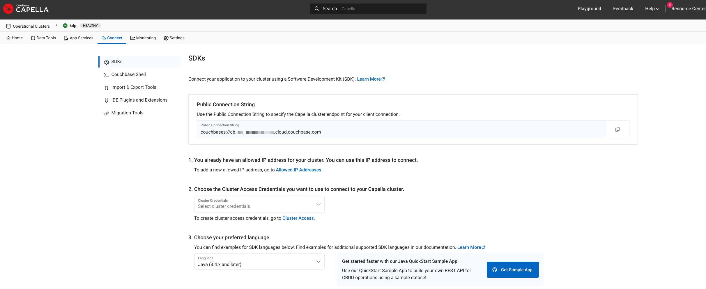
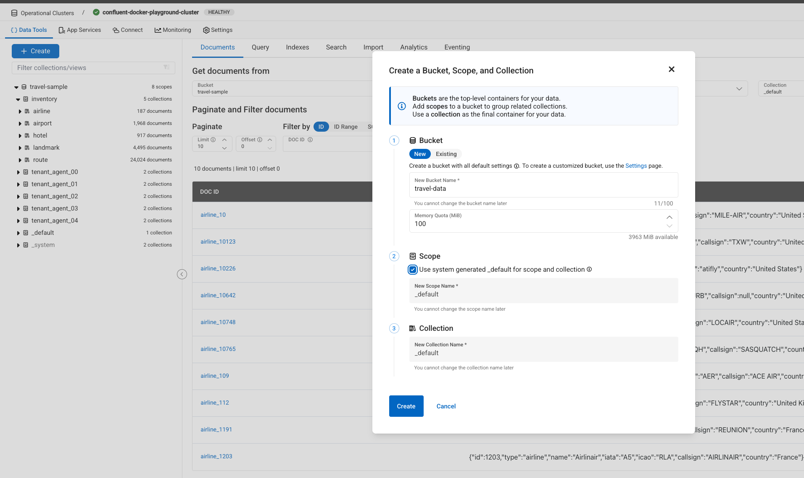
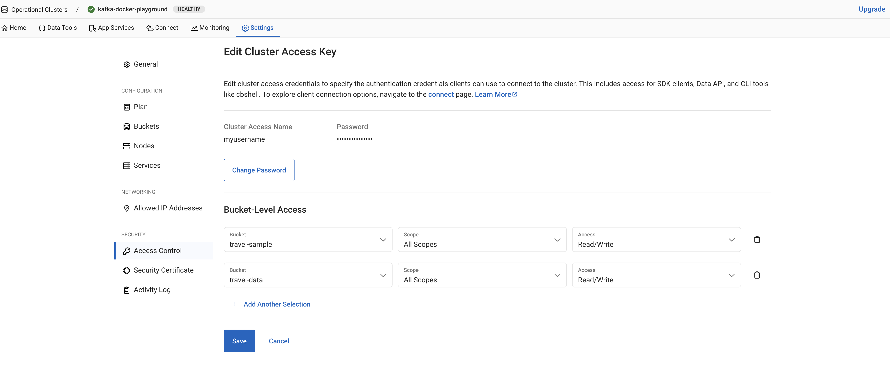

# Fully Managed Couchbase Sink connector

## Objective

Quickly test the [Fully Managed Couchbase Sink](https://docs.confluent.io/cloud/current/connectors/cc-couchbase-db-sink/cc-couchbase-db-sink.html) connector.

## Prerequisites

See [Confluent Cloud examples](https://kafka-docker-playground.io/#/how-to-use?id=%f0%9f%8c%a4%ef%b8%8f-confluent-cloud-examples).

| Variable | Description |
| --- | --- |
| `COUCHBASE_USERNAME` | Capella cluster access username |
| `COUCHBASE_PASSWORD` | Capella cluster access password |
| `COUCHBASE_HOSTNAME` | Capella public connection string without the `couchbases://` prefix |
| `COUCHBASE_CAPELLA_API_KEY`, `COUCHBASE_CAPELLA_ORG_ID`, `COUCHBASE_CAPELLA_PROJECT_ID`, `COUCHBASE_CAPELLA_CLUSTER_ID` | Optional. If all set, the script checks through the Capella API that the cluster is turned on (`COUCHBASE_CAPELLA_FREE_TIER`, default `true`, selects the free tier API path) |

### Couchbase Capella setup

[Create a free Couchbase Capella account](https://cloud.couchbase.com/sign-up) and a cluster.

Go to Settings->Allowed IP Addresses and add your Confluent Cloud cluster egress IP addresses:


Go to the `Connect` menu and copy the *Public Connection String*; remove `couchbases://` to get `COUCHBASE_HOSTNAME`:



Go to the `Data Tools` menu and create a bucket called *travel-data*:



Go to Security->Cluster Access and create a cluster access allowing access to bucket `travel-data`; this gives `COUCHBASE_USERNAME` and `COUCHBASE_PASSWORD`:



N.B: After a period of inactivity (72 hours), your [free tier cluster will automatically turn off](https://docs.couchbase.com/cloud/get-started/create-account.html#:~:text=Only%201%20free%20tier%20operational%20cluster%20is%20available%20per%20organization%20and%20it%20automatically%20turns%20off%20after%2072%20hours%20of%20inactivity).

## How to run

```bash
export COUCHBASE_USERNAME=<username>
export COUCHBASE_PASSWORD=<password>
export COUCHBASE_HOSTNAME=<hostname>
playground run -f fully-managed-couchbase-sink.sh
```

| Script | Description |
| --- | --- |
| `fully-managed-couchbase-sink.sh` | JSON records written to Capella bucket `travel-data` |

## What the script does

1. Optionally checks that the Capella cluster is turned on.
2. Creates topic `test-travel-sample` and produces 5 JSON records with `playground topic produce`.
3. Creates the fully managed `CouchbaseSink` connector (bucket `travel-data`).
4. Waits for the connector lag to reach 0 with `playground connector show-lag`.
5. Deletes the connector at the end of the run.
