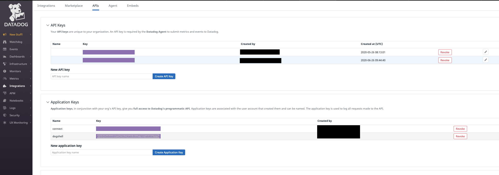

# Fully Managed Datadog Metrics Sink connector

## Objective

Quickly test the [Fully Managed Datadog Metrics Sink](https://docs.confluent.io/cloud/current/connectors/cc-datadog-metrics-sink.html) connector.

## Prerequisites

See [Confluent Cloud examples](https://kafka-docker-playground.io/#/how-to-use?id=%f0%9f%8c%a4%ef%b8%8f-confluent-cloud-examples).

### Datadog setup

Register for a [Datadog trial](https://app.datadoghq.com) if you don't already have an account (you can convert it to *Free plan* after the trial expires).

Create an API key (`DD_API_KEY`) and an Application key (`DD_APP_KEY`):



**Important**: the `COM` Datadog domain must be used.

| Variable | Description |
| --- | --- |
| `DD_API_KEY` | Datadog API key (used by the connector) |
| `DD_APP_KEY` | Datadog Application key (used to query the metric with dogshell) |

## How to run

```bash
export DD_API_KEY=<api key>
export DD_APP_KEY=<application key>
playground run -f fully-managed-datadog-metrics-sink.sh
```

| Script | Description |
| --- | --- |
| `fully-managed-datadog-metrics-sink.sh` | One Avro metric record sent to Datadog (`COM` domain) |

## What the script does

1. Builds the local `dogshell` image (`docker-dogshell/`), if needed.
2. Creates topic `datadog-metrics-topic` and the fully managed `DatadogMetricsSink` connector.
3. Produces one Avro metric record `perf.metric` with `playground topic produce`.
4. Verifies the `success-<connector id>` and `error-<connector id>` topics with `playground topic consume`, and the connector lag.
5. Outside CI only: checks with `dogshell search query perf.metric` that the metric exists in Datadog.
6. The connector is not deleted by the script.
