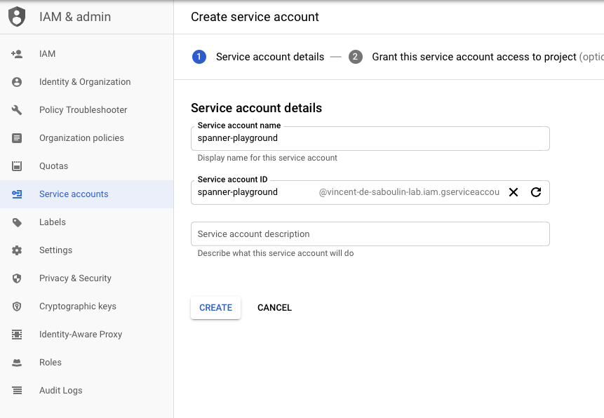

# Fully Managed Debezium CDC GCP Spanner source connector

## Objective

Quickly test the [Fully Managed Debezium CDC GCP Spanner Source](https://docs.confluent.io/cloud/current/connectors/cc-google-spanner-cdc-source-debezium.html) connector.

## Prerequisites

See [Confluent Cloud examples](https://kafka-docker-playground.io/#/how-to-use?id=%f0%9f%8c%a4%ef%b8%8f-confluent-cloud-examples).

An active Google Cloud Platform (GCP) account with authorization to create resources is required.

| Variable | Description |
| --- | --- |
| `GCP_PROJECT` | GCP project id |
| `GCP_KEYFILE_CONTENT` | Service account key content, if `keyfile.json` is not present (see below) |

The Spanner instance and the Confluent Cloud cluster are created in GCP region `europe-west2` (first positional argument of the script).

### Setup credentials

Create a `Service Account` from the IAM & Admin console and set `Service account name`:



Choose permission `Cloud Spanner`->`Cloud Spanner Admin`:


Create a key:


Download it as JSON:


Rename it to `keyfile.json` and place it in `../fm-gcp-spanner-sink/keyfile.json` (the script reads the key file from the `ccloud/fm-gcp-spanner-sink` folder), or set `GCP_KEYFILE_CONTENT`:

```bash
export GCP_KEYFILE_CONTENT=$(cat keyfile.json | jq -aRs . | sed 's/^"//' | sed 's/"$//')
```

## How to run

```bash
export GCP_PROJECT=<gcp project>
playground run -f fully-managed-debezium-cdc-gcp-spanner-source.sh
```

| Script | Description |
| --- | --- |
| `fully-managed-debezium-cdc-gcp-spanner-source.sh` | Change stream `AllChangesStream` on table `Items`, Avro output |

## What the script does

1. Authenticates `gcloud` with the service account key (in a `google/cloud-sdk` container).
2. Creates a Spanner instance (1 node) and database, the change stream `AllChangesStream` (`FOR ALL`) and table `Items`.
3. Creates the fully managed `SpannerCdcSource` connector (Avro output).
4. Runs INSERT, UPDATE and DELETE statements on `Items`.
5. Verifies at least 3 records in topic `<connector id>.Items` with `playground topic consume`.
6. Deletes the connector, the Spanner database and the instance at the end of the run.
