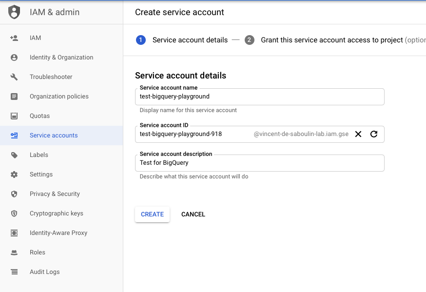
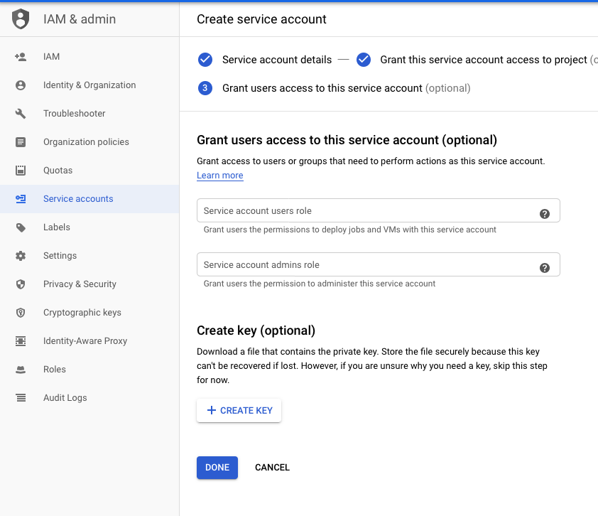

# Fully Managed Google BigQuery Source (JDBC) connector

## Objective

Quickly test the [Fully Managed Google BigQuery Source (JDBC)](https://docs.confluent.io/cloud/current/connectors/cc-gcp-bigquery-source.html) connector.

## Prerequisites

See [Confluent Cloud examples](https://kafka-docker-playground.io/#/how-to-use?id=%f0%9f%8c%a4%ef%b8%8f-confluent-cloud-examples).

An active Google Cloud Platform (GCP) account with authorization to create resources is required.

| Variable | Description |
| --- | --- |
| `GCP_PROJECT` | GCP project id |
| `GCP_KEYFILE_CONTENT` | Service account key content, if `./keyfile.json` is not present (see below) |

### GCP BigQuery setup

Follow [Quickstart using the web UI in the GCP Console](https://cloud.google.com/bigquery/docs/quickstarts/quickstart-web-ui) to get familiar with GCP BigQuery.

Create a `Service Account` from the IAM & Admin console and set `Service account name`:



Choose permission `BigQuery`->`BigQuery Admin` (the connector itself only needs `roles/bigquery.jobUser` and `roles/bigquery.dataViewer`; `BigQuery Admin` is used by the script to create the dataset and table):


Create a key:



Download it as JSON:


Rename it to `keyfile.json` and place it in `./keyfile.json`, or set `GCP_KEYFILE_CONTENT`:

```bash
export GCP_KEYFILE_CONTENT=$(cat keyfile.json | jq -aRs . | sed 's/^"//' | sed 's/"$//')
```

## How to run

```bash
export GCP_PROJECT=<gcp project>
playground run -f fully-managed-gcp-bigquery-source.sh
```

| Script | Description |
| --- | --- |
| `fully-managed-gcp-bigquery-source.sh` | `timestamp+incrementing` mode on table `customers`, Avro output to topic `bigquery_customers` |

## What the script does

1. Authenticates `gcloud` with the service account key (in a `google/cloud-sdk` container).
2. Creates a BigQuery dataset in location `US` and table `customers`, and inserts 2 rows.
3. Creates the fully managed `BigQuerySource` connector (`mode` `timestamp+incrementing` on `updated_at`/`id`, `topic.prefix` `bigquery_`).
4. Inserts 1 more row.
5. Verifies 3 records in topic `bigquery_customers` with `playground topic consume`.
6. Deletes the connector and the dataset at the end of the run.

## Known limitation

The BigQuery dataset is created in location `US`: with `timestamp`/`incrementing` modes, the connector validates the offset columns with a metadata query (`getPrimaryKeys`) that ignores `bigquery.query.location` and always runs in `US`, so a dataset in another location fails with:

```text
Not found: Dataset <project>:<dataset> was not found in location US
```
