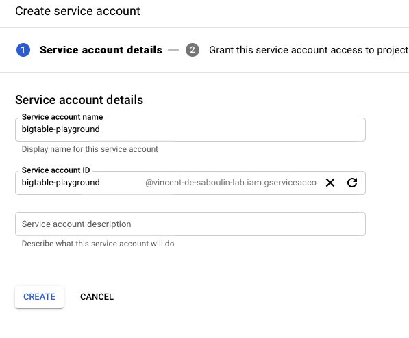
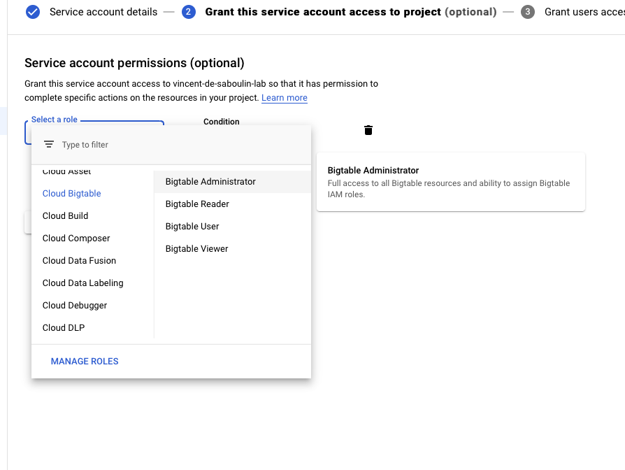
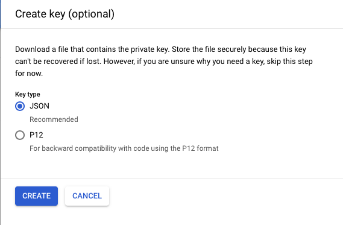

# Fully Managed GCP BigTable Sink connector

## Objective

Quickly test the [Fully Managed Google Cloud BigTable Sink](https://docs.confluent.io/cloud/current/connectors/cc-gcp-bigtable-sink.html) connector.

## Prerequisites

See [Confluent Cloud examples](https://kafka-docker-playground.io/#/how-to-use?id=%f0%9f%8c%a4%ef%b8%8f-confluent-cloud-examples).

An active Google Cloud Platform (GCP) account with authorization to create resources is required.

| Variable | Description |
| --- | --- |
| `GCP_PROJECT` | GCP project id |
| `GCP_KEYFILE_CONTENT` | Service account key content, if `./keyfile.json` is not present (see below) |

The BigTable instance is created in zone `europe-west2-a` (override with `GCP_BIGTABLE_REGION`).

### Enabling Cloud BigTable Admin API

Go to this [link](https://console.developers.google.com/apis/library/bigtableadmin.googleapis.com) and click `Enable`:


### Setup credentials

Create a `Service Account` from the IAM & Admin console and set `Service account name`:



Choose permission `Cloud BigTable`->`BigTable Administrator`:



Create a key:


Download it as JSON:



Rename it to `keyfile.json` and place it in `./keyfile.json`, or set `GCP_KEYFILE_CONTENT`:

```bash
export GCP_KEYFILE_CONTENT=$(cat keyfile.json | jq -aRs . | sed 's/^"//' | sed 's/"$//')
```

## How to run

```bash
export GCP_PROJECT=<gcp project>
playground run -f fully-managed-gcp-bigtable-sink.sh
```

| Script | Description |
| --- | --- |
| `fully-managed-gcp-bigtable-sink.sh` | Avro records with string keys written to auto-created table `kafka_big_query_cloud_stats` |

## What the script does

1. Creates topic `big_query_cloud_stats`, authenticates `gcloud` with the service account key and creates a BigTable instance.
2. Produces 3 Avro records (column family `users`) with string keys using `playground topic produce`.
3. Creates the fully managed `BigTableSink` connector (`auto.create.tables`, `auto.create.column.families`, `table.name.format` `kafka_${topic}`).
4. Waits for the connector lag to reach 0 with `playground connector show-lag`.
5. Outside CI only: reads table `kafka_big_query_cloud_stats` with `cbt` and checks that `Bob` is present.
6. Deletes the connector, the table and the BigTable instance at the end of the run.
