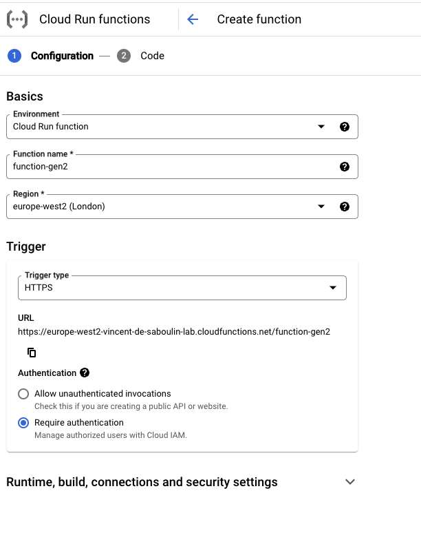
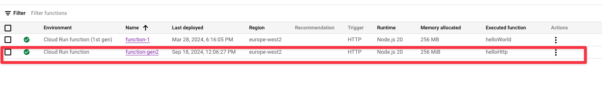

# Fully Managed Google Cloud Functions Gen 2 Sink connector

## Objective

Quickly test the [Fully Managed Google Cloud Functions Gen 2 Sink](https://docs.confluent.io/cloud/current/connectors/cc-google-cloud-functions-gen2-sink.html) connector.

## Prerequisites

See [Confluent Cloud examples](https://kafka-docker-playground.io/#/how-to-use?id=%f0%9f%8c%a4%ef%b8%8f-confluent-cloud-examples).

You need an active Google Cloud Platform (GCP) account with authorization to create resources.

| Variable | Description |
| --- | --- |
| `GCP_PROJECT` | GCP project id (required) |
| `GCP_KEYFILE_CONTENT` | Service account key content, only needed if `keyfile.json` is not present in this folder |

GCP credentials: place the service account key as `keyfile.json` in this folder, or export `GCP_KEYFILE_CONTENT`, generated with:

```bash
GCP_KEYFILE_CONTENT=$(cat keyfile.json | jq -aRs . | sed 's/^"//' | sed 's/"$//')
```

The service account must have the `Cloud Run Invoker` role.

### Google Cloud Functions setup

* Navigate to the [Google Cloud Console](https://console.cloud.google.com/).
* Go to the [Cloud Functions](https://console.cloud.google.com/functions) tab.



* Create a new function. Use the default code that is provided.



Note down the region (e.g. `us-central1`) and the function name (e.g. `function-1`): they are passed to the script.

## How to run

```bash
playground run -f fully-managed-google-cloud-functions-gen2-sink.sh
```

The function region defaults to `europe-west2` (also used as Confluent Cloud region) and the function name to `function-11`, override them with `GCP_FUNCTION_REGION` and `GCP_FUNCTION_FUNCTION`, e.g.:

```bash
export GCP_FUNCTION_REGION=us-central1
export GCP_FUNCTION_FUNCTION=function-1
playground run -f fully-managed-google-cloud-functions-gen2-sink.sh
```

| Script | Description |
| --- | --- |
| `fully-managed-google-cloud-functions-gen2-sink.sh` | Sends Avro records to a Google Cloud Function (Gen 2) |

## What the script does

1. Authenticates `gcloud` with the service account key.
2. Bootstraps the Confluent Cloud environment on GCP in the function region.
3. Recreates topic `functions-gen2-messages` and produces 10 Avro records.
4. Creates the `GoogleCloudFunctionsGen2Sink` fully managed connector pointing to the function.
5. Verifies that 10 records land in the `success-<connector id>` topic (`playground topic consume`).
6. Asks before deleting the connector.
