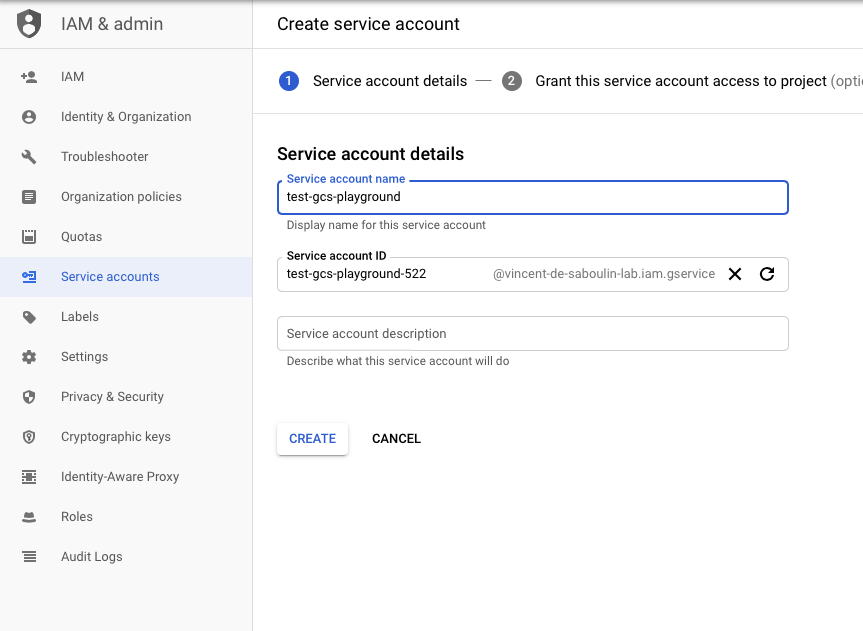
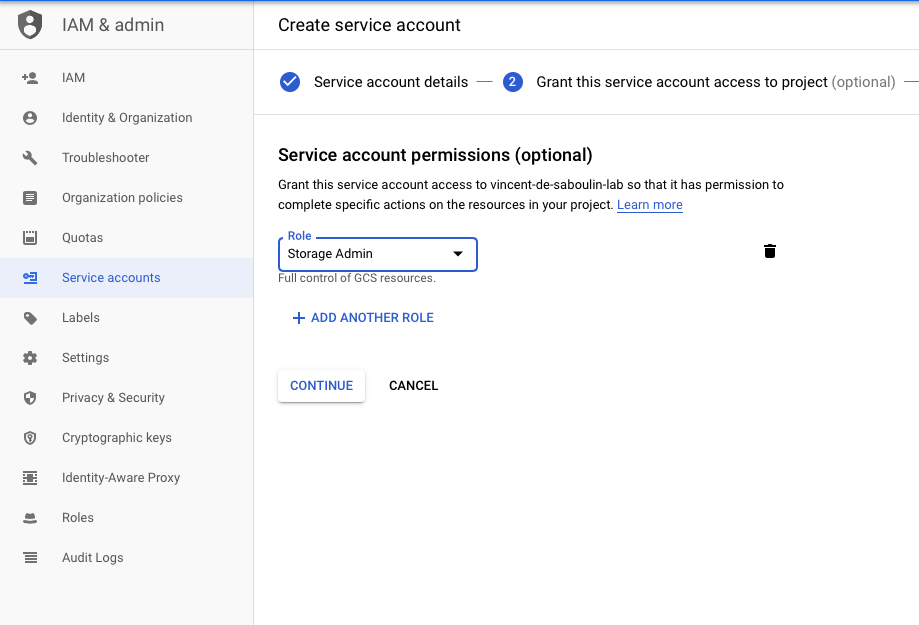

# Fully Managed GCS Sink connector

## Objective

Quickly test the [Fully Managed GCS Sink](https://docs.confluent.io/cloud/current/connectors/cc-gcs-sink.html) connector.

## Prerequisites

See [Confluent Cloud examples](https://kafka-docker-playground.io/#/how-to-use?id=%f0%9f%8c%a4%ef%b8%8f-confluent-cloud-examples).

You need an active Google Cloud Platform (GCP) account with authorization to create resources.

| Variable | Description |
| --- | --- |
| `GCP_PROJECT` | GCP project id (required) |
| `GCP_KEYFILE_CONTENT` | Service account key content, only needed if `keyfile.json` is not present in this folder |

GCP credentials: rename the service account key to `keyfile.json` and place it in this folder, or export `GCP_KEYFILE_CONTENT`, generated with:

```bash
GCP_KEYFILE_CONTENT=$(cat keyfile.json | jq -aRs . | sed 's/^"//' | sed 's/"$//')
```

### Service account setup

[Instructions](https://docs.confluent.io/kafka-connect-gcs-sink/current/overview.html)

* Create a `Service Account` from the IAM & Admin console and set the `Service account name`:



* Choose permission `Storage Admin` (probably not all of them are required):



* Create a key:


* Download it as JSON:


## How to run

```bash
playground run -f fully-managed-gcs-sink.sh
```

The bucket region defaults to `europe-west2` (also used as Confluent Cloud region), override it with `GCS_BUCKET_REGION`.

| Script | Description |
| --- | --- |
| `fully-managed-gcs-sink.sh` | Sinks Avro records to a GCS bucket in Avro format (hourly partitioning) |

## What the script does

1. Bootstraps the Confluent Cloud environment on GCP and recreates topic `gcs-topic`.
2. Creates the bucket `kafkadockerplaygroundbucket<user>...` if needed, labels it and removes existing objects under `topics/gcs-topic`.
3. Produces 1000 Avro records to `gcs-topic`.
4. Creates the `GcsSink` fully managed connector (`flush.size` 1000, `time.interval` HOURLY).
5. Lists the objects in the bucket, downloads the first Avro file and displays it with `playground tools read-avro-file`.
6. Asks before deleting the connector.
