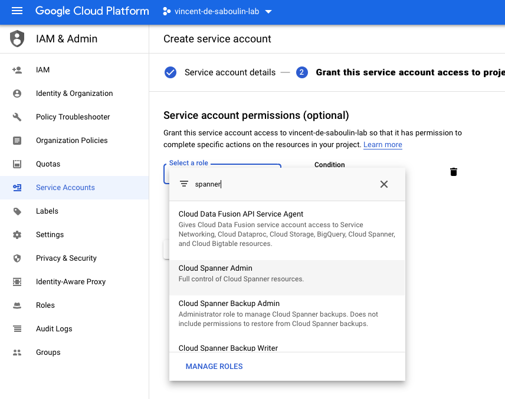

# Fully Managed GCP Spanner Sink connector

## Objective

Quickly test the [Fully Managed GCP Spanner Sink](https://docs.confluent.io/cloud/current/connectors/cc-gcp-spanner-sink.html) connector.

## Prerequisites

See [Confluent Cloud examples](https://kafka-docker-playground.io/#/how-to-use?id=%f0%9f%8c%a4%ef%b8%8f-confluent-cloud-examples).

You need an active Google Cloud Platform (GCP) account with authorization to create resources.

| Variable | Description |
| --- | --- |
| `GCP_PROJECT` | GCP project id (required) |
| `GCP_KEYFILE_CONTENT` | Service account key content, only needed if `keyfile.json` is not present in this folder |

GCP credentials: rename the service account key to `keyfile.json` and place it in this folder, or export `GCP_KEYFILE_CONTENT`, generated with:

```bash
GCP_KEYFILE_CONTENT=$(cat keyfile.json | jq -aRs . | sed 's/^"//' | sed 's/"$//')
```

### GCP Spanner setup

* Create a `Service Account` from the IAM & Admin console and set the `Service account name`:


* Choose permission `Cloud Spanner` -> `Cloud Spanner Admin`:



* Create a key:


* Download it as JSON:


## How to run

```bash
playground run -f fully-managed-gcp-spanner-sink.sh
```

The GCP region defaults to `europe-west2` (also used as Confluent Cloud region), override it with `GCP_SPANNER_REGION`.

| Script | Description |
| --- | --- |
| `fully-managed-gcp-spanner-sink.sh` | Sinks Avro records to a Spanner table (auto-created) |

## What the script does

1. Bootstraps the Confluent Cloud environment on GCP and recreates topic `products`.
2. Creates a Spanner instance (1 node, `regional-<region>`) and a database.
3. Produces 3 Avro records to `products`.
4. Creates the `SpannerSink` fully managed connector (`auto.create`, table `kafka_products`).
5. Runs `select * from kafka_products` with `gcloud spanner databases execute-sql` and checks that the `notebooks` record is present.
6. Asks before deleting the connector; on exit, deletes the Spanner database and instance.
