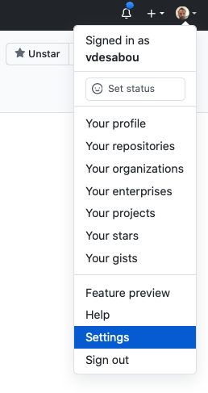

# Fully Managed Github Source connector

## Objective

Quickly test the [Fully Managed Github Source](https://docs.confluent.io/cloud/current/connectors/cc-github-source.html) connector.

## Prerequisites

See [Confluent Cloud examples](https://kafka-docker-playground.io/#/how-to-use?id=%f0%9f%8c%a4%ef%b8%8f-confluent-cloud-examples).

| Variable | Description |
| --- | --- |
| `CONNECTOR_GITHUB_ACCESS_TOKEN` | GitHub personal access token (required, can also be passed as first argument) |
| `CONNECTOR_GITHUB_REPOSITORIES` | Optional: comma-separated repositories to monitor (default `vdesabou/kafka-docker-playground`) |

```bash
export CONNECTOR_GITHUB_ACCESS_TOKEN=<your_personal_access_token>
export CONNECTOR_GITHUB_REPOSITORIES=confluentinc/examples,confluentinc/kafka-connect-github
```

### Create a personal access token

Go to your GitHub account and select `Settings`:



Click on `Developer Settings`:


Click on `Personal access tokens`:


Generate a new token with `repo` and `user` selected:


## How to run

```bash
playground run -f fully-managed-github-source.sh
```

| Script | Description |
| --- | --- |
| `fully-managed-github-source.sh` | Reads the `stargazers` resource of the configured repositories |

## What the script does

1. Bootstraps the Confluent Cloud environment and recreates topic `github-topic-stargazers`.
2. Creates the `GithubSource` fully managed connector (resource `stargazers`, since `2019-01-01`, Avro output).
3. Verifies that at least one record is in `github-topic-stargazers` (`playground topic consume`).
