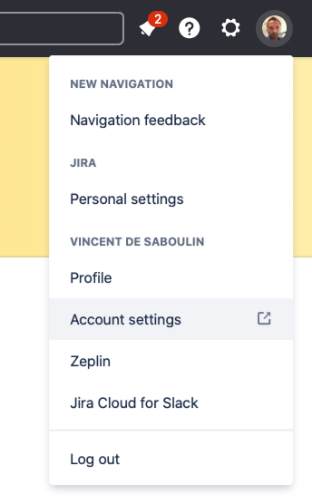
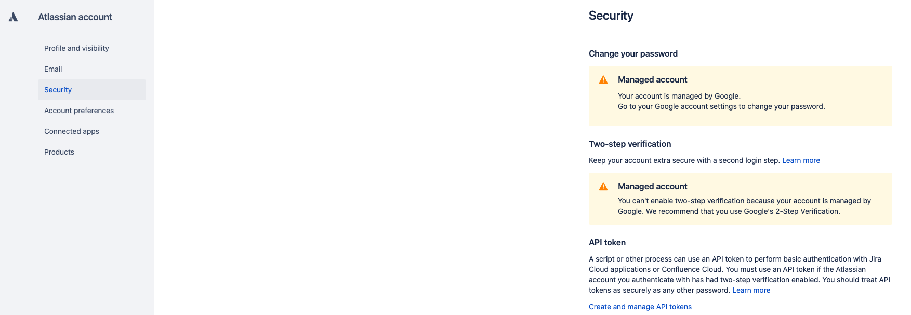
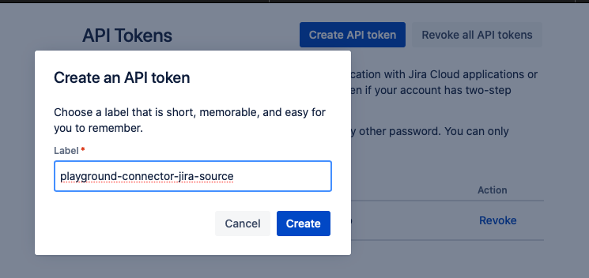

# Fully Managed Jira Source connector

## Objective

Quickly test the [Fully Managed Jira Source](https://docs.confluent.io/cloud/current/connectors/cc-jira-source.html) connector.

## Prerequisites

See [Confluent Cloud examples](https://kafka-docker-playground.io/#/how-to-use?id=%f0%9f%8c%a4%ef%b8%8f-confluent-cloud-examples).

| Variable | Description |
| --- | --- |
| `JIRA_URL` | Jira instance URL (e.g. `https://<your-site>.atlassian.net`) |
| `JIRA_USERNAME` | Jira user (email) |
| `JIRA_API_TOKEN` | Jira API token |

They can also be passed as positional arguments, in this order.

### Create an API token

If you want to create a developer account, create one [here](https://www.atlassian.com/try/cloud/signup?product=confluence.ondemand,jira-software.ondemand,jira-servicedesk.ondemand,jira-core.ondemand&developer=true).

Go to your Jira instance and select `Account Settings`:



Click on `Security` -> `Create and manage API tokens`:



Create the API token:



## How to run

```bash
export JIRA_URL="https://<your-site>.atlassian.net"
export JIRA_USERNAME="<email>"
export JIRA_API_TOKEN="<api-token>"
playground run -f fully-managed-jira-source.sh
```

| Script | Description |
| --- | --- |
| `fully-managed-jira-source.sh` | Reads Jira `issues` since 2021-01-01 (JSON output) |

## What the script does

1. Bootstraps the Confluent Cloud environment.
2. Creates the `JiraSource` fully managed connector (resource `issues`, `topic.name.pattern` `jira-topic-${resourceName}`).
3. Verifies that at least one record is in `jira-topic-issues` (`playground topic consume`).
