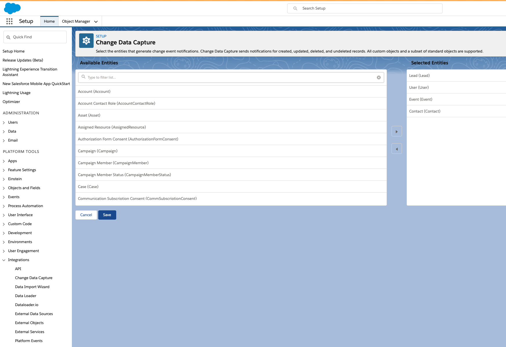

# Fully Managed Salesforce CDC Source connector

## Objective

Quickly test the [Salesforce CDC Source](https://docs.confluent.io/cloud/current/connectors/cc-salesforce-source-cdc.html) fully managed connector.

The connector authenticates with the OAuth JWT Bearer flow (`salesforce.grant.type=JWT_BEARER`).

## Prerequisites

See [Confluent Cloud examples](https://kafka-docker-playground.io/#/how-to-use?id=%f0%9f%8c%a4%ef%b8%8f-confluent-cloud-examples).

* A Salesforce account with an External Client App using the JWT Bearer flow (see [Salesforce setup](#salesforce-setup))
* Change Data Capture enabled for `Contact` (see [Enable Change Data Capture](#enable-change-data-capture))
* `salesforce-confluent.keystore.jks` (password `confluent`, it contains the private key matching the certificate of the External Client App) in this folder. If it is missing, the script tries to download it from the playground S3 bucket (Confluent employees only).

| Variable | Description |
| --- | --- |
| `SALESFORCE_USERNAME` | Salesforce username |
| `SALESFORCE_PASSWORD` | Salesforce password |
| `SALESFORCE_SECURITY_TOKEN` | Salesforce security token |
| `SALESFORCE_CONSUMER_KEY_WITH_JWT` | Consumer key of the External Client App with JWT Bearer flow enabled |
| `SALESFORCE_INSTANCE` | Optional, defaults to `https://login.salesforce.com` |

## How to run

```bash
playground run -f fully-managed-salesforce-cdc-source.sh
```

| Script | Description |
| --- | --- |
| `fully-managed-salesforce-cdc-source.sh` | Channel `ContactChangeEvent`, JSON output, JWT Bearer authentication |

## What the script does

1. Bootstraps the Confluent Cloud environment, recreates topic `sfdc-cdc-contacts` and starts an `sfdx-cli` container.
2. Creates the fully managed `SalesforceCdcSource` connector on `ContactChangeEvent`.
3. Logs in with the sfdx CLI (JWT) and creates a random Contact.
4. Verifies the change event with `playground topic consume --topic sfdc-cdc-contacts`.
5. Deletes the Contact created by the test on exit, and asks whether to delete the connector.

## Salesforce setup

1. Register a test account on the [Salesforce developer portal](https://developer.salesforce.com/signup/).
2. Create an External Client App with the OAuth JWT Bearer flow, following [OAuth with JWT Bearer Flow](https://github.com/vdesabou/kafka-docker-playground/tree/master/connect/connect-salesforce-cdc-source#oauth-with-jwt-bearer-flow). Its consumer key is `SALESFORCE_CONSUMER_KEY_WITH_JWT`.
3. Get your security token from *Settings* -> *My Personal Information* -> *Reset My Security Token*:


## Enable Change Data Capture

Search for *Change Data Capture* in *Setup* and select `Contact`:


