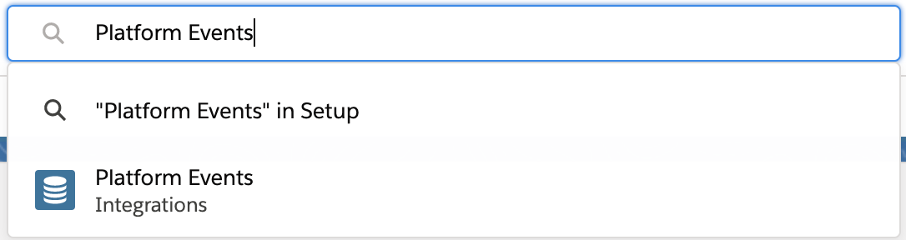
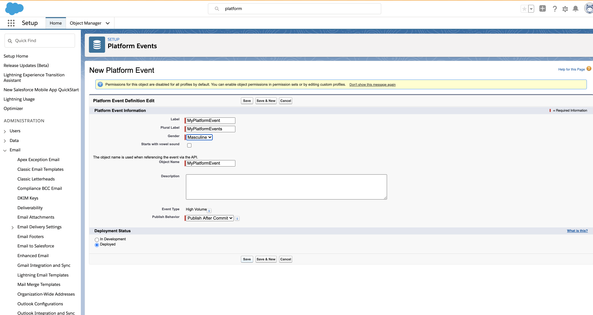
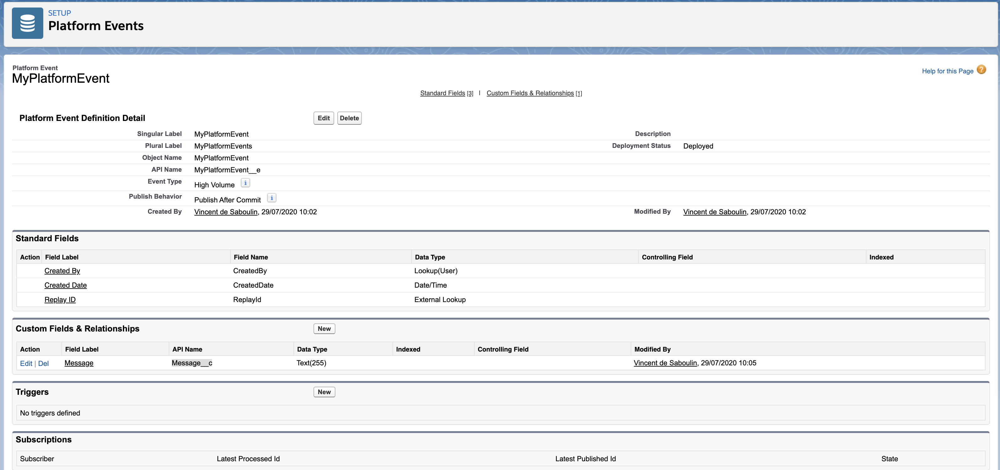
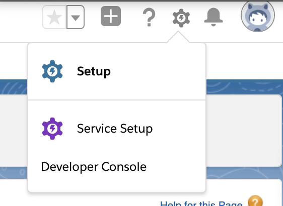
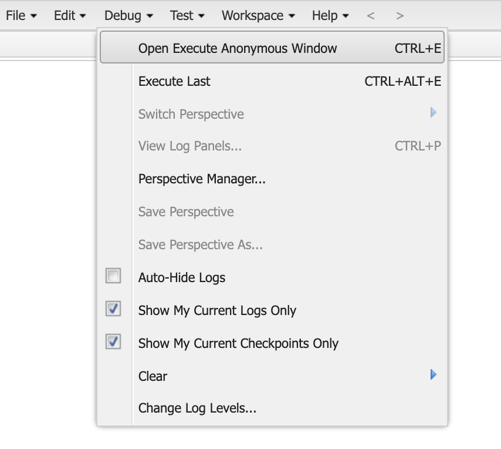

# Fully Managed Salesforce Platform Events Sink connector

## Objective

Quickly test the [Salesforce Platform Event Sink](https://docs.confluent.io/cloud/current/connectors/cc-salesforce-platform-event-sink.html) fully managed connector.

Platform events are first captured with the Salesforce Platform Event Source connector, then published back to Salesforce with the Platform Event Sink connector. Both connectors use the OAuth JWT Bearer flow.

## Prerequisites

> [!TIP]
> `playground salesforce setup` configures the Salesforce org (External Client App with the JWT Bearer flow, Platform Event, Change Data Capture) and stores `SALESFORCE_USERNAME`, `SALESFORCE_INSTANCE` and `SALESFORCE_CONSUMER_KEY_WITH_JWT`, see [Automated setup](https://github.com/vdesabou/kafka-docker-playground/tree/master/connect/connect-salesforce-cdc-source#automated-setup). `playground salesforce check` verifies them.

See [Confluent Cloud examples](https://kafka-docker-playground.io/#/how-to-use?id=%f0%9f%8c%a4%ef%b8%8f-confluent-cloud-examples).

* A Salesforce account with an External Client App using the JWT Bearer flow (see [Salesforce setup](#salesforce-setup))
* A platform event `MyPlatformEvent__e` with a text field `Message__c` (see [Create a Platform Event in Salesforce](#create-a-platform-event-in-salesforce))
* `salesforce-confluent.keystore.jks` (password `confluent`, it contains the private key matching the certificate of the External Client App) in this folder. If it is missing, the script tries to download it from the playground S3 bucket (Confluent employees only).

| Variable | Description |
| --- | --- |
| `SALESFORCE_USERNAME` | Salesforce username |
| `SALESFORCE_PASSWORD` | Salesforce password |
| `SALESFORCE_SECURITY_TOKEN` | Salesforce security token |
| `SALESFORCE_CONSUMER_KEY_WITH_JWT` | Consumer key of the External Client App with JWT Bearer flow enabled |
| `SALESFORCE_INSTANCE` | Optional, defaults to `https://login.salesforce.com` |

## How to run

```bash
playground run -f fully-managed-salesforce-platform-events-sink.sh
```

| Script | Description |
| --- | --- |
| `fully-managed-salesforce-platform-events-sink.sh` | Platform Event Source then Platform Event Sink on `MyPlatformEvent__e` (Avro) |

## What the script does

1. Bootstraps the Confluent Cloud environment, deletes topic `sfdc-platform-events` and starts an `sfdx-cli` container.
2. Creates the fully managed `SalesforcePlatformEventSource` connector on `MyPlatformEvent__e`, writing to `sfdc-platform-events`.
3. Publishes 2 platform events with the sfdx CLI (`event.apex`) and verifies them with `playground topic consume`.
4. Pauses the source connector, so it does not pick up the events published by the sink (infinite loop).
5. Creates the fully managed `SalesforcePlatformEventSink` connector reading `sfdc-platform-events`.
6. Verifies 2 records in the `success-<connector id>` topic.
7. Asks whether to delete the connectors.

## Salesforce setup

1. Register a test account on the [Salesforce developer portal](https://developer.salesforce.com/signup/).
2. Create an External Client App with the OAuth JWT Bearer flow, following [OAuth with JWT Bearer Flow](https://github.com/vdesabou/kafka-docker-playground/tree/master/connect/connect-salesforce-cdc-source#oauth-with-jwt-bearer-flow). Its consumer key is `SALESFORCE_CONSUMER_KEY_WITH_JWT`.
3. Get your security token from *Settings* -> *My Personal Information* -> *Reset My Security Token*:


## Create a Platform Event in Salesforce

In *Setup*, search for *Platform Events*:



Create a new Platform Event called `MyPlatformEvent`:



Add a text field `Message`:



The script publishes the events itself with `event.apex` (two `MyPlatformEvent__e` events with `Message__c` set), using the sfdx CLI. To publish them by hand, open the *Developer Console*, then *Debug* -> *Open Execute Anonymous Window* and execute the content of [`event.apex`](event.apex):




