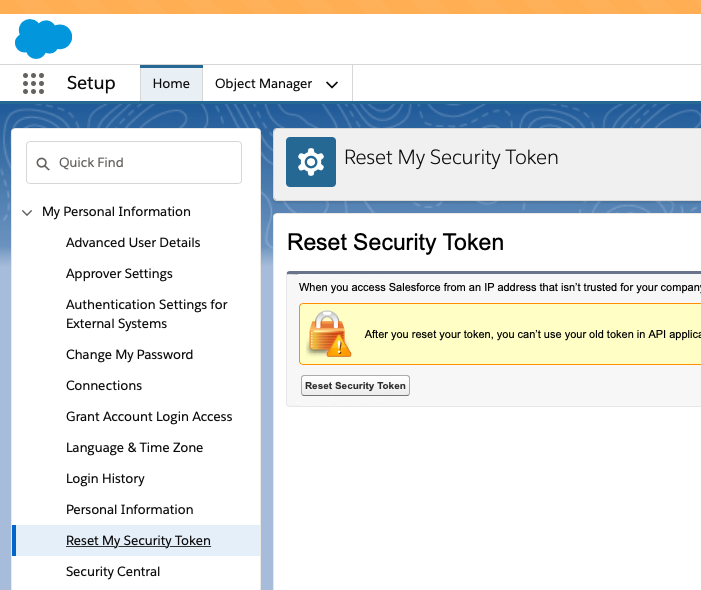

# Fully Managed Salesforce SObject Sink connector

## Objective

Quickly test the [Salesforce SObject Sink](https://docs.confluent.io/cloud/current/connectors/cc-salesforce-SObjects-sink.html) fully managed connector.

Leads are captured from a first Salesforce account with the Salesforce PushTopic Source connector, then inserted into a second Salesforce account with the SObject Sink connector. Both connectors use the OAuth JWT Bearer flow.

## Prerequisites

See [Confluent Cloud examples](https://kafka-docker-playground.io/#/how-to-use?id=%f0%9f%8c%a4%ef%b8%8f-confluent-cloud-examples).

* Two Salesforce accounts, each with an External Client App using the JWT Bearer flow (see [Salesforce setup](#salesforce-setup))
* `salesforce-confluent.keystore.jks` (password `confluent`, it contains the private key matching the certificate of the External Client App) in this folder. If it is missing, the script tries to download it from the playground S3 bucket (Confluent employees only).

| Variable | Description |
| --- | --- |
| `SALESFORCE_USERNAME` | Username of account #1 (source) |
| `SALESFORCE_PASSWORD` | Password of account #1 |
| `SALESFORCE_SECURITY_TOKEN` | Security token of account #1 |
| `SALESFORCE_CONSUMER_KEY_WITH_JWT` | Consumer key of the JWT External Client App of account #1 |
| `SALESFORCE_INSTANCE` | Optional, defaults to `https://login.salesforce.com` |
| `SALESFORCE_USERNAME_ACCOUNT2` | Username of account #2 (sink) |
| `SALESFORCE_PASSWORD_ACCOUNT2` | Password of account #2 |
| `SALESFORCE_SECURITY_TOKEN_ACCOUNT2` | Security token of account #2 |
| `SALESFORCE_CONSUMER_KEY_WITH_JWT_ACCOUNT2` | Consumer key of the JWT External Client App of account #2 |
| `SALESFORCE_INSTANCE_ACCOUNT2` | Optional, defaults to `https://login.salesforce.com` |

## How to run

```bash
playground run -f fully-managed-salesforce-sobject-sink.sh
```

| Script | Description |
| --- | --- |
| `fully-managed-salesforce-sobject-sink.sh` | PushTopic Source on account #1, SObject Sink (`insert` operation) to account #2 (Avro) |

## What the script does

1. Bootstraps the Confluent Cloud environment, recreates topic `sfdc-pushtopic-leads-sobject-sink` and starts an `sfdx-cli` container.
2. Logs in to account #1 with the sfdx CLI and (re)creates a Lead PushTopic with a name unique to the run.
3. Creates the fully managed `SalesforcePushTopicSource` connector writing Leads to `sfdc-pushtopic-leads-sobject-sink`.
4. Creates a random Lead in account #1 and verifies it with `playground topic consume`.
5. Creates the fully managed `SalesforceSObjectSink` connector inserting the records into the `Lead` object of account #2.
6. Verifies the `success-<connector id>` topic and queries account #2 with the sfdx CLI to find the Lead.
7. Deletes the created Leads and PushTopic on exit, and asks whether to delete the connectors.

## Salesforce setup

1. Register a test account on the [Salesforce developer portal](https://developer.salesforce.com/signup/).
2. Create an External Client App with the OAuth JWT Bearer flow, following [OAuth with JWT Bearer Flow](https://github.com/vdesabou/kafka-docker-playground/tree/master/connect/connect-salesforce-cdc-source#oauth-with-jwt-bearer-flow). Its consumer key is `SALESFORCE_CONSUMER_KEY_WITH_JWT`.
3. Get your security token from *Settings* -> *My Personal Information* -> *Reset My Security Token*:


