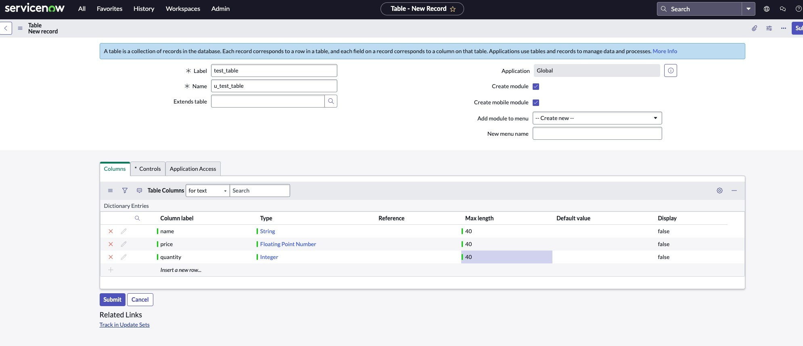

# Fully Managed ServiceNow Sink connector

## Objective

Quickly test the [ServiceNow Sink](https://docs.confluent.io/cloud/current/connectors/cc-servicenow-sink.html) fully managed connector.

## Prerequisites

See [Confluent Cloud examples](https://kafka-docker-playground.io/#/how-to-use?id=%f0%9f%8c%a4%ef%b8%8f-confluent-cloud-examples).

* A ServiceNow instance (see [ServiceNow setup](#servicenow-setup))
* A table `u_test_table` with fields `u_name` (string), `u_price` (decimal) and `u_quantity` (integer) (see [Create the test table](#create-the-test-table))

| Variable | Description |
| --- | --- |
| `SERVICENOW_URL` | ServiceNow instance URL, ending with `/` (e.g. `https://dev12345.service-now.com/`) |
| `SERVICENOW_PASSWORD` | Password of the ServiceNow `admin` user |

## How to run

```bash
playground run -f fully-managed-servicenow-sink.sh
```

| Script | Description |
| --- | --- |
| `fully-managed-servicenow-sink.sh` | Writes Avro records to table `u_test_table` with basic authentication |

## What the script does

1. Bootstraps the Confluent Cloud environment and recreates topic `test_table`.
2. Creates the fully managed `ServiceNowSink` connector writing to table `u_test_table` as user `admin`.
3. Produces 3 Avro records (`u_name`, `u_price`, `u_quantity`) to topic `test_table`.
4. Verifies 3 records in the `success-<connector id>` topic and checks the `error-<connector id>` topic.
5. Asks whether to delete the connector.

## ServiceNow setup

### Register a test account

Go to the [ServiceNow developer portal](https://developer.servicenow.com) and register an account. Click on *Manage* -> *Instance* and request an instance. After some time on the waiting list (it can take about one hour), you receive an email with the details of your test instance.

### Verify user-level requirements

The `admin` user must have *Identity Type* set to *Machine*:

* Navigate to *User Administration* -> *Users*.
* Search for and open the `admin` record.
* Make sure *Identity Type* is set to *Machine*.

### Create the test table

Search for *Tables* in the *All* menu and select the one from *System Definition*:


Then click on *New* to create a new table `test_table` (ServiceNow names it `u_test_table`):



**Do not set ACL.**
