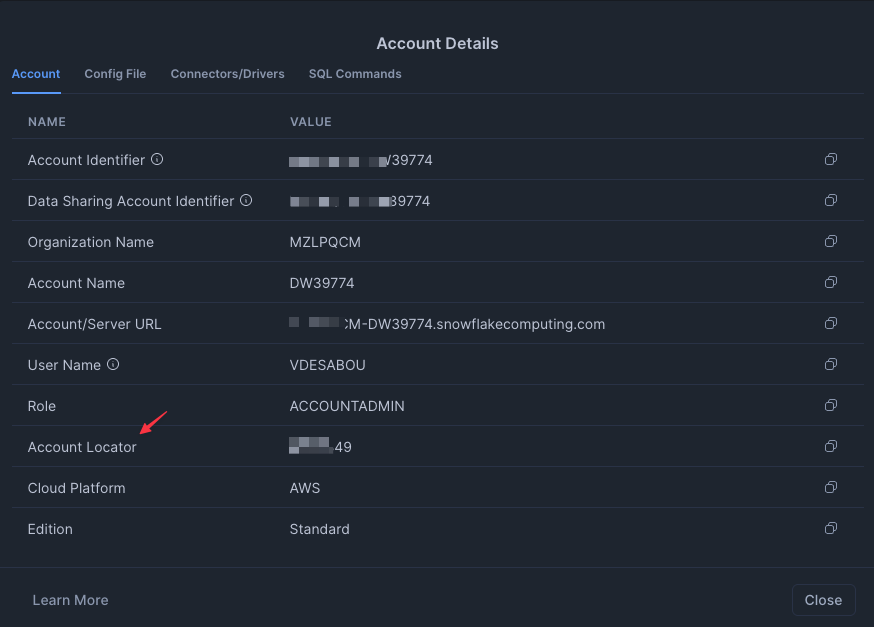

# Fully Managed Snowflake Sink connector

## Objective

Quickly test the [Snowflake Sink](https://docs.confluent.io/cloud/current/connectors/cc-snowflake-sink.html) fully managed connector.

## Prerequisites

See [Confluent Cloud examples](https://kafka-docker-playground.io/#/how-to-use?id=%f0%9f%8c%a4%ef%b8%8f-confluent-cloud-examples).

* A Snowflake account (see [Register a trial account](#register-a-trial-account)). The Iceberg variants require Snowflake **Enterprise Edition** (select it when you sign up for a trial).
* For `fully-managed-snowflake-iceberg-ext-volume-sink.sh`: AWS credentials, export `AWS_ACCESS_KEY_ID` and `AWS_SECRET_ACCESS_KEY` (optionally `AWS_REGION`, default `us-east-1`), or configure `~/.aws/credentials` and `~/.aws/config`.

| Variable | Description |
| --- | --- |
| `SNOWFLAKE_ACCOUNT_NAME` | `<account_locator>.<region_id>.<cloud_provider>`, see [Register a trial account](#register-a-trial-account) |
| `SNOWFLAKE_USERNAME` | Snowflake admin username, used to create the database, role, warehouse and user |
| `SNOWFLAKE_PASSWORD` | Password of `SNOWFLAKE_USERNAME` |
| `S3_BUCKET_NAME` | Optional, `fully-managed-snowflake-iceberg-ext-volume-sink.sh` only: S3 bucket used as Iceberg external volume, defaults to `playground-iceberg-<username>` |

## How to run

```bash
playground run -f fully-managed-snowflake-sink.sh
```

| Script | Description |
| --- | --- |
| `fully-managed-snowflake-sink.sh` | Writes Avro records to a standard Snowflake table, key pair authentication |
| `fully-managed-snowflake-iceberg-sink.sh` | Snowpipe Streaming into an Iceberg table on Snowflake-managed storage, with schematization |
| `fully-managed-snowflake-iceberg-ext-volume-sink.sh` | Same, with the Iceberg table on an S3 external volume (creates the bucket, an IAM role `snowflake-iceberg-role` and a storage integration), then reads a Parquet file from S3 |

## What the script does

1. Bootstraps the Confluent Cloud environment and deletes topic `test_table`.
2. Generates an encrypted RSA key pair (`snowflake_key.p8` / `snowflake_key.pub`, passphrase `confluent`).
3. With `snowsql`, creates a database, a role, a warehouse and a user (with the public key), unique to the script. The Iceberg variants also create the Iceberg table `TEST_TABLE` (and, for the external volume variant, the S3 bucket, IAM role, storage integration and external volume).
4. Produces Avro records (`u_name`, `u_price`, `u_quantity`) to topic `test_table`.
5. Creates the fully managed `SnowflakeSink` connector and waits for the lag to reach zero with `playground connector show-lag`.
6. Queries `TEST_TABLE` with `snowsql` as the connector user to verify the records.
7. Asks whether to delete the connector.

## Register a trial account

Go to [Snowflake](https://www.snowflake.com) and register an account. You receive an email to set up your account and access a 30-day trial instance.

To get `SNOWFLAKE_ACCOUNT_NAME`, get the *Account Locator* from:



`SNOWFLAKE_ACCOUNT_NAME` must be set to `<account_locator>.<region_id>.<cloud_provider>` (for example `XXXXX.eu-west-3.aws`).
