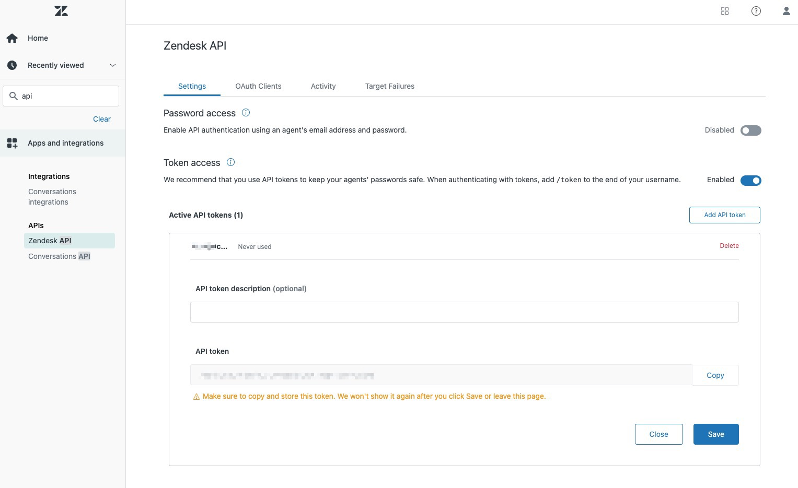

# Fully Managed Zendesk Source connector

## Objective

Quickly test the [Zendesk Source](https://docs.confluent.io/cloud/current/connectors/cc-zendesk-source.html) fully managed connector.

## Prerequisites

See [Confluent Cloud examples](https://kafka-docker-playground.io/#/how-to-use?id=%f0%9f%8c%a4%ef%b8%8f-confluent-cloud-examples).

* A Zendesk account and an API token (see [Create an API token](#create-an-api-token))

| Variable | Description |
| --- | --- |
| `ZENDESK_URL` | Zendesk URL (e.g. `https://<subdomain>.zendesk.com`) |
| `ZENDESK_USERNAME` | `<email>/token` |
| `ZENDESK_PASSWORD` | Zendesk API token |

## How to run

```bash
playground run -f fully-managed-zendesk-source.sh
```

| Script | Description |
| --- | --- |
| `fully-managed-zendesk-source.sh` | Reads table `organizations` with basic authentication (API token), JSON output |

## What the script does

1. Bootstraps the Confluent Cloud environment and recreates topic `zendesk-topic-organizations`.
2. Creates the fully managed `ZendeskSource` connector on `organizations`, since `2020-09-05`, with `topic.name.pattern=zendesk-topic-${entityName}`.
3. Verifies at least one record with `playground topic consume --topic zendesk-topic-organizations`.
4. Asks whether to delete the connector.

## Admin account

To create the token and get `tickets`, you need to be an `Admin` (it does not work with the `Agent` role), as `tickets` uses the [Incremental Ticket Export](https://developer.zendesk.com/api-reference/ticketing/ticket-management/incremental_exports/#allowed-for-2) API. This is why this example uses `organizations`.

## Create an API token

In your Zendesk account, create a token (if you are only an agent, ask an admin):


