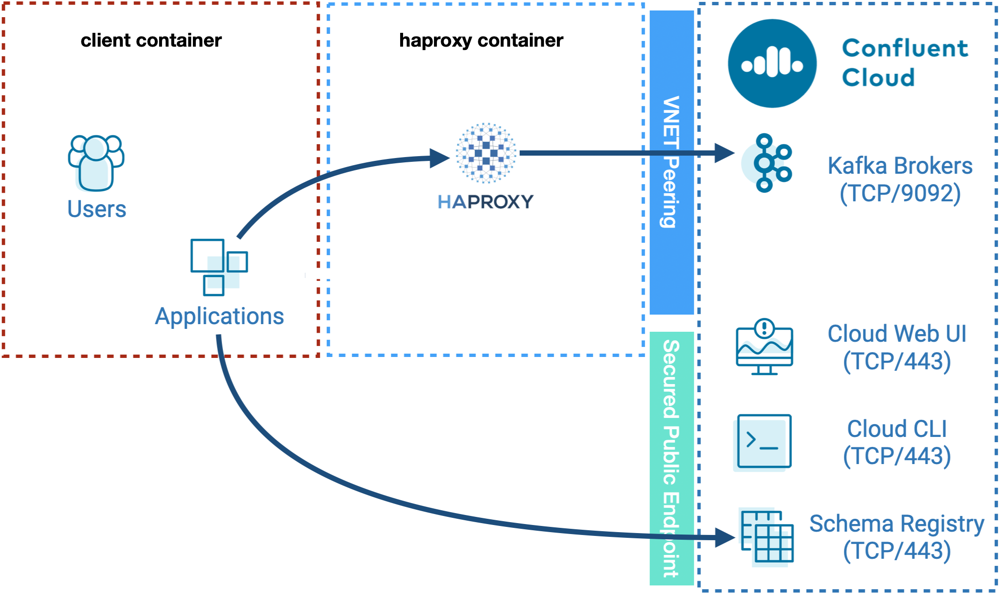

# Confluent Cloud Networking with HAProxy

## Objective

Implement SNI routing with HAProxy to simulate a VPC-peered Confluent Cloud cluster that must be accessed from a non-transitive VPC.

Two containers are started, `haproxy` and `client`:

* Using `iptables`, traffic between `client` and the Confluent Cloud bootstrap server and brokers (and optionally the REST and Schema Registry endpoints) is blocked.
* `haproxy` routes all `9092` (and `443`) traffic to the corresponding Confluent Cloud endpoint, based on the TLS SNI.



## Prerequisites

A Confluent Cloud cluster with a Kafka API key. This example does not use `bootstrap_ccloud_environment`: pass the endpoints and credentials with the variables below.

| Variable | Description |
| --- | --- |
| `PKC_ENDPOINT` | Bootstrap server **without** port (e.g. `pkc-xxxxx.eu-west-2.aws.confluent.cloud`) |
| `CLOUD_KEY` | Kafka API key |
| `CLOUD_SECRET` | Kafka API secret |
| `PKAC_ENDPOINT` | Optional, REST endpoint without `https://` (e.g. `pkac-xxxxx.eu-west-2.aws.confluent.cloud`) |
| `SCHEMA_REGISTRY_ENDPOINT` | Optional, Schema Registry endpoint without `https://` (e.g. `psrc-xxxxx.eu-central-1.aws.confluent.cloud`) |
| `SCHEMA_REGISTRY_BASIC_AUTH_USER_INFO` | Required when `SCHEMA_REGISTRY_ENDPOINT` is set: `<SR API KEY>:<SR API SECRET>` |

## How to run

```bash
export PKC_ENDPOINT=pkc-xxxxx.eu-west-2.aws.confluent.cloud
export CLOUD_KEY=<api key>
export CLOUD_SECRET=<api secret>
# optional
export PKAC_ENDPOINT=pkac-xxxxx.eu-west-2.aws.confluent.cloud
export SCHEMA_REGISTRY_ENDPOINT=psrc-xxxxx.eu-central-1.aws.confluent.cloud
export SCHEMA_REGISTRY_BASIC_AUTH_USER_INFO="<SR API KEY>:<SR API SECRET>"

playground run -f start.sh
```

| Script | Description |
| --- | --- |
| `start.sh` | Starts `haproxy` and `client`, blocks direct traffic and verifies access to Confluent Cloud through HAProxy |

## What the script does

1. Lists the brokers of the cluster with `kafkacat` to count them.
2. Generates `haproxy/haproxy.cfg` from `haproxy/haproxy-template.cfg`, with one SNI ACL and backend per endpoint (bootstrap, each broker `b<N>-<PKC_ENDPOINT>`, and the optional REST and Schema Registry endpoints).
3. Starts the `haproxy` and `client` containers.
4. Blocks the IP addresses of all endpoints with `iptables` in `client`, and checks that the cluster (and the optional endpoints) are no longer reachable.
5. Adds every endpoint to `/etc/hosts` of `client`, pointing to the HAProxy IP address.
6. Verifies that the cluster is reachable through HAProxy with `nc`, `openssl s_client` and `kafkacat`, and that the optional REST (HTTP 404 on `/subjects` is expected) and Schema Registry endpoints answer through HAProxy.

## Generated HAProxy configuration

The frontend routes TCP traffic based on the SNI. Example of the generated part for a cluster with 9 brokers (abbreviated):

```text
frontend kafka
    mode tcp
    bind *:9092
    bind *:443
    log global

    tcp-request inspect-delay 5s
    tcp-request content accept if { req.ssl_hello_type 1 }

    # define acl depending certificate name
    acl is_bootstrap req.ssl_sni -i pkc-41wq6.eu-west-2.aws.confluent.cloud
    acl is_kafka0 req.ssl_sni -i b0-pkc-41wq6.eu-west-2.aws.confluent.cloud
    # ... one acl per broker
    acl is_topic req.ssl_sni -i pkac-l7qj1.eu-west-2.aws.confluent.cloud
    acl is_ccsr req.ssl_sni -i psrc-lo5k9.eu-central-1.aws.confluent.cloud

    # depending name rule to route to specified backend
    use_backend bootstrap if is_bootstrap
    use_backend kafka0 if is_kafka0
    # ... one use_backend per broker
    use_backend topic if is_topic
    use_backend ccsr if is_ccsr

# backend definitions
backend bootstrap
    mode tcp
    server bootstrap pkc-41wq6.eu-west-2.aws.confluent.cloud:9092 check
backend kafka0
    mode tcp
    server kafka0 b0-pkc-41wq6.eu-west-2.aws.confluent.cloud:9092 check
# ... one backend per broker
backend topic
    mode tcp
    server topic pkac-l7qj1.eu-west-2.aws.confluent.cloud:443 check
backend ccsr
    mode tcp
    server ccsr psrc-lo5k9.eu-central-1.aws.confluent.cloud:443 check
```

## Expected results

Before `/etc/hosts` is updated, the cluster is not reachable from `client`:

```text
% ERROR: Failed to acquire metadata: Local: Broker transport failure
```

```text
curl: (7) Failed to connect to pkac-l7qj1.eu-west-2.aws.confluent.cloud port 443: Connection timed out
```

`/etc/hosts` of `client` after the update (`172.25.0.3` is the HAProxy IP address):

```text
172.25.0.3 pkc-41wq6.eu-west-2.aws.confluent.cloud
172.25.0.3 b0-pkc-41wq6.eu-west-2.aws.confluent.cloud
172.25.0.3 b1-pkc-41wq6.eu-west-2.aws.confluent.cloud
...
172.25.0.3 pkac-l7qj1.eu-west-2.aws.confluent.cloud
172.25.0.3 psrc-lo5k9.eu-central-1.aws.confluent.cloud
```

Through HAProxy, `nc` connects to the HAProxy IP address and `kafkacat` lists the brokers again:

```text
Ncat: Connected to 172.25.0.3:9092.
```

```text
Metadata for all topics (from broker -1: sasl_ssl://pkc-41wq6.eu-west-2.aws.confluent.cloud:9092/bootstrap):
 9 brokers:
  broker 0 at b0-pkc-41wq6.eu-west-2.aws.confluent.cloud:9092
  broker 5 at b5-pkc-41wq6.eu-west-2.aws.confluent.cloud:9092
  ...
```

The REST endpoint answers `{"error_code":404,"message":"HTTP 404 Not Found"}` on `/subjects` (expected), and Schema Registry returns the list of subjects.

## Troubleshooting

To capture the traffic, run in the `client` container:

```bash
tcpdump -w tcpdump.pcap -i eth0 -s 0 port 9092
```
