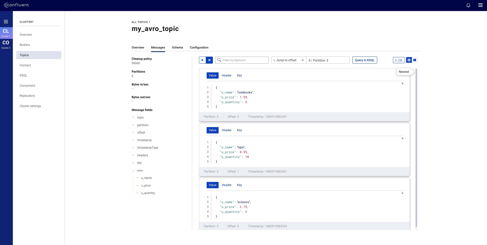
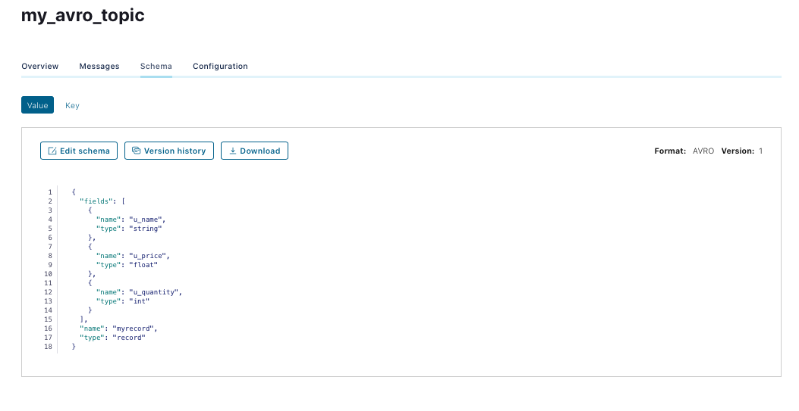

# Multi-Cluster Schema Registry with hybrid configuration (onprem/confluent cloud)

## Objective

Quickly test [Multi-Cluster Schema Registry](https://docs.confluent.io/current/control-center/topics/schema.html#enabling-multi-cluster-sr) (available since CP 5.4.1) in Control Center, using a hybrid deployment with an on-premise cluster and Confluent Cloud.

> [!NOTE]
> This is **unsupported**: Confluent Cloud brokers do not expose the `/v1/metadata/schemaRegistryUrls` endpoint. The workaround is to run a small REST API server that returns the URL of the Confluent Cloud Schema Registry (see [How the workaround works](#how-the-workaround-works)).

## Prerequisites

See [Confluent Cloud examples](https://kafka-docker-playground.io/#/how-to-use?id=%f0%9f%8c%a4%ef%b8%8f-confluent-cloud-examples).

Requires CP 5.4.1 or later (the script exits with code `111` otherwise).

## How to run

```bash
playground run -f start.sh
```

| Script | Description |
| --- | --- |
| `start.sh` | Control Center connected to the on-premise cluster and to Confluent Cloud, each with its own Schema Registry |

`httpd_debian.sh` and `httpd_rhel.sh` are helpers started inside the `webserver` container (not to be run directly).

## What the script does

1. Starts the environment with the `docker-compose.yml` override (broker, `webserver` container, Control Center multi-cluster configuration).
2. Generates `sr.json` from `sr-template.json` with the Confluent Cloud Schema Registry URL.
3. Installs `nc` in the `webserver` container and starts a minimal HTTP server on port `1500` (`httpd_rhel.sh` for UBI images, i.e. CP 6.0+, `httpd_debian.sh` otherwise) that always returns `sr.json`.
4. Calls `http://localhost:1500/v1/metadata/schemaRegistryUrls` to check the workaround endpoint answers.
5. Creates the `my_avro_topic` topic in Confluent Cloud and produces 3 Avro messages with `playground topic produce`.
6. You can then verify in Control Center ([http://127.0.0.1:9021](http://127.0.0.1:9021)) that the Avro data is readable.

## How the workaround works

The `webserver` container runs on port `1500` and replies to any request with the content of `sr.json` (generated by the script). The HTTP server is based on [jdoleczek/Bash-NetCat-HTTPD](https://github.com/jdoleczek/Bash-NetCat-HTTPD).

```bash
curl http://localhost:1500/v1/metadata/schemaRegistryUrls
```

```json
["https://psrc-xxxx.region.confluent.cloud"]
```

The broker is configured with the on-premise Schema Registry URL, so that the REST endpoint `http://broker:8090` works for the on-premise Schema Registry:

```yaml
  broker:
    environment:
      KAFKA_CONFLUENT_SCHEMA_REGISTRY_URL: http://schema-registry:8081
```

Control Center configuration:

```yaml
  control-center:
    environment:
      # on-premise Schema Registry and REST API endpoint
      CONTROL_CENTER_SCHEMA_REGISTRY_URL: "http://schema-registry:8081"
      CONTROL_CENTER_STREAMS_CPREST_URL: "http://broker:8090"

      # Confluent Cloud cluster named CLUSTER1
      CONTROL_CENTER_KAFKA_CLUSTER1_BOOTSTRAP_SERVERS: $BOOTSTRAP_SERVERS
      CONTROL_CENTER_KAFKA_CLUSTER1_SECURITY_PROTOCOL: SASL_SSL
      CONTROL_CENTER_KAFKA_CLUSTER1_SASL_JAAS_CONFIG: $SASL_JAAS_CONFIG
      CONTROL_CENTER_KAFKA_CLUSTER1_SASL_MECHANISM: PLAIN

      # CPREST_URL points to the REST API workaround
      CONTROL_CENTER_KAFKA_CLUSTER1_CPREST_URL: http://webserver:1500
      # Confluent Cloud Schema Registry
      CONTROL_CENTER_SCHEMA_REGISTRY_CLUSTER1_URL: $SCHEMA_REGISTRY_URL
      CONTROL_CENTER_SCHEMA_REGISTRY_CLUSTER1_BASIC_AUTH_CREDENTIALS_SOURCE: USER_INFO
      CONTROL_CENTER_SCHEMA_REGISTRY_CLUSTER1_BASIC_AUTH_USER_INFO: $SCHEMA_REGISTRY_BASIC_AUTH_USER_INFO
```

Result in Control Center:




