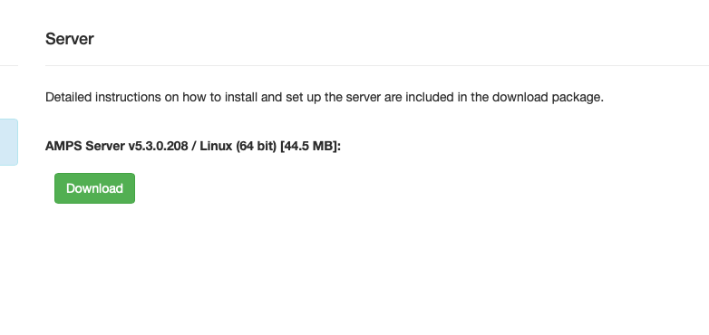

# AMPS Source connector

## Objective

Quickly test the [AMPS Source](https://docs.confluent.io/kafka-connectors/amps/current/overview.html) connector.

## Prerequisites

- CP lower than 8.0.0: this preview connector is not supported with CP 8.0 (the script exits with code `111` otherwise).
- AMPS server: create an account [here](https://www.crankuptheamps.com/developer) and download `AMPS Server v5.x.x / Linux (64 bit)`, then rename it to `AMPS.tar.gz` and put it into the `docker-amps` directory. Confluent employees with AWS credentials set get it automatically from the playground S3 bucket (see also this [Slack thread](https://confluent.slack.com/archives/C0116NM415F/p1636391410032900)).



The AMPS Java client (`amps_client.jar`) is downloaded automatically if missing.

## How to run

```bash
playground run -f amps-source.sh
```

| Script | Description |
| --- | --- |
| `amps-source.sh` | AMPS source connector with `sow_and_subscribe` on a SOW topic |

## What the script does

1. Builds the `amps:latest` Docker image from `docker-amps/AMPS.tar.gz` (first run only) and copies `amps_client.jar` into the connector `lib` folder.
2. Starts the environment with an `amps` container.
3. Publishes 2 JSON records to the AMPS `Orders` topic with the `spark` utility.
4. Creates the AMPS source connector (`io.confluent.connect.amps.AmpsSourceConnector`, `amps.topic.type=sow`, `amps.command=sow_and_subscribe`) writing to `AMPS_Orders`.
5. Verifies the 2 records are received in `AMPS_Orders` with `playground topic consume`.

Results:

```
{"id": 1, "order": "Apples"}
{"id": 2, "order": "Oranges"}
```
