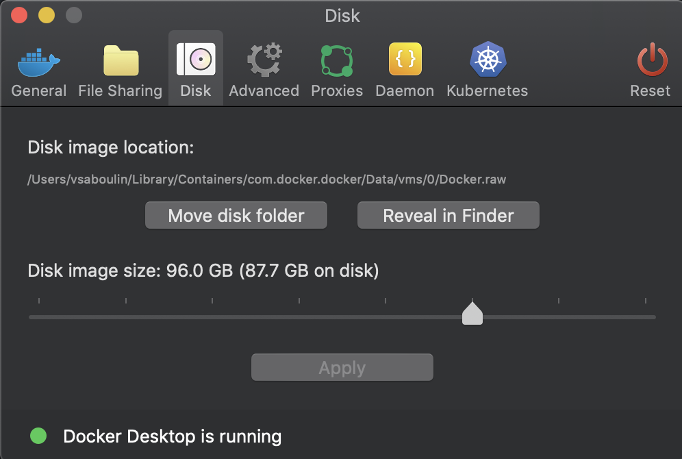

# Oracle XStream CDC Source (Oracle 19c) Source connector

## Objective

Quickly test the [Oracle XStream CDC Source](https://docs.confluent.io/kafka-connectors/oracle-xstream-cdc-source/current/overview.html) connector with Oracle 19c, in plaintext, TLS (with or without wallet) or mutual TLS, and with blocking snapshots triggered by signals.

## Prerequisites

The scripts need an Oracle 19c Docker image. They look for it in this order:

1. A prebuilt image already present locally.
2. A prebuilt image downloaded from the Confluent S3 bucket (Confluent employees only, requires AWS credentials). If you're a Confluent employee, check this [link](https://confluent.slack.com/archives/C0116NM415F/p1636391410032900) and also [here](https://confluent.slack.com/archives/C0116NM415F/p1636389483030900).
3. Otherwise, the image is built using the [oracle/docker-images](https://github.com/oracle/docker-images/blob/master/OracleDatabase/SingleInstance/README.md) project. Download Oracle Database 19c (19.3) for Linux x86-64 `LINUX.X64_193000_db_home.zip` from this [page](https://www.oracle.com/database/technologies/oracle19c-linux-downloads.html) and place it in this folder (on Apple Silicon, `LINUX.ARM64_1919000_db_home.zip` is used instead). The first build takes about 10 minutes.

The connector also needs the Oracle Instant Client (`instantclient_19_25_x86.zip`, or `instantclient_19_25_arm64.zip` on Apple Silicon). If `lib/instantclient` does not exist, the script tries to download the zip from the Confluent S3 bucket (Confluent employees only). Otherwise, download it manually from [Oracle Instant Client downloads](https://www.oracle.com/in/database/technologies/instant-client/downloads.html) (you must accept the license agreement) and place it in this folder. The script unzips it and copies `ojdbc8.jar`, `xstreams.jar` and the Instant Client libraries into the connector plugin folder.

**Make sure to increase the Docker disk image size (96 GB is known to be working)**:



## How to run

```bash
playground run -f cdc-xstream-oracle19.sh
```

| Script | Description |
| --- | --- |
| `cdc-xstream-oracle19.sh` | Basic example, plaintext connection on port 1521 |
| `cdc-xstream-oracle19-ssl.sh` | One-way TLS (`database.tls.mode` = `one-way`) on TCPS port 1532, without client wallet: the test CA certificate is added to the `connect` container default trust store |
| `cdc-xstream-oracle19-ssl-wallet.sh` | One-way TLS with a wallet (`database.wallet.location`), `cwallet.sso` copied to the `connect` container. Not supported with `cfk` |
| `cdc-xstream-oracle19-mtls-wallet.sh` | Two-way TLS (`database.tls.mode` = `two-way`) with a wallet. Not supported with `cfk` |
| `cdc-xstream-oracle19-blocking-snapshot.sh` | Blocking snapshot triggered by a row inserted in the signal table `CFLT_SIGNALS` (`signal.data.collection`) |
| `cdc-xstream-oracle19-blocking-snapshot-kafka-signal.sh` | Blocking snapshot triggered by a message produced to the Kafka signal topic `dbz-signals` (`signal.enabled.channels` = `kafka`) |

## What the script does

1. Gets or builds the Oracle 19c image, installs the Instant Client into the connector plugin and starts the environment (for TLS variants, the `oracle` container is started first to create the wallets with `orapki` and reconfigure the listener with the `.ora` files from `ssl/` or `mtls/`).
2. Prepares the `connect` container (JDK 17 for CP < 7.7, `libaio` and `libnsl` packages).
3. Enables XStream (`enable_goldengate_replication`), `ARCHIVELOG` mode and supplemental logging, and creates the XStream tablespaces, the `c##cfltadmin` administrator and the `c##cfltuser` connect user.
4. Creates the XStream outbound server `XOUT` capturing `C##CFLTUSER.CUSTOMERS` (plus `C##CFLTUSER.CFLT_SIGNALS` for the blocking snapshot variants) and runs Confluent's `orclcdc_readiness.sql` check.
5. Creates the `CUSTOMERS` table with 5 rows and the XStream CDC source connector (`topic.prefix` = `cflt`).
6. Inserts, updates and deletes rows and alters the table (basic and TLS variants), or inserts rows then triggers a blocking snapshot (blocking snapshot variants).
7. Verifies the topic `cflt.C__CFLTUSER.CUSTOMERS` with `playground topic consume`.

With `--enable-sql-datagen`, `playground run` injects rows in the `CUSTOMERS` table once the example succeeded, see [Benchmark](#benchmark).

## Benchmark

[`benchmark-load.bash`](benchmark-load.bash) loads rows in the `CUSTOMERS` table for [`playground connector benchmark`](https://kafka-docker-playground.io/#/playground%20connector%20benchmark), with the same database user and container database (CDB or PDB) as the variant of the example that was run. Once the example is running:

```bash
# time to capture 1M rows inserted in one transaction
playground connector benchmark --nb-records 1000000 --shape bulk

# 100k transactions of one row, then 1M updates of existing rows
playground connector benchmark --nb-records 100000 --shape small-txn
playground connector benchmark --nb-records 1000000 --shape update

# insert, update, then delete the same 500k rows: one drain per phase, compared in the summary and the report
# each deleted row gives a delete event and a tombstone (tombstones.on.delete, default true)
playground connector benchmark --nb-records 500000 --shape bulk,update,delete
```

The connector is paused while the rows are loaded, then resumed, and the benchmark measures the time it takes to produce the records.

`playground run -f cdc-xstream-oracle19.sh --enable-sql-datagen` uses the same load once the example succeeded: one row per transaction (`--shape small-txn`) from 5 parallel sessions for 10 minutes (`SQL_DATAGEN_SESSIONS`, `SQL_DATAGEN_DURATION` in minutes), logging the rows inserted every 30 seconds.

## Troubleshooting

When the `oracle` container is running:

```bash
# Run the official Oracle XStream CDC diagnostics script and open the report
playground connector oracle-cdc-xstream generate-report
# Execute various SQL commands to debug XStream components
playground connector oracle-cdc-xstream debug
# Generate the report and analyze it: findings with exact values, root-cause patterns
playground analyze oracle-xstream-report -c oracle
```

`playground analyze oracle-xstream-report -f orclcdc_diag_<date>.html` analyzes a report from anywhere (a
customer one too), and compares several reports of the same database when `-f` is repeated.
