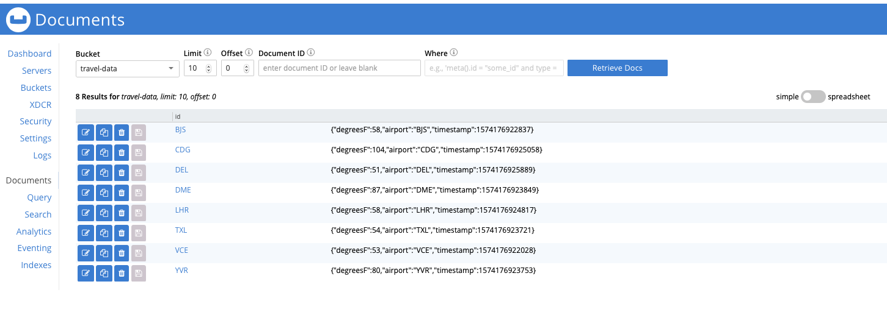

# Couchbase Sink connector

## Objective

Quickly test the [Couchbase Sink](https://docs.couchbase.com/kafka-connector/current/index.html) connector.

## How to run

```bash
playground run -f couchbase-sink.sh
```

| Script | Description |
| --- | --- |
| `couchbase-sink.sh` | Sink JSON records to a local Couchbase server, using the `airport` field as document ID |

Couchbase UI is available at [127.0.0.1:8091](http://127.0.0.1:8091) (`Administrator`/`password`).

## What the script does

1. Initializes the Couchbase cluster and creates the `travel-data` bucket with `couchbase-cli`.
2. Produces 20 weather report records to topic `couchbase-sink-example` with `playground topic produce` (one of them with airport `CDG`, used for verification).
3. Creates the `couchbase-sink` connector (`JsonConverter` without schemas, `couchbase.document.id` set to `/airport`).
4. Verifies that document `CDG` exists in bucket `travel-data` with `cbc cat`.

In the Couchbase UI:


