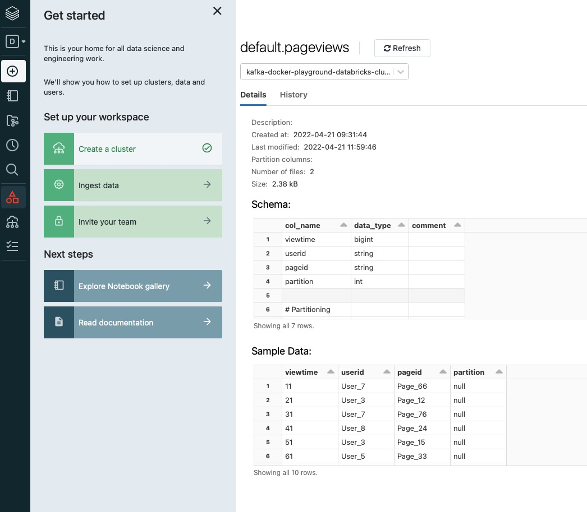

# Databricks Delta Lake Sink connector

## Objective

Quickly test the [Databricks Delta Lake Sink](https://docs.confluent.io/kafka-connectors/databricks-delta-lake-sink/current/overview.html) connector.

## Prerequisites

### Databricks setup

Follow all the steps from [Set up Databricks Delta Lake (AWS)](https://docs.confluent.io/kafka-connectors/databricks-delta-lake-sink/current/databricks-aws-setup.html#set-up-databricks-delta-lake-aws).

The script downloads the Simba Spark JDBC driver (`SparkJDBC42.jar`) if it is not present, copies it into the connector `lib` folder, and makes sure the Databricks SQL warehouse is running before starting the environment. The AWS CLI is used to empty the staging bucket.

With CP 8.x, the minimal supported connector version is 1.0.0 (the script exits with code 111 otherwise).

| Variable | Description |
| --- | --- |
| `DATABRICKS_AWS_BUCKET_NAME` | Staging Amazon S3 bucket name |
| `DATABRICKS_AWS_BUCKET_REGION` | Region of the staging bucket |
| `DATABRICKS_AWS_STAGING_S3_ACCESS_KEY_ID` | AWS access key ID with access to the staging bucket |
| `DATABRICKS_AWS_STAGING_S3_SECRET_ACCESS_KEY` | AWS secret access key with access to the staging bucket |
| `DATABRICKS_SERVER_HOSTNAME` | Databricks SQL warehouse server hostname |
| `DATABRICKS_HTTP_PATH` | Databricks SQL warehouse HTTP path |
| `DATABRICKS_TOKEN` | Databricks personal access token |

## How to run

```bash
playground run -f databricks-delta-lake-sink.sh
```

| Script | Description |
| --- | --- |
| `databricks-delta-lake-sink.sh` | Sink Avro `pageviews` records to a Delta Lake table, staged in Amazon S3 |

## What the script does

1. Downloads the Simba Spark JDBC driver if needed and ensures the Databricks SQL warehouse is running. Stops with the Databricks error if the warehouse start is refused (for example `denyReason: INACTIVE` when the workspace is deactivated).
2. Empties the staging S3 bucket.
3. Produces 100 Avro records to topic `pageviews` (datagen `pageviews` schema) with `playground topic produce`.
4. Creates the `databricks-delta-lake-sink` connector, mapping topic `pageviews` to table `pageviews` (`delta.lake.table.auto.create=true`).
5. Waits for the consumer lag to reach zero with `playground connector show-lag`.

You can verify that data is present in the table using the Databricks UI:


