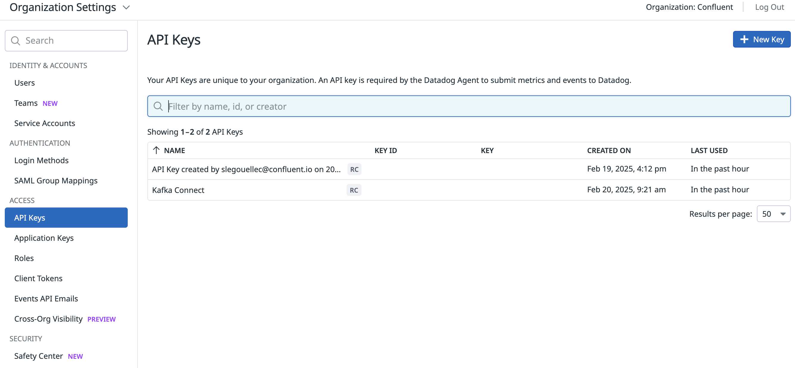
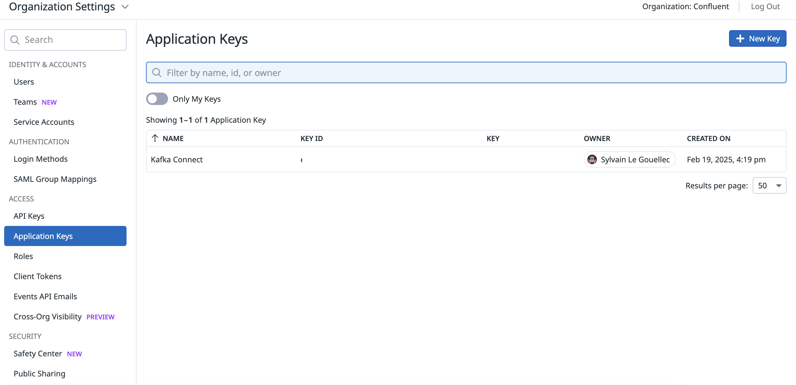
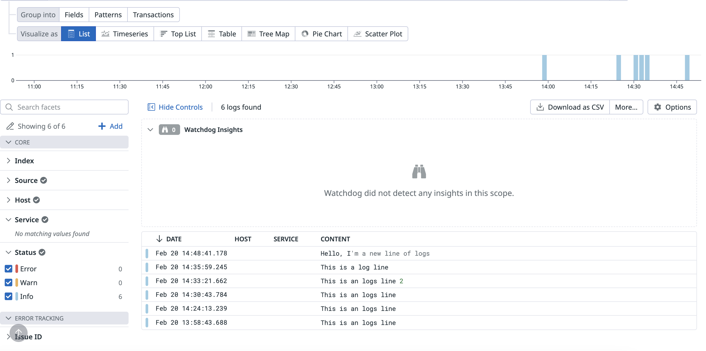

# Datadog Logs Sink connector

## Objective

Quickly test the [Datadog Logs Sink](https://www.confluent.io/hub/datadog/kafka-connect-logs) connector.

## Prerequisites

Register for a [Datadog trial](https://app.datadoghq.com) if you don't already have an account (you can convert it to *Free plan* after the trial expires).

Create an API key (`DD_API_KEY`) and an Application key (`DD_APP_KEY`):




| Variable | Description |
| --- | --- |
| `DD_API_KEY` | Datadog API key |
| `DD_APP_KEY` | Datadog Application key (used to query the logs) |
| `DD_SITE` | Datadog site (e.g. `us5.datadoghq.com`) |

## How to run

```bash
export DD_API_KEY="<your api key>"
export DD_APP_KEY="<your application key>"
export DD_SITE="us5.datadoghq.com"
playground run -f datadog-logs-sink.sh
```

| Script | Description |
| --- | --- |
| `datadog-logs-sink.sh` | Sink a string log line to Datadog Logs |

## What the script does

1. Produces the message `This is a log line` to topic `datadog-logs-topic` with `playground topic produce`.
2. Creates the `datadog-logs-sink` connector (`StringConverter` for key and value).
3. Searches the latest log event with the Datadog Logs API (`/api/v2/logs/events/search`) and verifies it contains `This is a log line`.

The log is visible in the Datadog UI:


