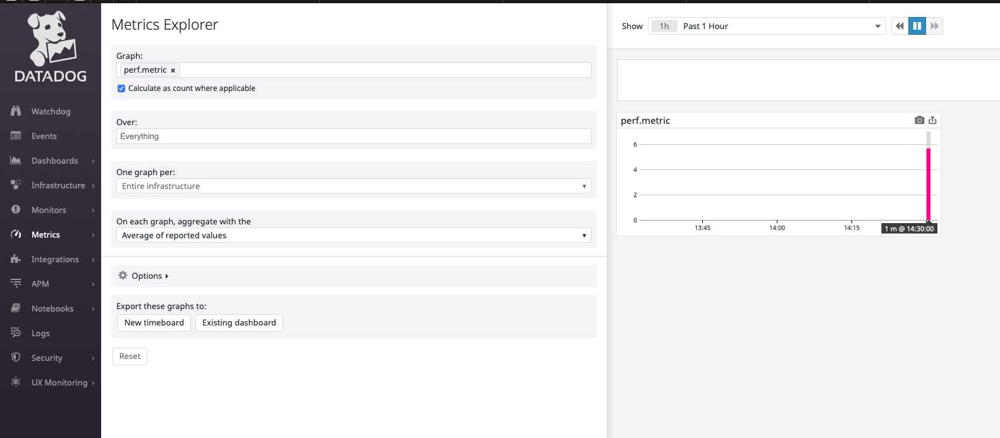

# Datadog Metrics Sink connector

## Objective

Quickly test the [Datadog Metrics Sink](https://docs.confluent.io/kafka-connectors/datadog-metrics/current/overview.html) connector.

## Prerequisites

Register for a [Datadog trial](https://app.datadoghq.com) if you don't already have an account (you can convert it to *Free plan* after the trial expires).

Create an API key (`DD_API_KEY`) and an Application key (`DD_APP_KEY`):


**Important**: the connector is configured with `"datadog.domain": "COM"`, so the account must be on the `COM` domain.

With CP 8.x, the minimal supported connector version is 2.0.4 (the script exits with code 111 otherwise).

| Variable | Description |
| --- | --- |
| `DD_API_KEY` | Datadog API key |
| `DD_APP_KEY` | Datadog Application key (used to query the metric) |

## How to run

```bash
playground run -f datadog-metrics-sink.sh
```

| Script | Description |
| --- | --- |
| `datadog-metrics-sink.sh` | Sink an Avro metric record to Datadog |

## What the script does

1. Builds the `dogshell:latest` Docker image from `docker-dogshell/` if it does not exist.
2. Produces one Avro metric record (`perf.metric`, type `rate`) to topic `datadog-metrics-topic` with `playground topic produce`.
3. Creates the `datadog-metrics-sink` connector, with reporter topics `success-responses` and `error-responses`.
4. Verifies topic `success-responses` with `playground topic consume` and waits for the consumer lag to reach zero.
5. Outside GitHub Actions, searches the `perf.metric` metric in Datadog with `dogshell`.

Check the data in Datadog:


