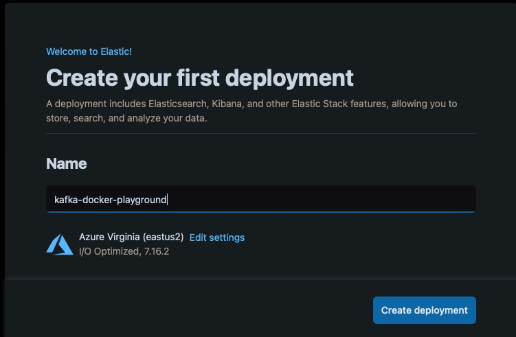
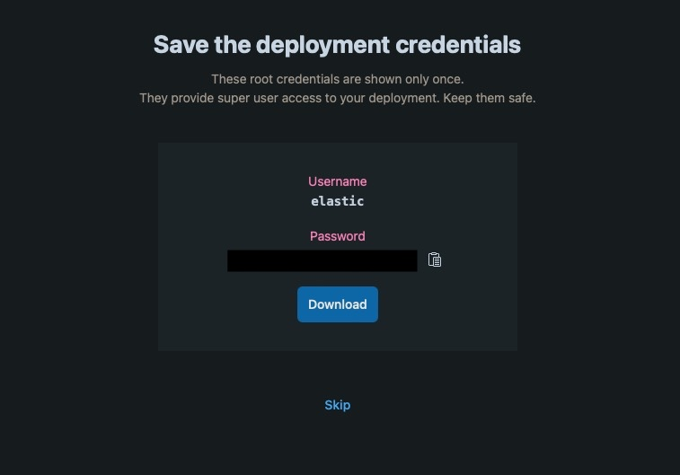
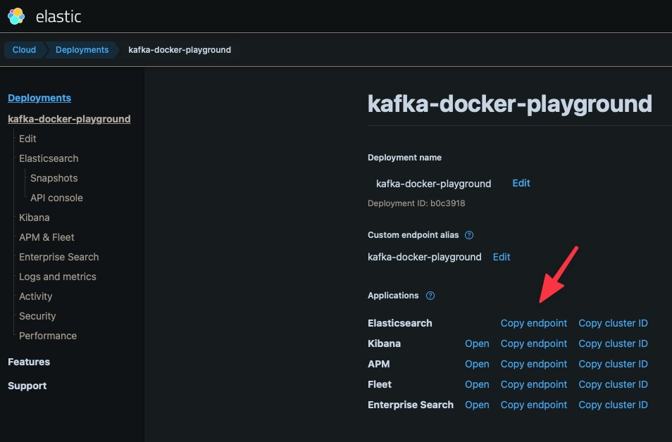

# Elasticsearch with Elastic Cloud Sink connector

## Objective

Quickly test the [Elasticsearch Sink](https://docs.confluent.io/kafka-connectors/elasticsearch/current/overview.html) connector with [Elastic Cloud](https://www.elastic.co/cloud/).

## Prerequisites

- If you don't already have an account, create one [here](https://info.elastic.co/elasticsearch-service-trial-by-invite-30d.html) for a 30 days trial.
- Create a deployment:

  

- Get your deployment credentials (used for `ELASTICSEARCH_CLOUD_USERNAME` and `ELASTICSEARCH_CLOUD_PASSWORD`):

  

- Get your Elasticsearch endpoint (used for `ELASTICSEARCH_CLOUD_ENDPOINT`):

  

| Variable | Description |
| --- | --- |
| `ELASTICSEARCH_CLOUD_ENDPOINT` | Elasticsearch endpoint of the deployment (`https://...`) |
| `ELASTICSEARCH_CLOUD_USERNAME` | Deployment username |
| `ELASTICSEARCH_CLOUD_PASSWORD` | Deployment password |

## How to run

```bash
export ELASTICSEARCH_CLOUD_ENDPOINT="https://<deployment>.es.<region>.<cloud>.cloud.es.io"
export ELASTICSEARCH_CLOUD_USERNAME="elastic"
export ELASTICSEARCH_CLOUD_PASSWORD="<password>"
playground run -f elasticsearch-cloud-sink.sh
```

| Script | Description |
| --- | --- |
| `elasticsearch-cloud-sink.sh` | Elasticsearch Sink connector writing to an Elastic Cloud deployment |

## What the script does

1. Starts the environment.
2. Creates the `elasticsearch-cloud-sink` connector pointing to `ELASTICSEARCH_CLOUD_ENDPOINT` with basic authentication (`type.name=kafka-connect` is added for connector versions before 11.0.0).
3. Produces 10 Avro records to topic `test-elasticsearch-sink` with `playground topic produce`.
4. Queries `$ELASTICSEARCH_CLOUD_ENDPOINT/test-elasticsearch-sink/_search` and checks that the records are indexed.
