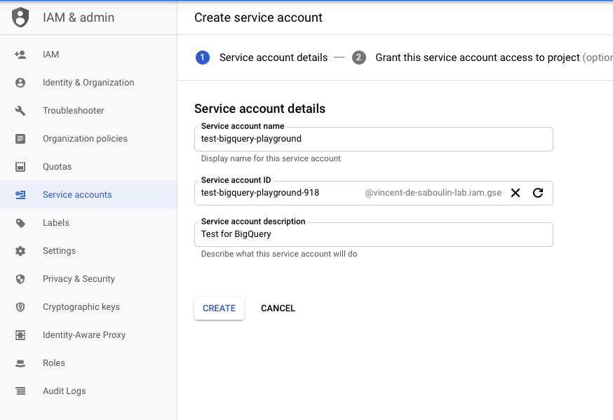
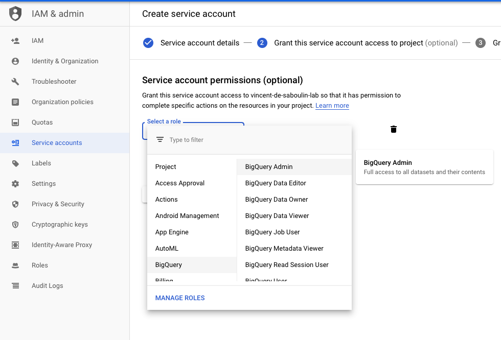

# GCP BigQuery Sink connector

## Objective

Quickly test the [GCP BigQuery Sink](https://docs.confluent.io/kafka-connectors/bigquery/current/overview.html) connector.

## Prerequisites

An active Google Cloud Platform (GCP) account with authorization to create resources.

With CP 8.x, the minimal supported connector version is 2.5.0 (the script exits with code 111 otherwise).

| Variable | Description |
| --- | --- |
| `GCP_PROJECT` | GCP project ID |
| `GCP_KEYFILE_CONTENT` | Content of the service account key file (only if `keyfile.json` is not present in the example folder) |

### GCP BigQuery setup

* Follow [Quickstart using the web UI in the GCP Console](https://cloud.google.com/bigquery/docs/quickstarts/quickstart-web-ui) to get familiar with GCP BigQuery.
* Create a `Service Account` from the IAM & Admin console.

Set `Service account name`:



Choose permission `BigQuery`->`BigQuery Admin`:



Create Key:


Download it as JSON:


Rename it to `keyfile.json` and place it in the example folder, or set the environment variable `GCP_KEYFILE_CONTENT` with its content, generated with:

```bash
export GCP_KEYFILE_CONTENT=$(cat keyfile.json | jq -aRs . | sed 's/^"//' | sed 's/"$//')
```

## How to run

```bash
playground run -f gcp-bigquery-sink.sh
```

| Script | Description |
| --- | --- |
| `gcp-bigquery-sink.sh` | Sink Avro records to a BigQuery table, auto-created in a dedicated dataset |

## What the script does

1. Authenticates with the service account in a `gcloud-config` container (`google/cloud-sdk` image).
2. Drops (if present) and creates a dataset named after the user, run number and CP version.
3. Creates the `gcp-bigquery-sink` connector (`autoCreateTables=true`, `sanitizeTopics=true`) for topic `products`.
4. Produces 3 Avro records to topic `products` with `playground topic produce` (one of them with `name=notebooks`).
5. Waits 125 seconds, then queries `SELECT * FROM <dataset>.products` with `bq` and checks that `notebooks` is present.
6. On exit, drops the dataset.
