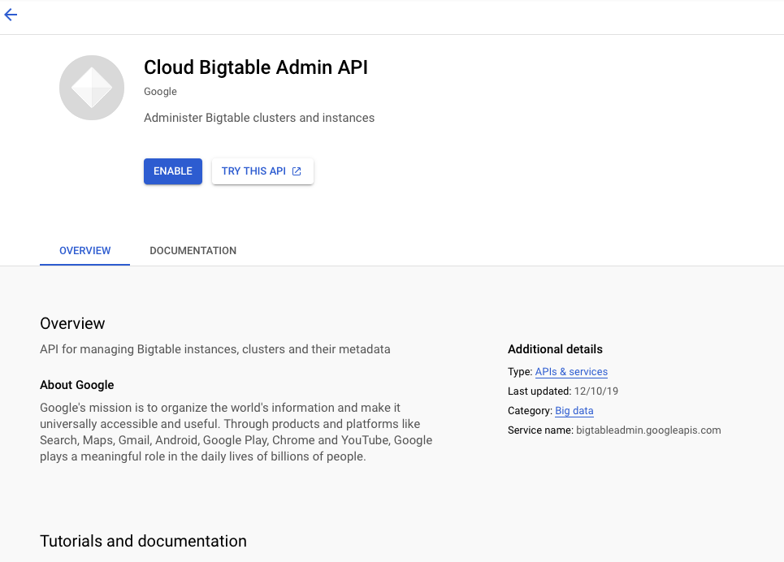
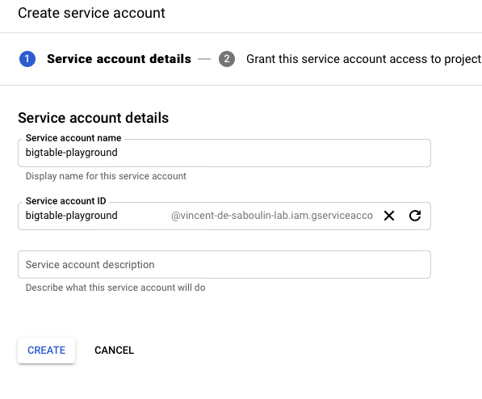

# GCP BigTable Sink connector

## Objective

Quickly test the [GCP BigTable Sink](https://docs.confluent.io/kafka-connectors/gcp-bigtable/current/overview.html) connector.

## Prerequisites

An active Google Cloud Platform (GCP) account with authorization to create resources.

With CP 8.x, the minimal supported connector version is 2.0.0 (the scripts exit with code 111 otherwise).

| Variable | Description |
| --- | --- |
| `GCP_PROJECT` | GCP project ID |
| `GCP_KEYFILE_CONTENT` | Content of the service account key file (only if `keyfile.json` is not present in the example folder) |

The BigTable instance is created in zone `europe-west2-a` (can be overridden with the first script argument).

### Enabling Cloud BigTable Admin API

Go to this [link](https://console.developers.google.com/apis/library/bigtableadmin.googleapis.com) and click `Enable`:



### Setup credentials

Create a `Service Account` from the IAM & Admin console.

Set `Service account name`:



Choose permission `Cloud BigTable`->`BigTable Administrator`:


Create Key:


Download it as JSON:


Rename it to `keyfile.json` and place it in the example folder, or set the environment variable `GCP_KEYFILE_CONTENT` with its content, generated with:

```bash
export GCP_KEYFILE_CONTENT=$(cat keyfile.json | jq -aRs . | sed 's/^"//' | sed 's/"$//')
```

## How to run

```bash
playground run -f gcp-bigtable-sink.sh
```

| Script | Description |
| --- | --- |
| `gcp-bigtable-sink.sh` | Sink Avro records to a BigTable table, auto-created with its column families |
| `gcp-bigtable-sink-proxy.sh` | Same, through an nginx proxy (`proxy.url`), with direct traffic to `bigtableadmin.googleapis.com` blocked (not supported with `cfk`) |

## What the scripts do

1. Authenticate with the service account in a `gcloud-config` container (`google/cloud-sdk` image).
2. Delete (if present) and create a BigTable instance named after the user, run number and CP version.
3. Produce 3 Avro records with keys `simple-key-1..3` and a `users` column family to topic `big_query_stats` with `playground topic produce`.
4. Proxy variant only: block traffic from `connect` to `bigtableadmin.googleapis.com` with `playground debug block-traffic`.
5. Create the `gcp-bigtable-sink` connector (`table.name.format=kafka_${topic}`, `auto.create.tables` and `auto.create.column.families` enabled).
6. Wait for the consumer lag to reach zero with `playground connector show-lag`, then (outside GitHub Actions) read table `kafka_big_query_stats` with `cbt` and check that `Bob` is present.
7. On exit, delete the table and the instance.
