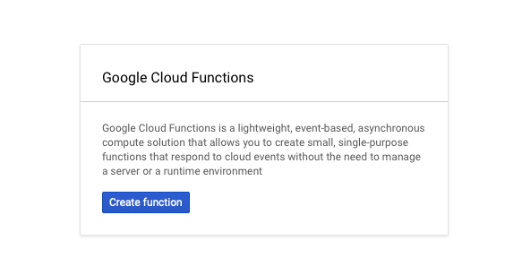

# Google Cloud Functions Sink connector

## Objective

Quickly test the [Google Cloud Functions Sink](https://docs.confluent.io/current/connect/kafka-connect-gcp-functions/index.html#quick-start) connector.

## Prerequisites

An active Google Cloud Platform (GCP) account with authorization to create resources.

With CP 8.x, the minimal supported connector version is 1.2.5 (the script exits with code 111 otherwise).

| Variable | Description |
| --- | --- |
| `GCP_PROJECT` | GCP project ID |
| `GCP_KEYFILE_CONTENT` | Content of the service account key file (only if `keyfile.json` is not present in the example folder) |

The function region and name default to `europe-west2` and `function-1` (override with `GCP_FUNCTION_REGION` and `GCP_FUNCTION_FUNCTION`).

### Google Cloud Functions setup

* Navigate to the [Google Cloud Console](https://console.cloud.google.com/).
* Go to the [Cloud Functions](https://console.cloud.google.com/functions) tab.



* Create a new function. Use the default code that is provided.


Note down the region and the function name.

### Service account key

Create a service account with permission to invoke the function and download its key as JSON. Rename it to `keyfile.json` and place it in the example folder, or set the environment variable `GCP_KEYFILE_CONTENT` with its content, generated with:

```bash
export GCP_KEYFILE_CONTENT=$(cat keyfile.json | jq -aRs . | sed 's/^"//' | sed 's/"$//')
```

## How to run

```bash
playground run -f google-cloud-functions-sink.sh
```

| Script | Description |
| --- | --- |
| `google-cloud-functions-sink.sh` | Sink string records to a Google Cloud Function, results written to reporter topics |

## What the script does

1. Produces 3 string records to topic `functions-messages` with `playground topic produce`.
2. Creates the `gcp-functions` connector, with reporter topics `test-result` and `test-error`.
3. Verifies that 3 function responses are in topic `test-result` with `playground topic consume`.

Expected result (with the default function code):

```text
Hello World!
Hello World!
Hello World!
```
