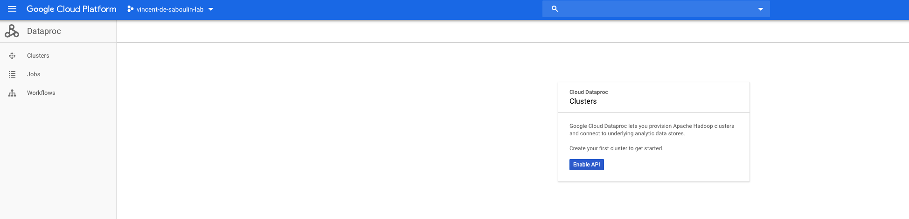
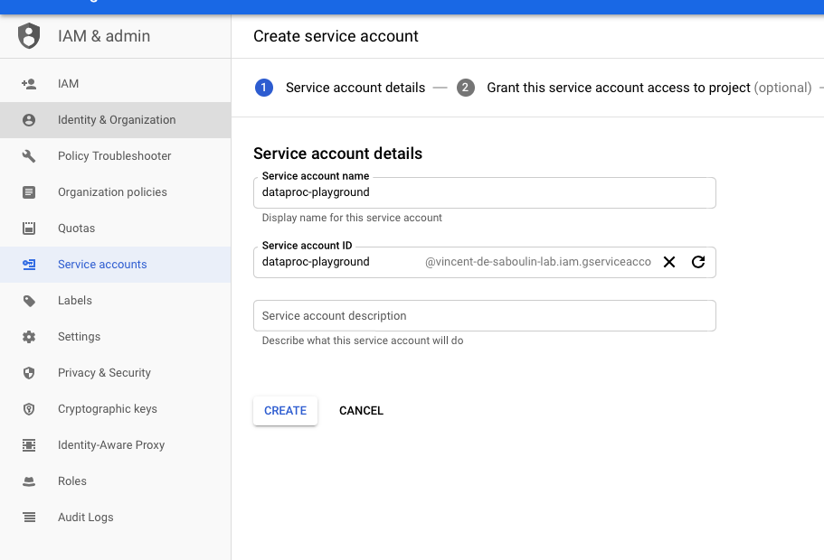
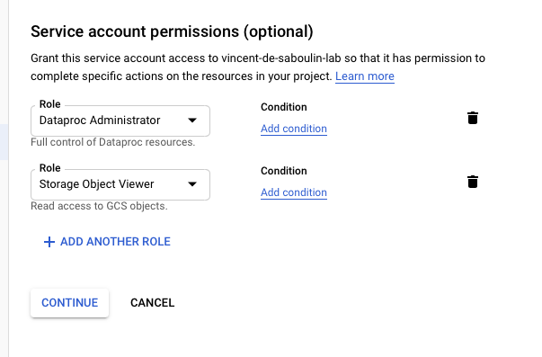

# GCP Dataproc Sink connector

> [!WARNING]
> **Not working**: the connector must be deployed on a VM in the same GCP subnet as the Dataproc cluster, so it cannot work with the playground. The script exits immediately with an error.

## Objective

Quickly test the [GCP Dataproc Sink](https://docs.confluent.io/current/connect/kafka-connect-gcp-dataproc/sink/index.html#quick-start) connector.

## Prerequisites

An active Google Cloud Platform (GCP) account with authorization to create resources.

| Variable | Description |
| --- | --- |
| `GCP_PROJECT` | GCP project ID |
| `GCP_KEYFILE_CONTENT` | Content of the service account key file (only if `keyfile.json` is not present) |

### GCP Dataproc setup

* Make sure to enable the API in your Dataproc console:



* Create a `Service Account` from the IAM & Admin console.

Set `Service account name`:



Choose permission `Dataproc`->`Dataproc Administrator` and the role `Storage`->`Storage Object Viewer`:



Create Key:


Download it as JSON:


Rename it to `keyfile.json` and place it in the example folder, or set the environment variable `GCP_KEYFILE_CONTENT` with its content, generated with:

```bash
export GCP_KEYFILE_CONTENT=$(cat keyfile.json | jq -aRs . | sed 's/^"//' | sed 's/"$//')
```

## How to run

```bash
playground run -f gcp-dataproc-sink.sh
```

| Script | Description |
| --- | --- |
| `gcp-dataproc-sink.sh` | Sink Avro records to a Dataproc cluster (currently exits with an error, see above) |

## What the script would do

1. Authenticates with the service account and creates Dataproc cluster `playground-cluster` in `us-east1`.
2. Produces 10 Avro records to topic `test_dataproc` with `playground topic produce`.
3. Creates the `gcp-dataproc-sink` connector (`flush.size=3`).
4. Deletes the Dataproc cluster.

When run from outside the cluster subnet, the task fails with `java.net.UnknownHostException: playground-cluster-m`.
