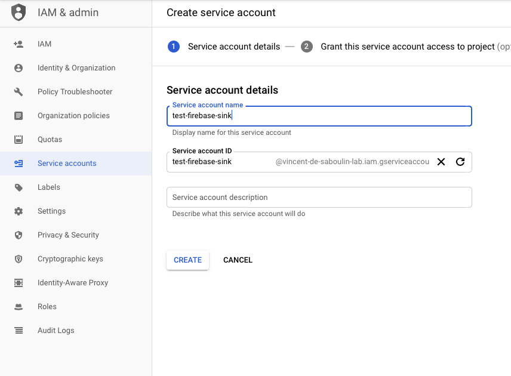
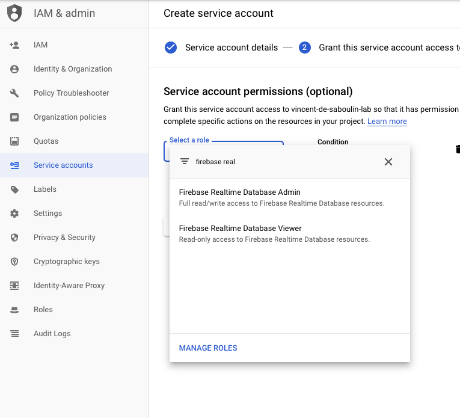
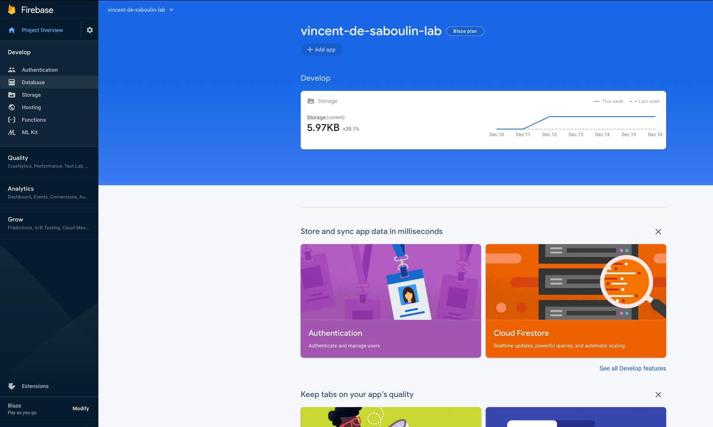
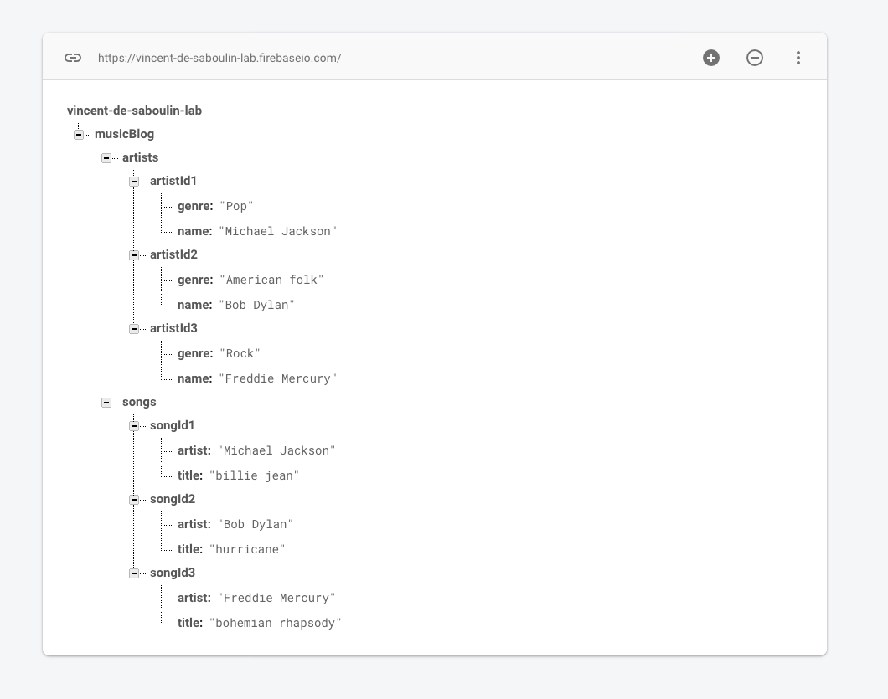

# GCP Firebase Sink connector

## Objective

Quickly test the [GCP Firebase Sink](https://docs.confluent.io/kafka-connectors/firebase/current/sink/overview.html) connector.

## Prerequisites

An active Google Cloud Platform (GCP) account with authorization to create resources.

With CP 8.x, the minimal supported connector version is 1.2.7 (the script exits with code 111 otherwise).

| Variable | Description |
| --- | --- |
| `GCP_PROJECT` | GCP project ID |
| `GCP_FIREBASE_REGION` | Region of the Realtime Database (default `europe-west1`) |
| `GCP_KEYFILE_CONTENT` | Content of the service account key file (only if `keyfile.json` is not present in the example folder) |

`gcp.firebase.database.reference` is built from `GCP_PROJECT` and `GCP_FIREBASE_REGION`, e.g. `https://<GCP_PROJECT>-default-rtdb.<GCP_FIREBASE_REGION>.firebasedatabase.app/musicBlog`. Set `GCP_FIREBASE_REGION` to `us-central1` for legacy databases using the `https://<GCP_PROJECT>.firebaseio.com/musicBlog` format instead.

### Service account setup

Create a `Service Account` from the IAM & Admin console.

Set `Service account name`:



Choose permission `Firebase`->`Firebase Realtime Database Admin`:



Create Key:


Download it as JSON:


Rename it to `keyfile.json` and place it in the example folder, or set the environment variable `GCP_KEYFILE_CONTENT` with its content, generated with:

```bash
export GCP_KEYFILE_CONTENT=$(cat keyfile.json | jq -aRs . | sed 's/^"//' | sed 's/"$//')
```

### Realtime Database setup

Go to the [Firebase console](https://console.firebase.google.com), click `Add Project` and choose your GCP project.

In your console, click `Database` on the left sidebar:



Click on `Realtime Database`:


Click on `Enable`:


## How to run

```bash
playground run -f gcp-firebase-sink.sh
```

| Script | Description |
| --- | --- |
| `gcp-firebase-sink.sh` | Sink Avro records from topics `artists` and `songs` to a Firebase Realtime Database (`insert.mode=update`) |

## What the script does

1. Removes all data from the Realtime Database with `firebase-tools`.
2. Creates the `firebase-sink` connector for topics `artists` and `songs`.
3. Produces 4 Avro records to topic `artists` (keys `artistId1..4`) and 3 to topic `songs` (keys `songId1..3`) with `playground topic produce`.
4. Reads the database content with `firebase database:get /` and checks that `artist` is present.

You can also check the data in the [Firebase console](https://console.firebase.google.com) under `Realtime Database`:


