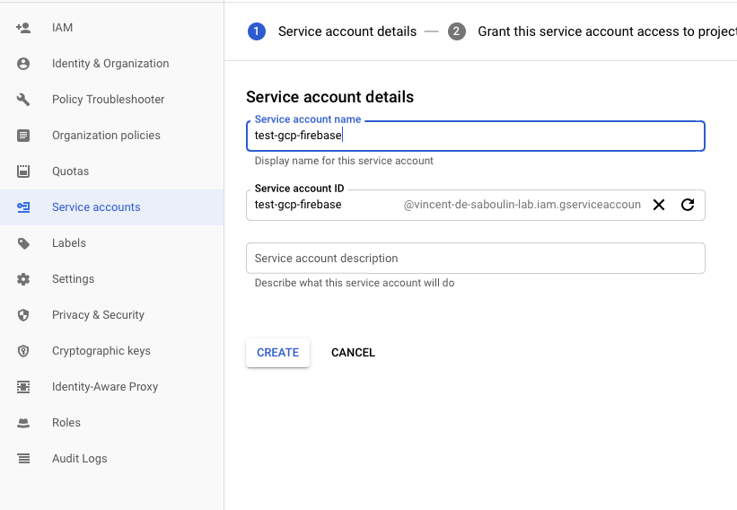
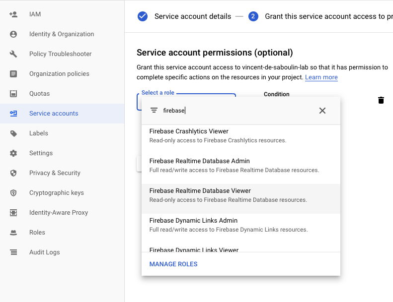
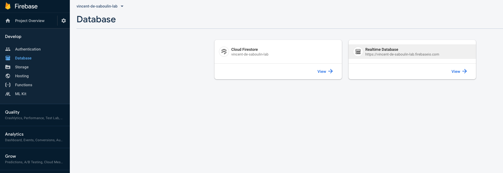
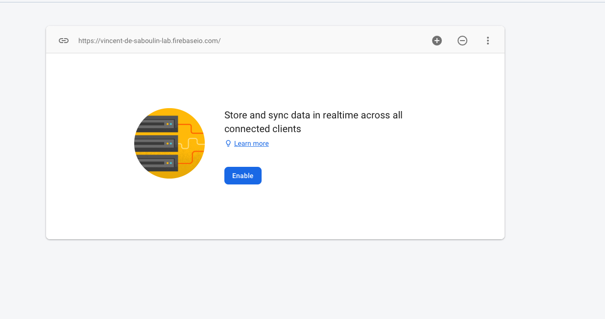
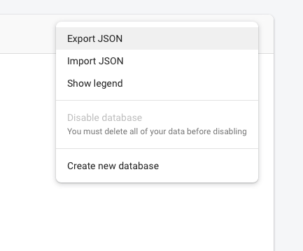
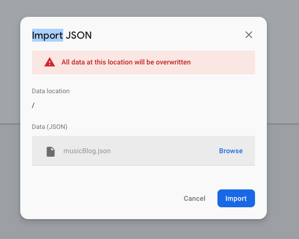

# GCP Firebase Source connector

## Objective

Quickly test the [GCP Firebase Source](https://docs.confluent.io/kafka-connectors/firebase/current/source/overview.html) connector.

## Prerequisites

* Active Google Cloud Platform (GCP) account with authorization to create resources
* A service account key, either saved as `keyfile.json` in this folder or provided through `GCP_KEYFILE_CONTENT` (see [GCP Firebase setup](#gcp-firebase-setup))
* A Firebase Realtime Database enabled in your GCP project

| Variable | Description |
| --- | --- |
| `GCP_PROJECT` | GCP project ID (required) |
| `GCP_KEYFILE_CONTENT` | Content of the service account key, used when `keyfile.json` is not present |
| `GCP_FIREBASE_REGION` | Region of the Realtime Database (default: `europe-west1`) |

`gcp.firebase.database.reference` is built from `GCP_PROJECT` and `GCP_FIREBASE_REGION`:

* default: `https://<GCP_PROJECT>-default-rtdb.<GCP_FIREBASE_REGION>.firebasedatabase.app/musicBlog`
* `GCP_FIREBASE_REGION=us-central1` (legacy databases): `https://<GCP_PROJECT>.firebaseio.com/musicBlog`

## How to run

```bash
export GCP_PROJECT=<your-gcp-project>
playground run -f gcp-firebase-source.sh
```

| Script | Description |
| --- | --- |
| `gcp-firebase-source.sh` | Firebase Realtime Database source with snapshot enabled |

Requires connector version 1.2.7 or later with CP 8.x (the script exits with code 111 otherwise).

## What the script does

1. Removes all data from the Realtime Database, then loads `musicBlog.json` with the `firebase-tools` CLI and displays it
2. Starts the environment
3. Creates the `firebase-source` connector on the `musicBlog` reference, with `gcp.firebase.snapshot=true`
4. Verifies that records arrive in the `artists` and `songs` topics with `playground topic consume`

## GCP Firebase setup

### Service account

Create a `Service Account` from the IAM & Admin console.

Set the `Service account name`:



Choose the permission `Firebase` -> `Firebase Realtime Database Viewer`:



Create a key:


Download it as JSON:


Rename it to `keyfile.json` and place it in this folder, or export its content in `GCP_KEYFILE_CONTENT`:

```bash
export GCP_KEYFILE_CONTENT=$(cat keyfile.json | jq -aRs . | sed 's/^"//' | sed 's/"$//')
```

Note: the script removes and reloads the database content, so the service account needs write access to the database for that step.

### Realtime Database

Go to the [Firebase console](https://console.firebase.google.com), click `Add Project` and choose your GCP project.

In the console, click `Database` on the left sidebar:


Click `Realtime Database`:



Click `Enable`:



Optionally, import the sample data manually (the script also loads it): click the vertical dots on the right-hand side and choose `Import JSON`:



Browse to `musicBlog.json` and import it:



You should see:


