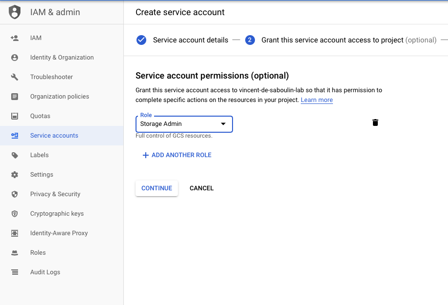

# GCS Sink connector

## Objective

Quickly test the [GCS Sink](https://docs.confluent.io/kafka-connectors/gcs-sink/current/overview.html) connector.

## Prerequisites

* Active Google Cloud Platform (GCP) account with authorization to create resources
* A service account key, either saved as `keyfile.json` in this folder or provided through `GCP_KEYFILE_CONTENT` (see [Service account setup](#service-account-setup))

| Variable | Description |
| --- | --- |
| `GCP_PROJECT` | GCP project ID (required) |
| `GCP_KEYFILE_CONTENT` | Content of the service account key, used when `keyfile.json` is not present |

## How to run

```bash
export GCP_PROJECT=<your-gcp-project>
playground run -f gcs-sink.sh
```

| Script | Description |
| --- | --- |
| `gcs-sink.sh` | GCS sink writing Avro files with the default partitioner |

The bucket is created in region `europe-west2` (override with `GCS_BUCKET_REGION`). Requires connector version 10.3.3 or later with CP 8.x (the script exits with code 111 otherwise).

## What the script does

1. Starts the environment and authenticates `gcloud` with the service account key
2. Creates the bucket `kafkadockerplaygroundbucket<user>...` if needed, labels it and removes existing objects under `topics/gcs-topic`
3. Produces 10 Avro records to `gcs-topic`
4. Creates the `gcs-sink` connector (`AvroFormat`, `flush.size=3`)
5. Lists the objects in the bucket, downloads `gcs-topic+0+0000000000.avro` and displays it with `playground tools read-avro-file`

## Service account setup

See also [Prepare a bucket](https://docs.confluent.io/kafka-connectors/gcs-sink/current/overview.html).

Create a `Service Account` from the IAM & Admin console.

Set the `Service account name`:


Choose the permission `Storage Admin` (probably more than required):



Create a key:


Download it as JSON:


Rename it to `keyfile.json` and place it in this folder, or export its content in `GCP_KEYFILE_CONTENT`:

```bash
export GCP_KEYFILE_CONTENT=$(cat keyfile.json | jq -aRs . | sed 's/^"//' | sed 's/"$//')
```
