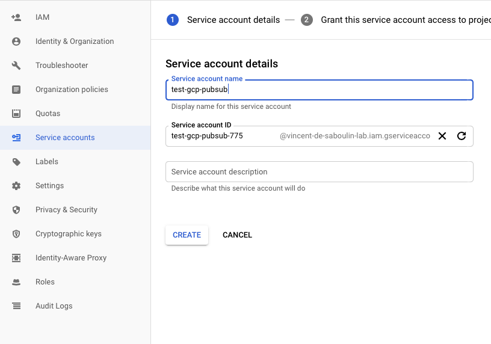
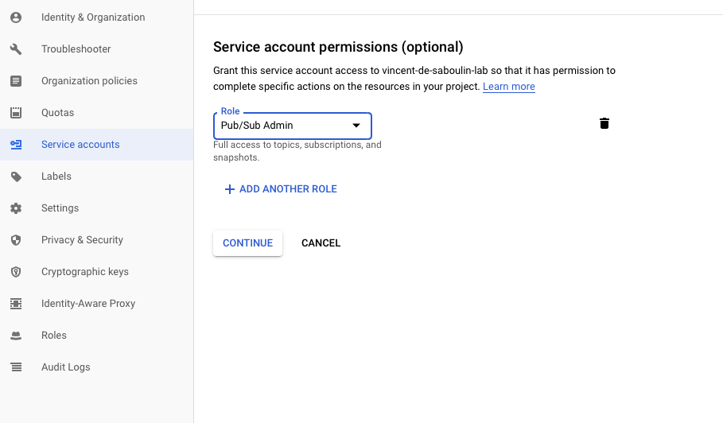

# GCP Pub/Sub Source connector

## Objective

Quickly test the [GCP Pub/Sub Source](https://docs.confluent.io/kafka-connectors/gcp-pubsub/current/overview.html) connector.

## Prerequisites

* Active Google Cloud Platform (GCP) account with authorization to create resources
* A service account key, either saved as `keyfile.json` in this folder or provided through `GCP_KEYFILE_CONTENT` (see [Service account setup](#service-account-setup))

| Variable | Description |
| --- | --- |
| `GCP_PROJECT` | GCP project ID (required) |
| `GCP_KEYFILE_CONTENT` | Content of the service account key, used when `keyfile.json` is not present |

## How to run

```bash
export GCP_PROJECT=<your-gcp-project>
playground run -f gcp-pubsub-source.sh
```

| Script | Description |
| --- | --- |
| `gcp-pubsub-source.sh` | Basic example, also checks that messages are acknowledged (no redelivery after the ack deadline) |
| `gcp-pubsub-source-nginx-proxy.sh` | Same, through an nginx HTTP/2 forward proxy (`gcp.pubsub.proxy.url=nginx_http2_proxy:8888`); not supported on arm64 |

Requires connector version 1.2.10 or later with CP 8.x (the scripts exit with code 111 otherwise).

## What the scripts do

1. Start the environment (plus the `nginx_http2_proxy` container for the proxy variant) and authenticate `gcloud` with the service account key
2. Create a Pub/Sub topic and subscription (ack deadline 60s), deleting them first if they exist
3. Publish three messages (`Peter`, `Megan`, `Erin`) to the Pub/Sub topic
4. Create the `pubsub-source` connector and verify 3 records arrive in the Kafka topic (`pubsub-topic-<suffix>` for the basic example, `pubsub-topic` for the proxy variant) with `playground topic consume`
5. Basic example only: wait 80 seconds and fail if messages were redelivered (exactly 3 records expected)
6. On exit, delete the Pub/Sub topic and subscription

Records look like:

```json
{"MessageData":{"string":"Megan"},"AttributesMap":{}}
{"MessageData":{"string":"Peter"},"AttributesMap":{}}
{"MessageData":{"string":"Erin"},"AttributesMap":{}}
```

## Benchmark

[`benchmark-load.bash`](benchmark-load.bash) publishes `benchmark message <i>` messages to the topic of the connector (`gcp.pubsub.project.id`, `gcp.pubsub.topic.id`) for [`playground connector benchmark`](https://kafka-docker-playground.io/#/playground%20connector%20benchmark), with the Pub/Sub python client (batches of 1000 messages) in a small `playground-benchmark-python` image built the first time ([`tools/benchmark-python/benchmark_producer.py`](../../tools/benchmark-python/benchmark_producer.py)), and the `keyfile.json` of the example. The messages wait in the subscription while the connector is paused, so a drain measures the connector.

> [!IMPORTANT]
> The script deletes the topic and the subscription on exit, after a `Continue (y/n)?` prompt: answer `n` to keep them for the benchmark. Running the example again deletes and recreates them.

```bash
# drain of 100000 messages
playground connector benchmark --nb-records 100000

# throughput during 2 minutes while batches of 10000 messages are published
playground connector benchmark --mode steady --duration 2m --nb-records 10000
```

`--shape small-txn` publishes the messages one by one, waiting for each one.

## Service account setup

Create a `Service Account` from the IAM & Admin console.

Set the `Service account name`:



Choose the permission `Pub/Sub` -> `Pub/Sub Admin`:



Create a key:


Download it as JSON:


Rename it to `keyfile.json` and place it in this folder, or export its content in `GCP_KEYFILE_CONTENT`:

```bash
export GCP_KEYFILE_CONTENT=$(cat keyfile.json | jq -aRs . | sed 's/^"//' | sed 's/"$//')
```
