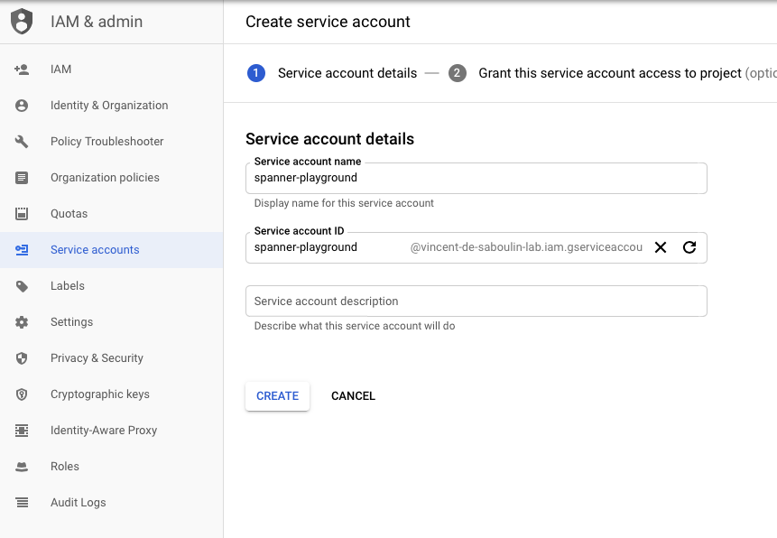
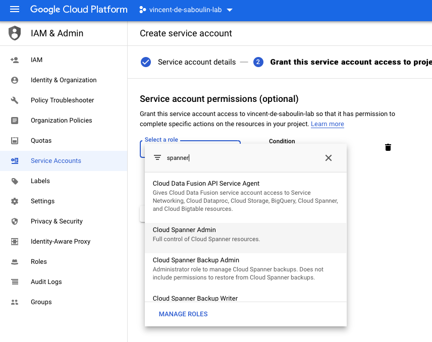
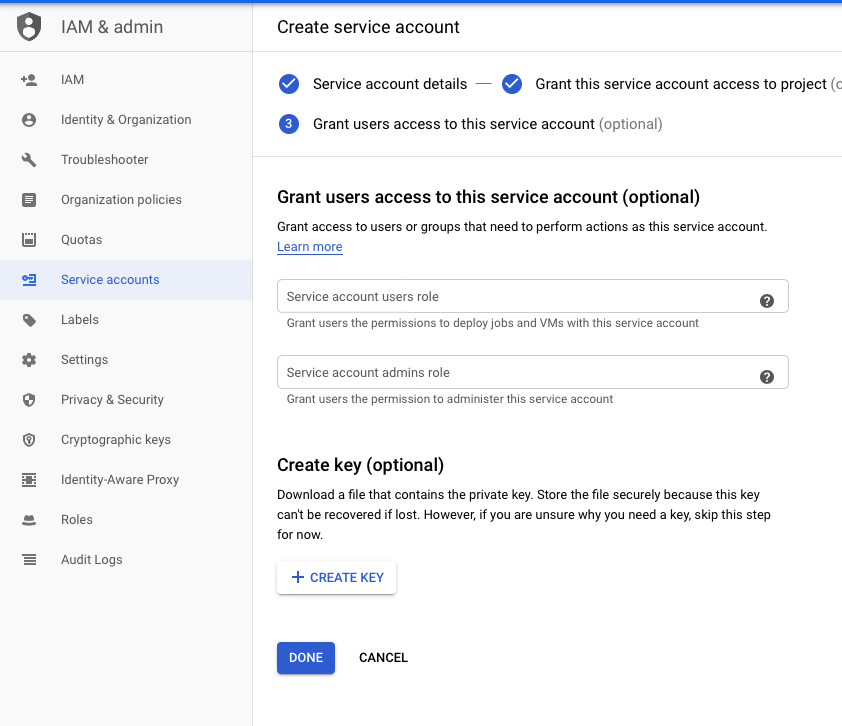

# GCP Spanner Sink connector

## Objective

Quickly test the [GCP Spanner Sink](https://docs.confluent.io/kafka-connectors/gcp-spanner/current/overview.html) connector.

## Prerequisites

* An active Google Cloud Platform (GCP) account with authorization to create resources
* A service account key file (see [GCP Spanner setup](#gcp-spanner-setup) below)

| Variable | Description |
| --- | --- |
| `GCP_PROJECT` | GCP project ID (required) |
| `GCP_KEYFILE_CONTENT` | Content of the service account key file, used when `keyfile.json` is not present in this folder |

`GCP_KEYFILE_CONTENT` can be generated with:

```bash
export GCP_KEYFILE_CONTENT=$(cat keyfile.json | jq -aRs . | sed 's/^"//' | sed 's/"$//')
```

The Spanner instance is created in region `europe-west2` by default; the script accepts another region as its first argument.

## How to run

```bash
playground run -f gcp-spanner-sink.sh
```

| Script | Description |
| --- | --- |
| `gcp-spanner-sink.sh` | Basic example |
| `gcp-spanner-sink-proxy.sh` | Same, through an nginx forward proxy (`gcp.spanner.proxy.url`); direct traffic to `spanner.googleapis.com` is blocked to make sure the proxy is used |

## What the script does

1. Authenticates `gcloud` with the service account key and (re)creates a Spanner instance and database named after your user.
2. Produces 3 Avro records (`name`, `price`, `quantity`) to topic `products`, one of them with `name` = `notebooks`.
3. Creates the `gcp-spanner-sink` connector with `auto.create=true` and `table.name.format=kafka_${topic}`.
4. Runs `select * from kafka_products` with `gcloud spanner databases execute-sql` and checks that `notebooks` is present.
5. Deletes the Spanner database and instance on exit.

## GCP Spanner setup

### Setup credentials

Create a `Service Account` from the IAM & Admin console.

Set `Service account name`:



Choose permission `Cloud Spanner` -> `Cloud Spanner Admin`:



Create a key:



Download it as JSON:


Rename it to `keyfile.json` and place it in this folder (`./keyfile.json`), or use the `GCP_KEYFILE_CONTENT` environment variable described above.
