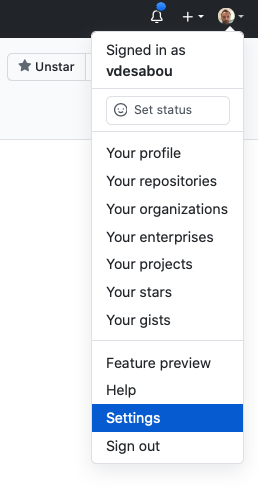
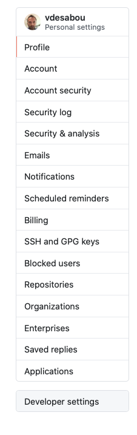
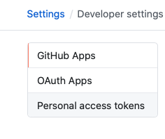
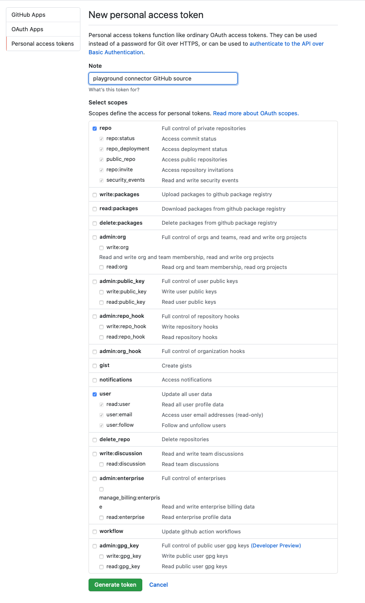

# Github Source connector

## Objective

Quickly test the [Github Source](https://docs.confluent.io/kafka-connectors/github/current/overview.html) connector.

## Prerequisites

| Variable | Description |
| --- | --- |
| `CONNECTOR_GITHUB_ACCESS_TOKEN` | GitHub personal access token (required, see below) |
| `CONNECTOR_GITHUB_REPOSITORIES` | Comma-separated list of repositories to monitor (default: `vdesabou/kafka-docker-playground`) |

```bash
export CONNECTOR_GITHUB_ACCESS_TOKEN=<your_personal_access_token>
export CONNECTOR_GITHUB_REPOSITORIES=confluentinc/examples,confluentinc/kafka-connect-github
```

### Create a personal access token

Go to your GitHub account and select `Settings`:



Click on `Developer Settings`:



Click on `Personal access tokens`:



Generate a new token with `repo` and `user` selected:



## How to run

```bash
playground run -f github-source.sh
```

| Script | Description |
| --- | --- |
| `github-source.sh` | Retrieves the `stargazers` resource of the configured repositories |

## What the script does

1. Starts the environment.
2. Creates the `github-source` connector with `github.resources=stargazers` (`github.tables` for connector versions before 2.0.0), `github.since=2019-01-01` and Avro converters, writing to `github-topic-${resourceName}`.
3. Verifies that records arrive in topic `github-topic-stargazers` with `playground topic consume`.
