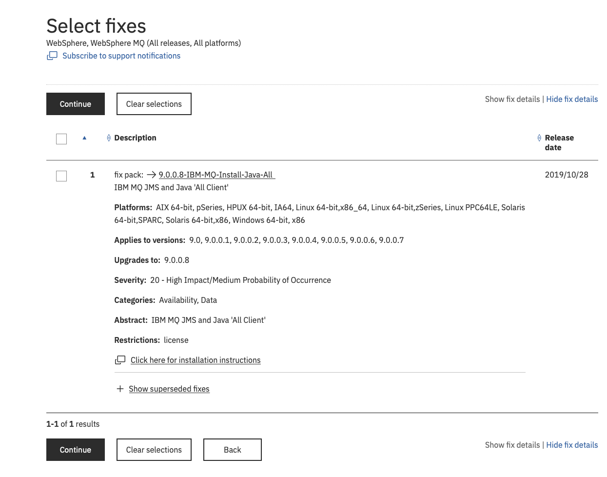

# IBM MQ Sink connector

## Objective

Quickly test the [IBM MQ Sink](https://docs.confluent.io/kafka-connectors/ibmmq-sink/current/overview.html) connector.

IBM MQ runs with the Docker [image](https://github.com/ibm-messaging/mq-container) `icr.io/ibm-messaging/mq`.

## Prerequisites

Download [IBM-MQ-Install-Java-All.jar](https://ibm.biz/mq92javaclient) (for example `9.3.4.0-IBM-MQ-Install-Java-All.jar`) and save it as `./IBM-MQ-Install-Java-All.jar` in this folder (it must be downloaded manually to accept the license agreement). The scripts extract `com.ibm.mq.allclient.jar` and `jms.jar` from it and add them to the connector `lib` folder.



N.B: if you're a Confluent employee, please check this [link](https://confluent.slack.com/archives/C0116NM415F/p1636391410032900).

With CP 8+, the minimum supported connector version is 2.1.16: older `--connector-tag` values are skipped (exit code 111).

## How to run

```bash
playground run -f ibm-mq-sink.sh
```

| Script | Description |
| --- | --- |
| `ibm-mq-sink.sh` | Basic example, user/password authentication |
| `ibm-mq-sink-ssl.sh` | TLS encryption on channel `DEV.APP.SVRCONN` (truststore only) |
| `ibm-mq-sink-mtls.sh` | TLS encryption + mutual TLS authentication (`SSLCAUTH(REQUIRED)`, keystore + truststore, no user/password) |
| `ibm-mq-sink-eos.sh` | Exactly-once delivery (`exactly.once.enabled=true`) using offsets queue `KAFKA.OFFSETS.QUEUE` |

## What the script does

1. Extracts the IBM MQ client jars from `IBM-MQ-Install-Java-All.jar` (first run only) and copies them to the connector.
2. For SSL/mTLS variants: generates certificates with `playground tools certs-create` and configures TLS on channel `DEV.APP.SVRCONN` (mTLS also sets `SSLCAUTH(REQUIRED)` and refreshes security).
3. For the EOS variant: creates the exclusive local queue `KAFKA.OFFSETS.QUEUE` and grants user `app` access to it.
4. Produces 1 message to topic `sink-messages`.
5. Creates the IBM MQ sink connector to queue `DEV.QUEUE.1` of queue manager `QM1`.
6. Verifies the message is in the queue with `amqsbcg`.
