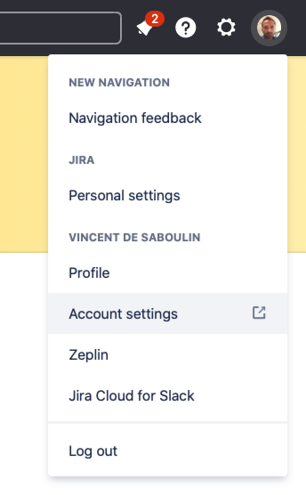
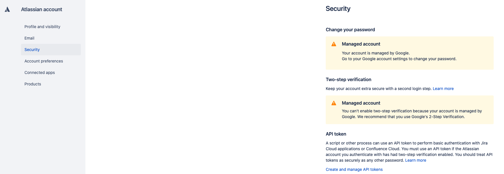
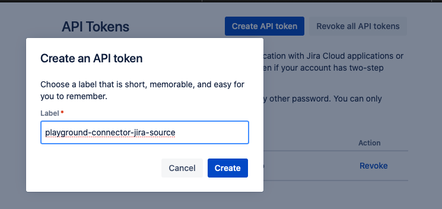

# Jira Source connector

## Objective

Quickly test the [Jira Source](https://docs.confluent.io/kafka-connectors/jira/current/overview.html) connector.

## Prerequisites

| Variable | Description |
| --- | --- |
| `JIRA_URL` | Jira instance URL (e.g. `https://<your-site>.atlassian.net`) |
| `JIRA_USERNAME` | Jira user (email address) |
| `JIRA_API_TOKEN` | API token of `JIRA_USERNAME` (see below) |

With CP 8.x, the Jira connector version must be 1.2.0 or later (the script exits with code 111 otherwise).

### Create an API token

If you need a developer account, create one [here](https://www.atlassian.com/try/cloud/signup?product=confluence.ondemand,jira-software.ondemand,jira-servicedesk.ondemand,jira-core.ondemand&developer=true).

Go to your Jira instance and select `Account Settings`:



Click on `Security` > `Create and manage API tokens`:



Create the API token:



## How to run

```bash
export JIRA_URL="https://<your-site>.atlassian.net"
export JIRA_USERNAME="<email>"
export JIRA_API_TOKEN="<api token>"
playground run -f jira-source.sh
```

| Script | Description |
| --- | --- |
| `jira-source.sh` | Jira source fetching issues since `2021-01-01 00:00` |

## What the script does

1. Starts the plaintext environment.
2. Creates the `jira-source` connector (`jira.resources=issues`, `jira.since=2021-01-01 00:00`, `topic.name.pattern=jira-topic-${resourceName}`, JSON converters).
3. Verifies that at least one record lands in topic `jira-topic-issues` with `playground topic consume`.
