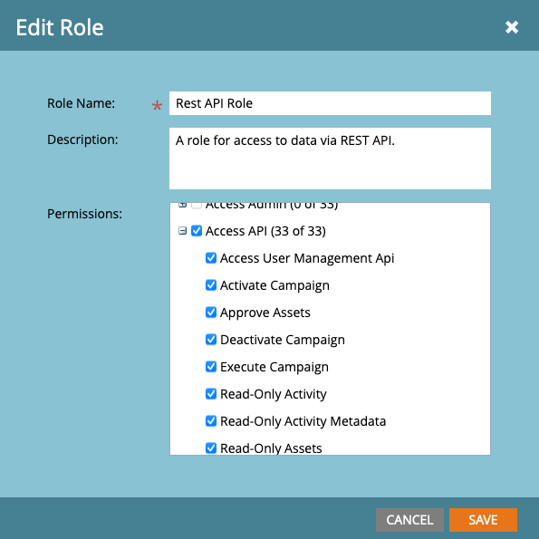
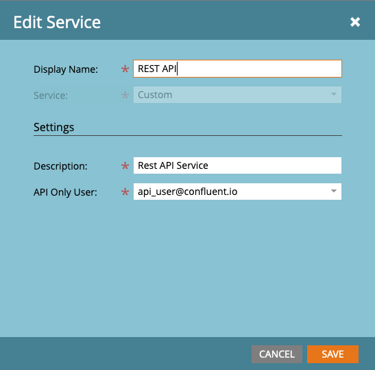
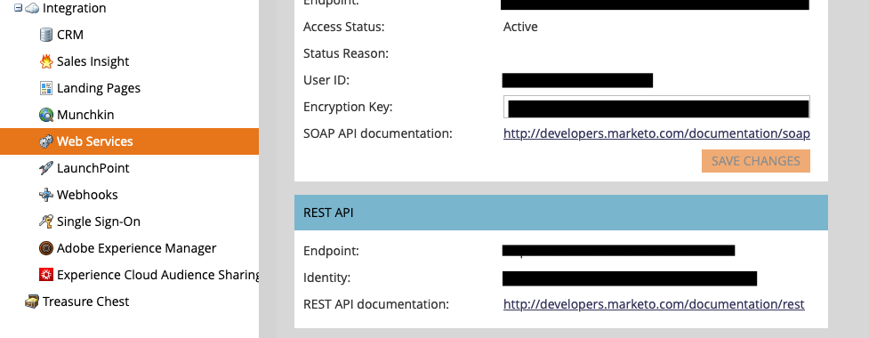

# Marketo Source connector

## Objective

Quickly test the [Marketo Source](https://docs.confluent.io/current/connect/kafka-connect-marketo/index.html) connector.

## Prerequisites

This is a preview connector, not supported with CP 8.0 and later (the script exits with code 111).

| Variable | Description |
| --- | --- |
| `MARKETO_ENDPOINT_URL` | Marketo REST API endpoint URL, without the trailing `/rest` (e.g. `https://<instance-id>.mktorest.com`) |
| `MARKETO_CLIENT_ID` | Client ID of the Marketo custom service |
| `MARKETO_CLIENT_SECRET` | Client secret of the Marketo custom service |

See [Marketo setup](#marketo-setup) below to get these values.

## How to run

```bash
export MARKETO_ENDPOINT_URL="https://<instance-id>.mktorest.com"
export MARKETO_CLIENT_ID="<client id>"
export MARKETO_CLIENT_SECRET="<client secret>"
playground run -f marketo-source.sh
```

| Script | Description |
| --- | --- |
| `marketo-source.sh` | Basic example |
| `marketo-source-proxy.sh` | Same, through an nginx forward proxy (`http.proxy.host`/`http.proxy.port`). Currently skipped (exit 111) as it does not work |

## What the script does

1. Downloads `jcl-over-slf4j-2.0.7.jar` and copies it into the `confluentinc-kafka-connect-marketo` plugin `lib` folder.
2. Gets an OAuth access token from `${MARKETO_ENDPOINT_URL}/identity/oauth/token` and creates 3 leads with the Marketo REST API.
3. Creates topic `marketo-leads`.
4. Creates the Marketo source connector `marketo-source` (`entity.names=leads`, `marketo.since` set to 8 days ago, `topic.name.pattern=marketo-${entityName}`).
5. Verifies that topic `marketo-leads` receives at least one lead with `playground topic consume`.

The proxy variant creates a single lead, blocks direct traffic from the `connect` container to Marketo (`playground debug block-traffic`) to make sure the proxy is used, and waits 10 minutes before checking topic `marketo_leads`, as leads are pulled with a delay of 5 minutes between consecutive pulls.

## Marketo setup

Go to your [Marketo portal](https://engage-ab.marketo.com) (there is no trial or free version available).

### Create REST API Role

Click on `Admin` -> `Security` -> `Users & Roles` and create a new role which has all `Access API` selected (the connector itself only requires read-only privileges):



### Create REST API User

Click on `Admin` -> `Security` -> `Users & Roles`, create a new user and associate it with the REST API role that you created in the previous step.

### Create custom service

A custom service is required to uniquely identify your client application. To create a custom application, go to the `Admin` -> `LaunchPoint` screen and create a new service. Provide the Display Name, choose the "Custom" service type, provide a Description, and the user email address created in the previous step.



Once created, click on `View Details` to get the values for `MARKETO_CLIENT_ID` and `MARKETO_CLIENT_SECRET`.

### Getting endpoint URL

The REST API endpoint URL (`MARKETO_ENDPOINT_URL`) can be found in the `Admin` -> `Web Services` menu.


