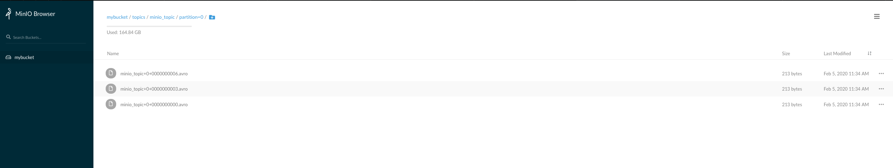

# S3 Sink connector with Minio

## Objective

Quickly test the [S3 Sink](https://docs.confluent.io/kafka-connectors/s3-sink/current/overview.html) connector with [Minio](https://min.io).

## Prerequisites

Not supported with the `cfk` environment. With CP 8.x, the minimum supported connector version is 10.6.0 (the script exits with code 111 otherwise).

## How to run

```bash
playground run -f minio-sink.sh
```

Minio UI is accessible at [http://127.0.0.1:9000](http://127.0.0.1:9000), using the access key and secret key from the [`credentials`](credentials) file (AWS documentation placeholder keys).

## What the script does

1. Starts the environment with a Minio container, and creates bucket `mybucket` (helper container `create-buckets`).
2. Creates the S3 sink connector `minio-sink` (`store.url=http://minio:9000`, Avro format, `flush.size=3`).
3. Produces 10 Avro records to topic `minio-topic` with `playground topic produce`.
4. Lists the objects of bucket `mybucket` (helper container `list-buckets`).
5. Copies one of the Avro files locally (helper container `copy-files`) and displays its content with `playground tools read-avro-file`.

After a few seconds, Minio should contain files in the bucket:



Example of listing:

```text
[2020-02-05 12:41:28 UTC]    213B topics/minio-topic/partition=0/minio-topic+0+0000000000.avro
[2020-02-05 12:41:28 UTC]    213B topics/minio-topic/partition=0/minio-topic+0+0000000003.avro
[2020-02-05 12:41:28 UTC]    213B topics/minio-topic/partition=0/minio-topic+0+0000000006.avro
```

Content of `minio-topic+0+0000000000.avro`:

```json
{"f1":"value1"}
{"f1":"value2"}
{"f1":"value3"}
```
