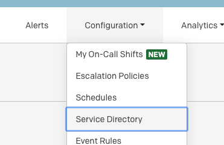
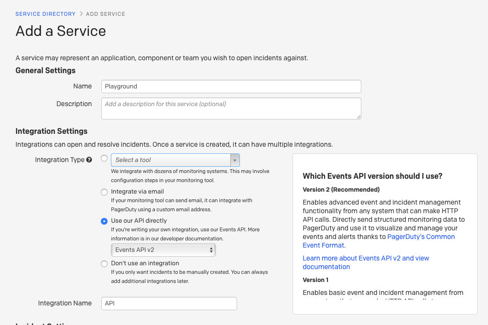
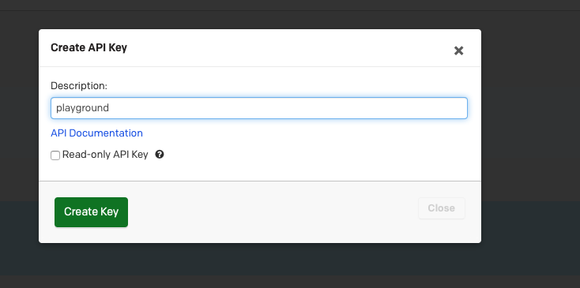
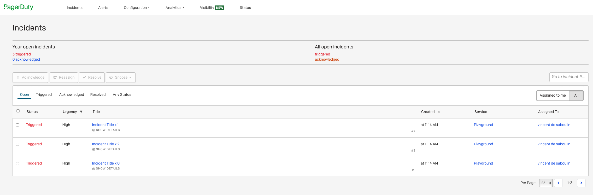

# PagerDuty Sink connector

## Objective

Quickly test the [PagerDuty Sink](https://docs.confluent.io/kafka-connectors/pagerduty-sink/current/overview.html) connector.

## Prerequisites

| Variable | Description |
| --- | --- |
| `PAGERDUTY_USER_EMAIL` | Email of your PagerDuty user (used as `fromEmail` of the incidents) |
| `PAGERDUTY_API_KEY` | PagerDuty API key |
| `PAGERDUTY_SERVICE_ID` | ID of the PagerDuty service where incidents are created (e.g. `PY7K7O3`) |

With CP 8.x, the minimum supported connector version is 1.0.0 (the script exits with code 111 otherwise).

### Register a trial account

Go to the [PagerDuty portal](https://www.pagerduty.com/sign-up/?type=team) and register an account.

### Get the service ID

Select `Configuration` -> `Service Directory`:



Click on `+New Service` and select `Use our API directly` as the integration type:



Get the service ID from the URL bar, for example `https://xxx.pagerduty.com/service-directory/PY7K7O3`.

### Get the PagerDuty API key

Select `Configuration` -> `API Access` and create a new API key:



## How to run

```bash
export PAGERDUTY_USER_EMAIL="<your email>"
export PAGERDUTY_API_KEY="<your api key>"
export PAGERDUTY_SERVICE_ID="<your service id>"
playground run -f pagerduty-sink.sh
```

| Script | Description |
| --- | --- |
| `pagerduty-sink.sh` | Basic example |
| `pagerduty-sink-proxy.sh` | Same, through a squid proxy with basic authentication (`pagerduty.proxy.url=http://squid:8888`) |

## What the script does

1. Starts the environment (with a squid proxy for the proxy variant).
2. Produces 3 Avro records (`fromEmail`, `serviceId`, `incidentTitle`) to topic `incidents` with `playground topic produce`.
3. Creates the PagerDuty sink connector `pagerduty-sink` (`behavior.on.error=fail`).
4. Verifies with the PagerDuty REST API (`GET https://api.pagerduty.com/incidents`) that the incidents were created.

The incidents are also visible in the PagerDuty UI:


