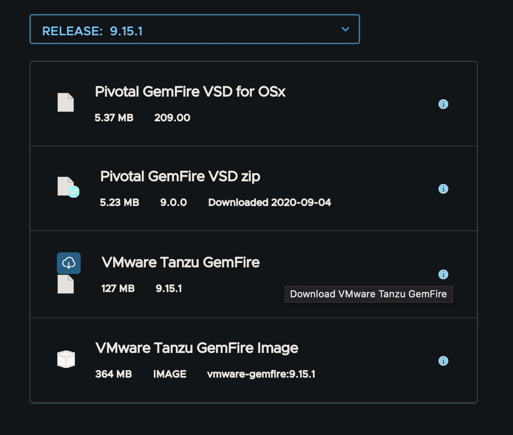
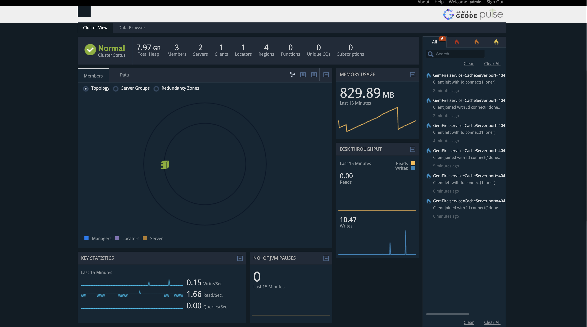

# Pivotal Gemfire sink connector

## Objective

Quickly test the [Pivotal Gemfire sink](https://docs.confluent.io/current/connect/kafka-connect-pivotal-gemfire/index.html) connector.

## Prerequisites

Create an account [here](https://account.run.pivotal.io/z/uaa/sign-up) and download from [here](https://network.pivotal.io/products/pivotal-gemfire#/releases/692529) `[Pivotal GemFire Tar]` version `9.15.1`, then rename it to `pivotal-gemfire.tgz` and put it into the `docker-pivotal-gemfire` directory. It is only needed the first time, to build the `pivotal-gemfire:latest` image.



If you're a Confluent employee, the file is downloaded automatically from the playground S3 bucket when AWS credentials are set (see this [link](https://confluent.slack.com/archives/C0116NM415F/p1636391410032900)).

With CP 8.x, the minimum supported connector version is 1.0.0 (the script exits with code 111 otherwise).

## How to run

```bash
playground run -f pivotal-gemfire-sink.sh
```

The Pulse UI is reachable at [http://127.0.0.1:7070](http://127.0.0.1:7070) (`admin`/`admin`):



## What the script does

1. Builds the `pivotal-gemfire:latest` docker image (first run only) and starts the environment.
2. Starts a GemFire locator and two servers, and waits until the cluster has 3 members.
3. Creates the Pivotal Gemfire sink connector `pivotal-gemfire-sink` (locator `pivotal-gemfire:10334`, region `exampleRegion`).
4. Produces 10 Avro records to topic `input-topic` with `playground topic produce`.
5. Verifies with `gfsh` (`query --query="select * from /exampleRegion"`) that the records are in the region.

Example of result:

```text
Cluster-1 gfsh>query --query="select * from /exampleRegion"
Result : true
Limit  : 100
Rows   : 10

Result
---------------
{"f1":"value1"}
{"f1":"value2"}
{"f1":"value3"}
...
```
