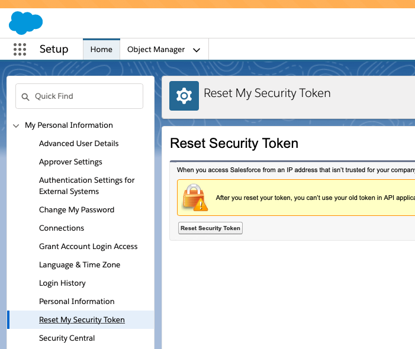

# Salesforce Bulk API Source connector

## Objective

Quickly test the [Salesforce Bulk API Source](https://docs.confluent.io/current/connect/kafka-connect-salesforce-bulk-api/source/index.html) connector.

## Prerequisites

* A Salesforce account (see [Register a test account](#register-a-test-account)).
* An External Client App with the JWT Bearer flow enabled (see [OAuth with JWT Bearer Flow](#oauth-with-jwt-bearer-flow)). It is always used by the sfdx CLI, and also by the connector for versions that support `JWT_BEARER` (3.0.15 to 3.0.x, and later than 3.1.8). Older versions authenticate with username, password and security token.
* `salesforce-confluent.keystore.jks` (password `confluent`) in this folder. If it is missing, the script tries to download it from the playground S3 bucket (Confluent employees only, with AWS credentials set).
* With CP 8.x, connector version 2.0.29 or later (the script exits with code 111 otherwise).

| Variable | Description |
| --- | --- |
| `SALESFORCE_USERNAME` | Salesforce username |
| `SALESFORCE_PASSWORD` | Salesforce password |
| `SALESFORCE_SECURITY_TOKEN` | Salesforce security token (see screenshot below) |
| `SALESFORCE_CONSUMER_KEY_WITH_JWT` | Consumer key of the External Client App with JWT Bearer flow enabled |
| `SALESFORCE_INSTANCE` | Optional, defaults to `https://login.salesforce.com` |

`salesforce-bulkapi-source.sh` also accepts test-specific overrides suffixed with `_KDP_BULKAPI_SOURCE` (e.g. `SALESFORCE_USERNAME_KDP_BULKAPI_SOURCE`), which take precedence over the shared variables when set.

The security token can be reset from `Setup` -> `My Personal Information` -> `Reset My Security Token`:



## How to run

```bash
playground run -f salesforce-bulkapi-source.sh
```

| Script | Description |
| --- | --- |
| `salesforce-bulkapi-source.sh` | Basic example |
| `salesforce-bulkapi-source-proxy.sh` | Same, through an nginx forward proxy (`http.proxy=nginx-proxy:8888`); direct traffic from `connect` to Salesforce is blocked to make sure the proxy is used |

## What the script does

1. Picks the authentication grant (`JWT_BEARER` or `PASSWORD`) from the connector version, and starts the environment with an `sfdx-cli` container.
2. Logs in with the sfdx CLI (JWT) and creates a random Lead in Salesforce.
3. Creates the Salesforce Bulk API source connector `salesforce-bulkapi-source` (object `Lead`, topic `sfdc-bulkapi-leads`, JSON converter), and checks that its task is running.
4. Verifies that topic `sfdc-bulkapi-leads` receives the Lead with `playground topic consume`.
5. Deletes the Lead created by the test on exit.

## Register a test account

Go to [Salesforce developer portal](https://developer.salesforce.com/signup/) and register an account.

## OAuth with JWT Bearer Flow

Follow the instructions from [here](../connect-salesforce-cdc-source/README.md#oauth-with-jwt-bearer-flow) to create the External Client App with the JWT Bearer flow.
