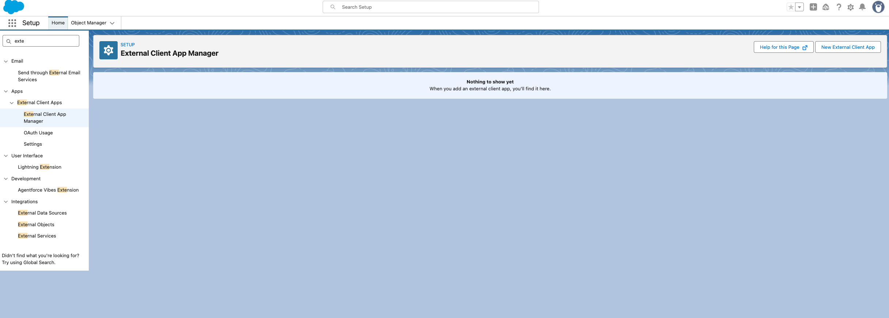
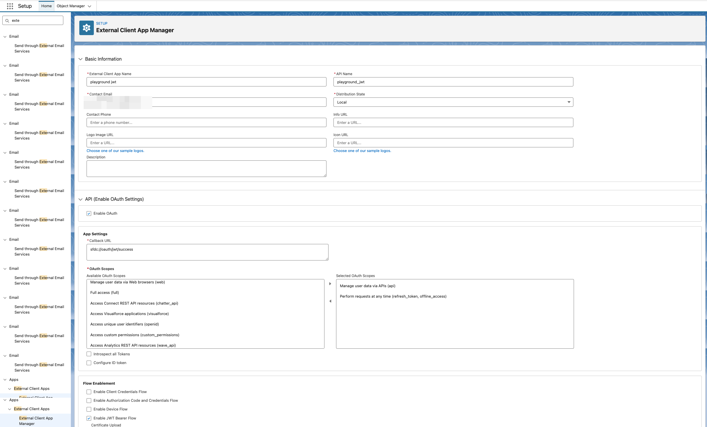
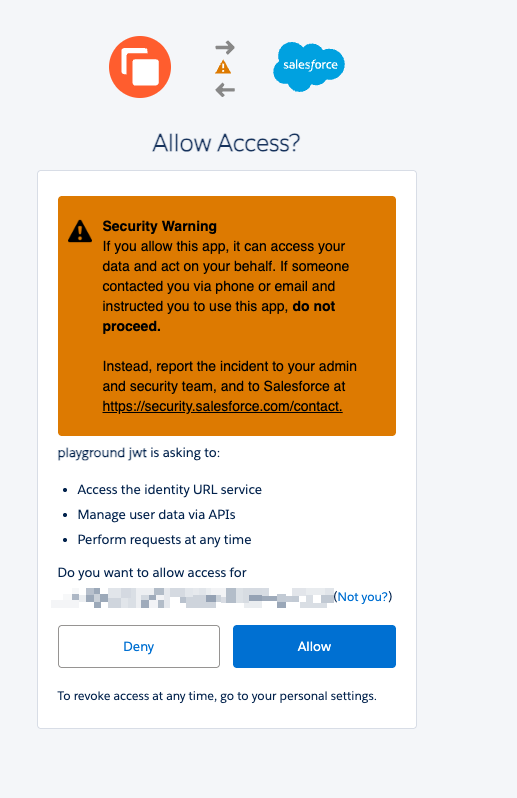
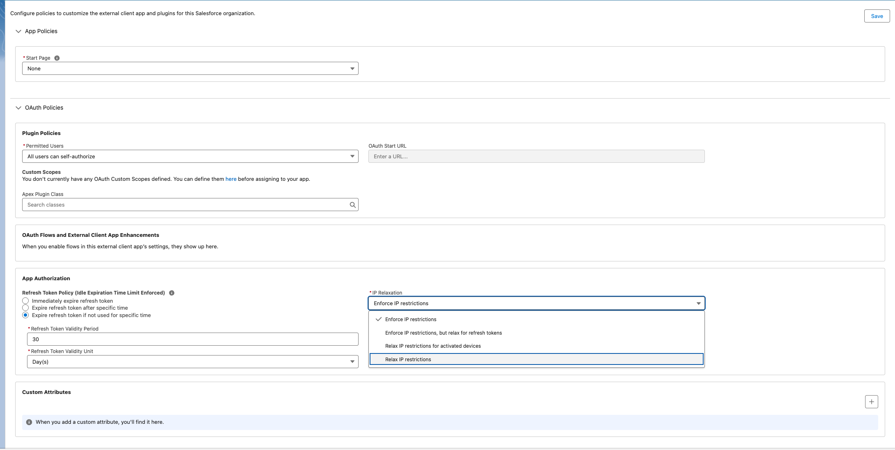
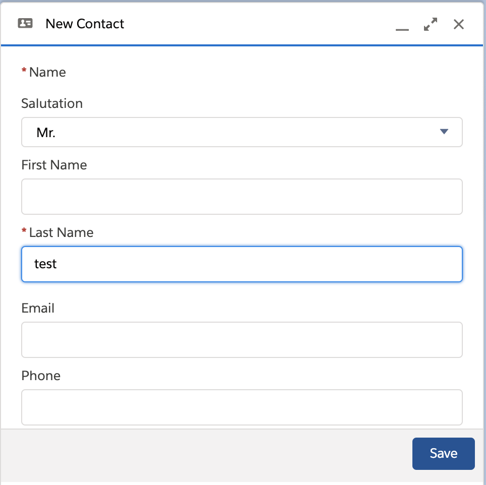

# Salesforce CDC Source connector

## Objective

Quickly test the [Salesforce CDC Source](https://docs.confluent.io/current/connect/kafka-connect-salesforce/change-data-capture/index.html#salesforce-cdc-source-connector-for-cp) connector.

The connector authenticates with the OAuth JWT Bearer flow (`salesforce.grant.type=JWT_BEARER`).

## Prerequisites

* A Salesforce account (see [Register a test account](#register-a-test-account))
* An External Client App with the JWT Bearer flow enabled, and Change Data Capture enabled for `Contact`: `playground salesforce setup` does both (see [Automated setup](#automated-setup)), or follow [OAuth with JWT Bearer Flow](#oauth-with-jwt-bearer-flow) and [Enable Change Data Capture](#enable-change-data-capture)
* CP 6.0.0 or later (the keystore was created with JDK 11). With CP 8.x, connector version 2.0.29 or later.
* `salesforce-confluent.keystore.jks` (password `confluent`) in this folder. If it is missing, the script tries to download it from the playground S3 bucket (Confluent employees only, with AWS credentials set).

| Variable | Description |
| --- | --- |
| `SALESFORCE_USERNAME` | Salesforce username |
| `SALESFORCE_PASSWORD` | Salesforce password |
| `SALESFORCE_SECURITY_TOKEN` | Salesforce security token |
| `SALESFORCE_CONSUMER_KEY_WITH_JWT` | Consumer key of the External Client App with JWT Bearer flow enabled |
| `SALESFORCE_INSTANCE` | Optional, defaults to `https://login.salesforce.com` |

`salesforce-cdc-source.sh` also accepts test-specific overrides suffixed with `_KDP_CDC` (e.g. `SALESFORCE_USERNAME_KDP_CDC`), which take precedence over the shared variables when set.

## How to run

```bash
playground run -f salesforce-cdc-source.sh
```

| Script | Description |
| --- | --- |
| `salesforce-cdc-source.sh` | Basic example |
| `salesforce-cdc-source-proxy.sh` | Same, through an nginx forward proxy (`http.proxy=nginx-proxy:8888`); direct traffic from `connect` to Salesforce is blocked to make sure the proxy is used |

## What the script does

1. Starts the environment with an `sfdx-cli` container and the keystore mounted in `connect`.
2. Creates the Salesforce CDC Source connector on channel `ContactChangeEvent`, writing to topic `sfdc-cdc-contacts` (JSON converter), and waits for the subscription.
3. Logs in with the sfdx CLI (JWT) and creates a random Contact in Salesforce.
4. Verifies the change event is received with `playground topic consume --topic sfdc-cdc-contacts`.
5. Deletes the Contact created by the test on exit.

## Automated setup

Once you have an account (see [Register a test account](#register-a-test-account)), one command configures it for all the Salesforce examples. It needs the [Salesforce CLI](https://developer.salesforce.com/tools/salesforcecli) (`sf`) on your machine:

```bash
playground salesforce setup
```

1. Opens the browser once to log in (`sf org login web`). Pass `--target-org <alias>` to use an org `sf` is already logged into.
2. Deploys an External Client App `kdp_jwt` with the JWT Bearer flow and the certificate of `salesforce-confluent.keystore.jks`, pre-authorized for the profile of your user (no browser approval) and with IP restrictions relaxed, the Platform Event `MyPlatformEvent__e` with the text field `Message__c`, and Change Data Capture on `Contact`. Running it again on the same org changes nothing.
3. Reads the consumer key back, waits until a JWT Bearer login works (a new app takes 2 to 10 minutes to be active), and stores `SALESFORCE_USERNAME`, `SALESFORCE_INSTANCE` and `SALESFORCE_CONSUMER_KEY_WITH_JWT` with `playground secrets set`.

`SALESFORCE_PASSWORD` and `SALESFORCE_SECURITY_TOKEN` can't be read from Salesforce: store them with `playground secrets set SALESFORCE_PASSWORD` and `playground secrets set SALESFORCE_SECURITY_TOKEN` (see [Find your security token](#find-your-security-token)).

| Flag | Use |
| --- | --- |
| `--account2` | the second org of the sink examples (`SALESFORCE_*_ACCOUNT2`) |
| `--suffix KDP_CDC` | per-test variables (`SALESFORCE_USERNAME_KDP_CDC`…) |
| `--instance-url https://test.salesforce.com` | a sandbox |
| `--generate-keystore` | create a new key pair when `salesforce-confluent.keystore.jks` is missing (copied into every Salesforce example folder) |
| `--dry-run` | only render the metadata in `/tmp/playground-salesforce-setup` |
| `--no-store` | print the values instead of storing them |

Then, at any time, `playground salesforce check` (same `--suffix` / `--account2`) logs in with the JWT Bearer flow exactly like the connector, explains a rejection, and checks that `MyPlatformEvent__e` and Change Data Capture on `Contact` are there. It needs neither Docker nor `sf`.

The manual steps below do the same by hand.

## Register a test account

Go to [Salesforce developer portal](https://developer.salesforce.com/signup/) and register an account.

## OAuth with JWT Bearer Flow

### Generate a private key and a certificate

The private key is used by the external app to sign the JWT, and the digital certificate is used by Salesforce to validate the signature and issue an access token.

For example:

```bash
keytool -genkeypair -noprompt \
  -alias salesforce-confluent \
  -dname "CN=ca1.test.confluent.io, OU=TEST, O=CONFLUENT, L=PaloAlto, ST=Ca, C=US" \
  -keystore salesforce-confluent.p12 \
  -storetype PKCS12 \
  -keyalg RSA \
  -keysize 2048 \
  -validity 3650 \
  -storepass confluent \
  -keypass confluent

keytool -exportcert -rfc \
  -keystore salesforce-confluent.p12 \
  -storetype PKCS12 \
  -alias salesforce-confluent \
  -file salesforce-confluent.crt \
  -storepass confluent

keytool -importkeystore \
  -srckeystore salesforce-confluent.p12 \
  -srcstoretype PKCS12 \
  -srcstorepass confluent \
  -destkeystore salesforce-confluent.keystore.jks \
  -deststoretype PKCS12 \
  -deststorepass confluent \
  -noprompt
```

### Create a new External Client App

* Select the gear icon in the upper right hand corner and choose *Setup*.
* Enter App in the Quick Find search box, and choose *External Client App Manager* in the filtered results.
* Click the *New External Client App* button in the upper right corner of the Setup panel.



* Supply a Connected App Name, API Name, and Contact Email. Distribution State can be set to Local. The API Name is automatically populated based on the Connected App Name.
* Select *API (Enable OAuth Settings)* menu and click on *Enable OAuth* checkbox.
* Set the callback URL to `sfdc://oauth/jwt/success`.
* Selected OAuth Scopes: `Manage user data via APIs (api)` + `Perform requests at any time (refresh_token, offline_access)`.
* Select the *Enable JWT Bearer Flow* checkbox in *Flow Enablement* section.
* Upload the digital certificate created in the previous step (`salesforce-confluent.crt` file).

Example:



* Save the External Client App, it takes between 2 and 10 minutes to be activated.
* Look for the Consumer Key (`SALESFORCE_CONSUMER_KEY_WITH_JWT`) in the *Settings* / *OAuth Section* / *App Settings* / *Consumer Key and Secret* section.

### Pre-approve the External Client App with the User-Agent OAuth flow

One way to pre-approve the External Client App is by using another simple OAuth flow, the User-Agent OAuth flow.

With your environment variables set, run:

```bash
echo "$SALESFORCE_INSTANCE/services/oauth2/authorize?response_type=token&client_id=$SALESFORCE_CONSUMER_KEY_WITH_JWT&redirect_uri=sfdc://oauth/jwt/success"
```

Open this link in a browser, log in to Salesforce and authorize the External Client App.



### Relax IP restrictions

Go to *External Client App Manager* and relax IP restrictions:



## Find your security token

Find your security token (emailed to you from Salesforce.com). To reset it, select *Settings* -> *My Personal Information* -> *Reset My Security Token* and follow the instructions.


## Enable Change Data Capture

Search for *Change Data Capture* in Setup and select `Contact`:



## Troubleshooting

* If authentication fails, check the logs in Salesforce: *Setup* -> *Login History* and look for the error message.
