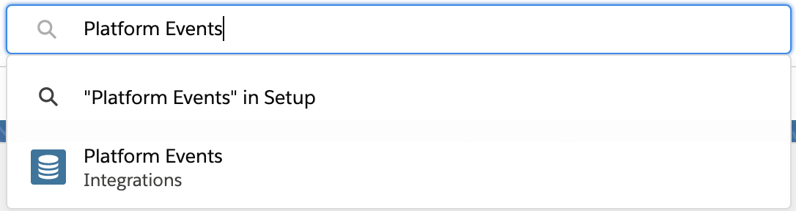
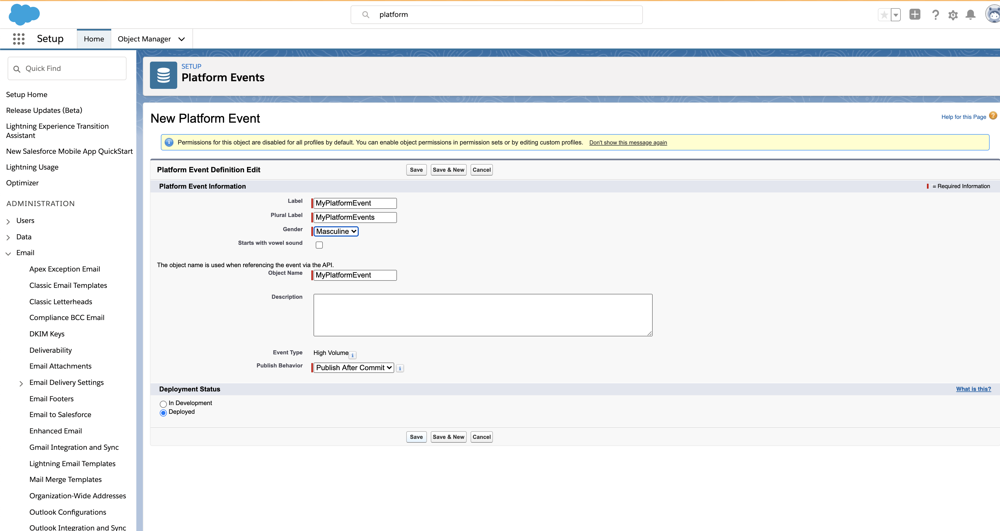

# Salesforce Platform Events Sink connector

## Objective

Quickly test the [Salesforce Platform Events Sink](https://docs.confluent.io/current/connect/kafka-connect-salesforce/platformevents_sink/index.html#salesforce-platform-events-sink-connector-for-cp) connector.

The connectors authenticate with the OAuth JWT Bearer flow (`salesforce.grant.type=JWT_BEARER`).

## Prerequisites

* A Salesforce account: go to [Salesforce developer portal](https://developer.salesforce.com/signup/) and register an account.
* An External Client App with the JWT Bearer flow: follow [these instructions](https://github.com/vdesabou/kafka-docker-playground/tree/master/connect/connect-salesforce-cdc-source#oauth-with-jwt-bearer-flow).
* A Platform Event `MyPlatformEvent__e` with a text field `Message__c` (see [Create a Platform Event](#create-a-platform-event-in-salesforce)).
* With CP 8.x, connector version 2.0.29 or later.
* `salesforce-confluent.keystore.jks` (password `confluent`) in this folder. If it is missing, the script tries to download it from the playground S3 bucket (Confluent employees only, with AWS credentials set).

| Variable | Description |
| --- | --- |
| `SALESFORCE_USERNAME` | Salesforce username |
| `SALESFORCE_PASSWORD` | Salesforce password |
| `SALESFORCE_SECURITY_TOKEN` | Salesforce security token (see [Find your security token](#find-your-security-token)) |
| `SALESFORCE_CONSUMER_KEY_WITH_JWT` | Consumer key of the External Client App with JWT Bearer flow enabled |
| `SALESFORCE_INSTANCE` | Optional, defaults to `https://login.salesforce.com` |

`salesforce-platform-events-sink.sh` also accepts test-specific overrides suffixed with `_KDP_PE_SINK` (e.g. `SALESFORCE_USERNAME_KDP_PE_SINK`), which take precedence over the shared variables when set.

## How to run

```bash
playground run -f salesforce-platform-events-sink.sh
```

| Script | Description |
| --- | --- |
| `salesforce-platform-events-sink.sh` | Basic example |
| `salesforce-platform-events-sink-proxy.sh` | Same, through an nginx forward proxy (`http.proxy=nginx-proxy:8888`); direct traffic from `connect` to Salesforce is blocked |
| `salesforce-platform-events-sink-proxy-basic-auth.sh` | Same, through a squid proxy with basic authentication (`squid:8888`, user `admin`) |

## What the script does

1. Creates a Salesforce Platform Events Source connector on `MyPlatformEvent__e`, writing to topic `sfdc-platform-events`.
2. Logs in with the sfdx CLI (JWT) and publishes 2 platform events with `event.apex`.
3. Verifies the events are received in `sfdc-platform-events`, then pauses the source connector (to avoid a publish loop).
4. Creates the Salesforce Platform Events Sink connector reading `sfdc-platform-events` and publishing back to `MyPlatformEvent__e`, with a `MaskField` SMT on `Message__c`.
5. Verifies 2 records in the `success-responses` reporter topic and that `error-responses` is empty.

## Find your security token

Find your security token (emailed to you from Salesforce.com). To reset it, select *Settings* -> *My Personal Information* -> *Reset My Security Token* and follow the instructions.


## Create a Platform Event in Salesforce

In Setup, search for *Platform Events*:



Create a new Platform Event called *MyPlatformEvent*:



Add a text field *Message*:


## Send a Platform Event manually (optional)

The script publishes the events automatically. To do it by hand, select *Developer Console* in the upper right menu:


Then choose *Debug* -> *Open Execute Anonymous Window*:


and execute the content of [event.apex](event.apex).
