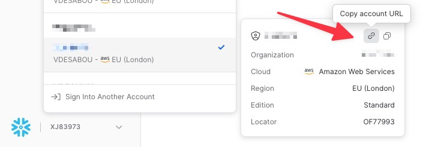

# Snowflake Sink connector

## Objective

Quickly test the [Snowflake Sink](https://docs.snowflake.com/en/user-guide/kafka-connector.html) connector.

## Prerequisites

* A Snowflake account (see [Register a trial account](#register-a-trial-account)). The user must be able to use the `SECURITYADMIN`, `SYSADMIN` and `USERADMIN` roles.
* The Iceberg variants require Snowflake **Enterprise Edition** (select it when signing up for a trial).

| Variable | Description |
| --- | --- |
| `SNOWFLAKE_ACCOUNT_NAME` | Account identifier, `<account_locator>.<region_id>.<cloud_provider>` (e.g. `XXXXX.eu-west-3.aws`) |
| `SNOWFLAKE_USERNAME` | Snowflake admin username |
| `SNOWFLAKE_PASSWORD` | Snowflake admin password |

For `snowflake-sink-snowpipe-streaming-iceberg-ext-volume.sh` only:

| Variable | Description |
| --- | --- |
| `AWS_ACCESS_KEY_ID` / `AWS_SECRET_ACCESS_KEY` | AWS credentials; if not set, `~/.aws/credentials` and `~/.aws/config` are used |
| `AWS_REGION` | Optional, defaults to `us-east-1` |
| `S3_BUCKET_NAME` | Optional, defaults to `playground-iceberg-<username>` |
| `AWS_ACCOUNT_ID` | Optional, derived with `aws sts get-caller-identity` |

## How to run

```bash
export SNOWFLAKE_ACCOUNT_NAME="XXXXX.eu-west-3.aws"
export SNOWFLAKE_USERNAME="<username>"
export SNOWFLAKE_PASSWORD="<password>"
playground run -f snowflake-sink.sh
```

| Script | Description |
| --- | --- |
| `snowflake-sink.sh` | Basic example (Snowpipe for connector < 4.0, `SnowflakeStreamingSinkConnector` with Snowpipe Streaming for 4.0+) |
| `snowflake-sink-proxy.sh` | Same, through a squid proxy (`jvm.proxy.host=squid`, `jvm.proxy.port=3128`) |
| `snowflake-sink-snowpipe-streaming.sh` | Snowpipe Streaming (`snowflake.ingestion.method=SNOWPIPE_STREAMING`) with schematization |
| `snowflake-sink-snowpipe-streaming-iceberg.sh` | Snowpipe Streaming into a Snowflake-managed Iceberg table (`snowflake.streaming.iceberg.enabled=true`, account default external volume) |
| `snowflake-sink-snowpipe-streaming-iceberg-ext-volume.sh` | Snowpipe Streaming into an Iceberg table stored in an S3 bucket through an external volume (creates the S3 bucket and an IAM role for Snowflake) |

## What the script does

1. Generates an encrypted RSA key pair (`snowflake_key.p8`, passphrase `confluent`) for key-pair authentication.
2. With `snowsql`, creates a database, a role, a warehouse and a user (names unique per script and environment), with the public key assigned to the user. The Iceberg variants also create the Iceberg table `TEST_TABLE` (and, for `-ext-volume`, the S3 bucket, IAM role and external volume).
3. Produces Avro records (`u_name`, `u_price`, `u_quantity`) to topic `test_table`.
4. Creates the Snowflake Sink connector authenticating with the private key.
5. Polls `SELECT * FROM <db>.PUBLIC.TEST_TABLE` with `snowsql` until rows are found (`SNOWFLAKE_CHECK_MAX_ATTEMPTS`, default 24, every `SNOWFLAKE_CHECK_SLEEP_SECONDS`, default 5).

Expected result with Snowpipe (classic):

```
+--------------------------------+--------------------------+
| RECORD_METADATA                | RECORD_CONTENT           |
|--------------------------------+--------------------------|
| {                              | {                        |
|   "CreateTime": 1586360912100, |   "u_name": "scissors",  |
|   "offset": 0,                 |   "u_price": 2.75,       |
|   "partition": 0,              |   "u_quantity": 3        |
|   "topic": "test_table"        | }                        |
| }                              |                          |
+--------------------------------+--------------------------+
```

## Register a trial account

Go to [Snowflake](https://www.snowflake.com) and register an account. You'll receive an email to set up your account and access a 30-day trial instance.

To get the `SNOWFLAKE_ACCOUNT_NAME`, get the *Account Locator* from:



`SNOWFLAKE_ACCOUNT_NAME` should be set with `<account_locator>.<region_id>.<cloud_provider>` (for example `XXXXX.eu-west-3.aws`).
