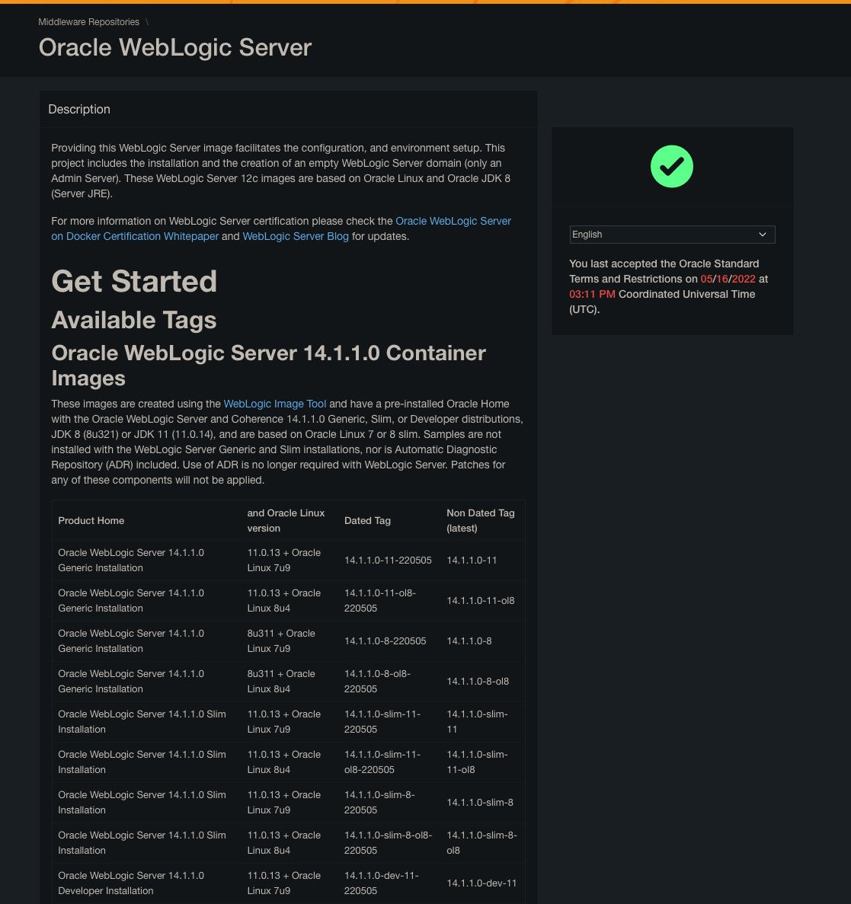
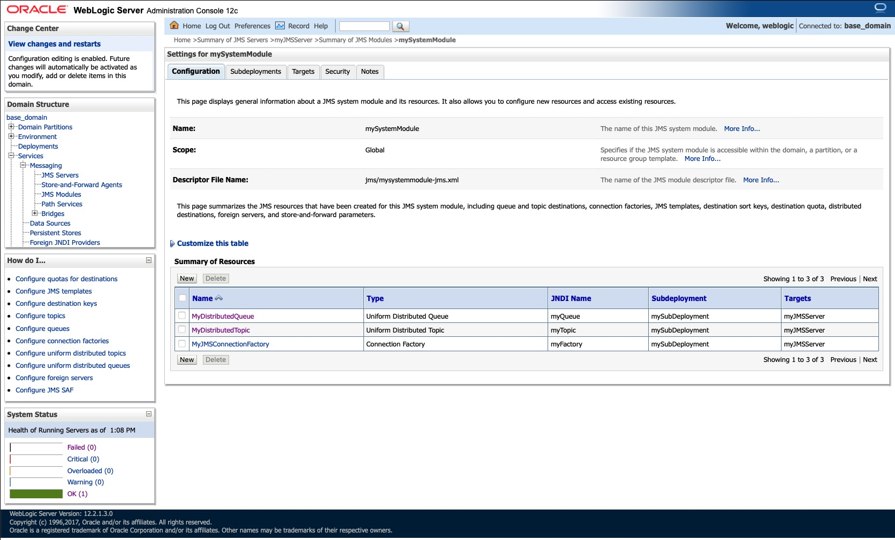

# Oracle Weblogic Source connector

## Objective

Quickly test the [Oracle Weblogic Source](https://docs.confluent.io/kafka-connect-weblogic-source/current/index.html) connector.

Uses the Oracle WebLogic Server (Developer Tier, version `12.2.1.3`) Docker image from [Oracle Container Registry](https://container-registry.oracle.com).

## Prerequisites

* CP 7.x or earlier: preview connectors are no longer supported with CP 8.0 (the scripts exit with code 111).
* The image `container-registry.oracle.com/middleware/weblogic:12.2.1.3`. You need to register on [Oracle Container Registry](https://container-registry.oracle.com) and acknowledge the license terms and conditions to get it:



If the image is not present locally, the scripts log in and pull it when these variables are set (otherwise you must pull the image yourself):

| Variable | Description |
| --- | --- |
| `ORACLE_CONTAINER_REGISTRY_USERNAME` | Oracle Container Registry username |
| `ORACLE_CONTAINER_REGISTRY_PASSWORD` | Oracle Container Registry password |

## How to run

```bash
playground run -f weblogic-queue.sh
```

| Script | Description |
| --- | --- |
| `weblogic-queue.sh` | Reads from the JMS queue `MyDistributedQueue` |
| `weblogic-topic.sh` | Reads from the JMS topic `MyDistributedTopic` with a durable subscription (`jms.subscription.name=sub1`) |

The WebLogic console is reachable at [http://127.0.0.1:7001/console](http://127.0.0.1:7001/console) (`weblogic`/`welcome1`). You can use it to see all JMS resources:



## What the script does

1. Builds the `weblogic-jms:latest` image with JMS resources configured (first run only, it can take a while), extracts `weblogic.jar` and `wlthint3client.jar` from it, and builds the `jms-sender` Java tool with Maven in Docker.
2. Copies `wlthint3client.jar` into the connector `lib` folder and starts the environment.
3. Creates the Weblogic Source connector (`t3://weblogic-jms:7001`, connection factory `myFactory`), writing to topic `from-weblogic-messages`.
4. Sends one message with the `jms-sender` container.
5. Verifies the message with `playground topic consume --topic from-weblogic-messages`.

Example record (queue):

```
Struct{messageID=ID:<576249.1618314788338.0>,messageType=text,timestamp=1618314788338,deliveryMode=2,destination=Struct{destinationType=queue,name=mySystemModule!myJMSServer@MyDistributedQueue},redelivered=false,expiration=0,priority=4,properties={JMS_BEA_DeliveryTime=Struct{propertyType=long,long=1618314788338}, JMSXDeliveryCount=Struct{propertyType=integer,integer=1}},text=Hello Queue World!}
```
