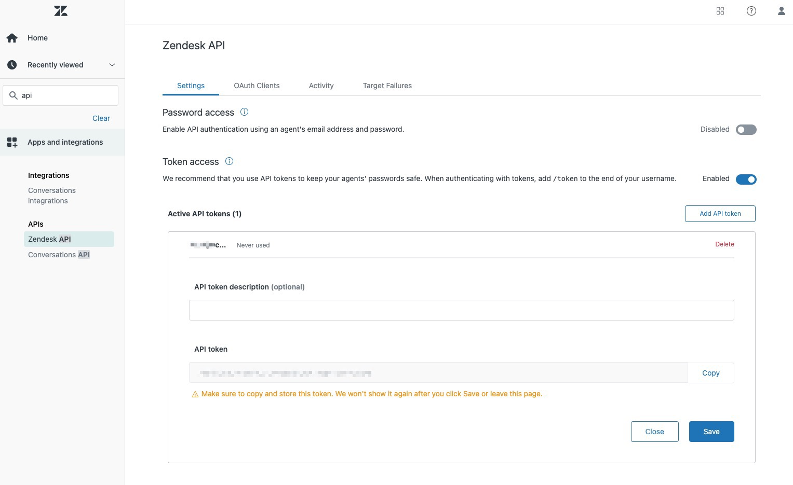

# Zendesk Source connector

## Objective

Quickly test the [Zendesk Source](https://docs.confluent.io/kafka-connectors/zendesk/current/overview.html) connector.

## Prerequisites

* A Zendesk account with an API token (see [Create an API token](#create-an-api-token)).
* With CP 8.x, connector version 1.3.0 or later.

| Variable | Description |
| --- | --- |
| `ZENDESK_URL` | Zendesk URL (e.g. `https://<subdomain>.zendesk.com`) |
| `ZENDESK_USERNAME` | `<email>/token` (e.g. `foo@gmail.com/token`) |
| `ZENDESK_PASSWORD` | Zendesk API token |

## How to run

```bash
export ZENDESK_URL="https://<subdomain>.zendesk.com"
export ZENDESK_USERNAME="foo@gmail.com/token"
export ZENDESK_PASSWORD="<api token>"
playground run -f zendesk-source-organizations.sh
```

## What the script does

1. Creates the Zendesk Source connector with basic authentication on table `organizations` (`zendesk.since=2020-09-05`), writing to topic `zendesk-topic-organizations` (`topic.name.pattern=zendesk-topic-${entityName}`, schemaless JSON).
2. Verifies at least one record with `playground topic consume --topic zendesk-topic-organizations`.

## Admin account

To get `tickets`, you need to be an `Admin` (it doesn't work with the `Agent` role), as the connector uses [Incremental Ticket Export](https://developer.zendesk.com/api-reference/ticketing/ticket-management/incremental_exports/#allowed-for-2). This is why this example uses `organizations`.

## Create an API token

In your Zendesk account, create a token (if you're only an agent, ask an admin):


