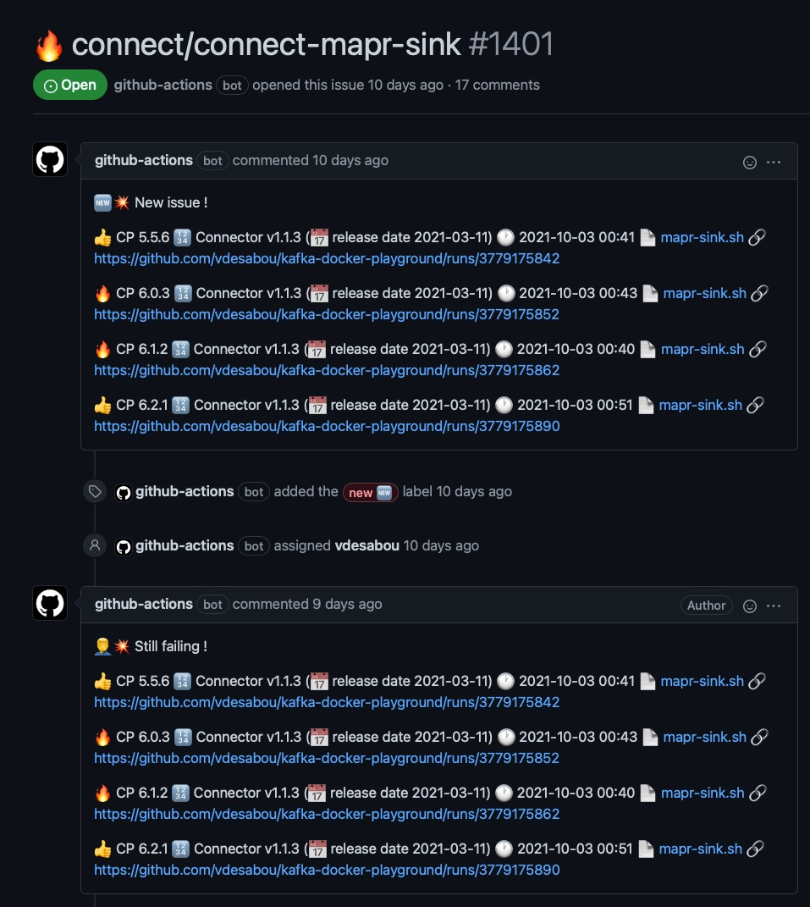
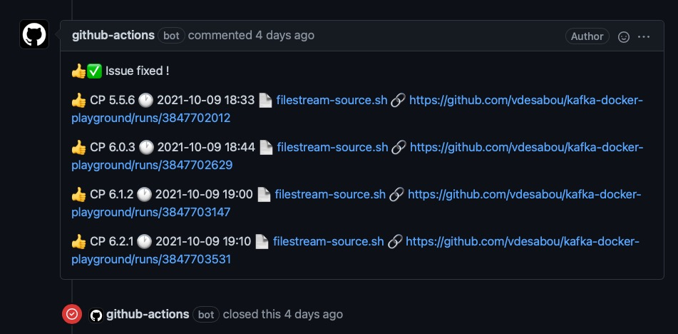
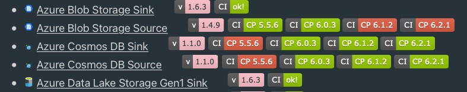

# 🎓️ How it works

This page explains how the playground works internally: how environments and examples are assembled with Docker Compose, which Connect image is used, and how CI tests every example. To create your own examples or reproduction models next, see the [reproduction models toolkit](/toolkit-reproduction-models.md) and its [deep dive](/deep-dive-reproduction-models.md).


## 🐳 Docker override

The playground makes extensive use of Docker Compose [override](https://docs.docker.com/compose/how-tos/multiple-compose-files/merge/) (i.e `docker compose -f docker-compose1.yml -f docker-compose2.yml ...`).

Each test is built based on an [environment](/content?id=🔐-environments), [PLAINTEXT](https://github.com/vdesabou/kafka-docker-playground/tree/master/environment/plaintext) being the most common one.

> [!TIP]
> Check **[📝 See properties file](/how-to-use?id=📝-see-properties-file)** section, in order to see the end result properties file.

Let's have a look at some examples to understand how it works:

### 🔓 Connector using PLAINTEXT

Example with ([active-mq-sink.sh](https://github.com/vdesabou/kafka-docker-playground/blob/master/connect/connect-active-mq-sink/active-mq-sink.sh)):

At the beginning of the script, we have:

```shell
$ PLAYGROUND_ENVIRONMENT=${PLAYGROUND_ENVIRONMENT:-"plaintext"}
$ playground start-environment --environment "${PLAYGROUND_ENVIRONMENT}" --docker-compose-override-file "${PWD}/docker-compose.plaintext.yml"
```

The *local* [`${PWD}/docker-compose.plaintext.yml`](https://github.com/vdesabou/kafka-docker-playground/blob/master/connect/connect-active-mq-sink/docker-compose.plaintext.yml) file is essentially composed of:

```yml
---
services:
  activemq:
    image: rmohr/activemq:5.15.9
    hostname: activemq
    container_name: activemq
    working_dir: /opt/apache-activemq-5.15.9 # podman workaround (#9174)
    ports:
      - '61616:61616'
      - '8161:8161'

  connect:
    environment:
      CONNECT_PLUGIN_PATH: /usr/share/confluent-hub-components/confluentinc-kafka-connect-activemq-sink
```

It contains:

* `activemq` which is a container required for the test.
* `connect` container, which overrides value `CONNECT_PLUGIN_PATH` from [`environment/plaintext/docker-compose.yml`](https://github.com/vdesabou/kafka-docker-playground/blob/master/environment/plaintext/docker-compose.yml)

PLAINTEXT environment is used thanks to the call to `playground start-environment` (an internal command, called by the example when started with [playground run](/playground%20run)), which in the end invokes a docker compose command like this (simplified):

```bash
docker compose -f ../../environment/plaintext/docker-compose.yml -f ${PWD}/docker-compose.plaintext.yml up -d
```

The real command ([`environment/plaintext/start.sh`](https://github.com/vdesabou/kafka-docker-playground/blob/master/environment/plaintext/start.sh)) also adds the KRaft and telemetry compose files, and one `--profile` per `--enable-*` option (Control Center, ksqlDB, Flink, Grafana, extra broker or connect nodes…). The full command is stored in `playground.ini` (`run.docker_command`), and it is the one that [playground container recreate](/playground%20container%20recreate) replays.

> [!NOTE]
> With CP 8+ (KRaft mode), [`environment/plaintext/docker-compose-kraft.yml`](https://github.com/vdesabou/kafka-docker-playground/blob/master/environment/plaintext/docker-compose-kraft.yml) is also added, which brings the `controller` container.

### 🔐 Environment SASL/SSL

Environments are also overriding [PLAINTEXT](https://github.com/vdesabou/kafka-docker-playground/tree/master/environment/plaintext), so for example [SASL/SSL](https://github.com/vdesabou/kafka-docker-playground/tree/master/environment/sasl-ssl) has a [docker-compose.yml](https://github.com/vdesabou/kafka-docker-playground/blob/master/environment/sasl-ssl/docker-compose.yml) file like this:

```yml
  ####
  #
  # This file overrides values from environment/plaintext/docker-compose.yml
  #
  ####

  <snip> (zookeeper section, only used with CP < 8)

  broker:
    volumes:
      - ../../environment/sasl-ssl/security:/etc/kafka/secrets
    environment:
      KAFKA_INTER_BROKER_LISTENER_NAME: SASL_SSL
      # in KRaft mode, ${CONTROLLER_SECURITY_PROTOCOL_MAP} adds the controller listener
      KAFKA_LISTENER_SECURITY_PROTOCOL_MAP: SASL_SSL:SASL_SSL${CONTROLLER_SECURITY_PROTOCOL_MAP}
      KAFKA_ADVERTISED_LISTENERS: SASL_SSL://broker:9092
      KAFKA_LISTENERS: SASL_SSL://:9092
      CONFLUENT_METRICS_REPORTER_SECURITY_PROTOCOL: SASL_SSL
      CONFLUENT_METRICS_REPORTER_SASL_JAAS_CONFIG: "org.apache.kafka.common.security.plain.PlainLoginModule required \
        username=\"client\" \
        password=\"client-secret\";"
      CONFLUENT_METRICS_REPORTER_SASL_MECHANISM: PLAIN
      CONFLUENT_METRICS_REPORTER_SSL_TRUSTSTORE_LOCATION: /etc/kafka/secrets/kafka.client.truststore.jks
      CONFLUENT_METRICS_REPORTER_SSL_TRUSTSTORE_PASSWORD: confluent
      CONFLUENT_METRICS_REPORTER_SSL_KEYSTORE_LOCATION: /etc/kafka/secrets/kafka.client.keystore.jks
      CONFLUENT_METRICS_REPORTER_SSL_KEYSTORE_PASSWORD: confluent
      CONFLUENT_METRICS_REPORTER_SSL_KEY_PASSWORD: confluent
      KAFKA_SASL_ENABLED_MECHANISMS: PLAIN
      KAFKA_SASL_MECHANISM_INTER_BROKER_PROTOCOL: PLAIN
      KAFKA_SSL_KEYSTORE_FILENAME: kafka.broker.keystore.jks
      KAFKA_SSL_KEYSTORE_CREDENTIALS: broker_keystore_creds
      KAFKA_SSL_KEY_CREDENTIALS: broker_sslkey_creds
      KAFKA_SSL_TRUSTSTORE_FILENAME: kafka.broker.truststore.jks
      KAFKA_SSL_TRUSTSTORE_CREDENTIALS: broker_truststore_creds
      # enables 2-way authentication
      KAFKA_SSL_CLIENT_AUTH: "required"
      KAFKA_SSL_ENDPOINT_IDENTIFICATION_ALGORITHM: "HTTPS"
      KAFKA_OPTS: -Djava.security.auth.login.config=/etc/kafka/secrets/broker_jaas.conf
      KAFKA_SSL_PRINCIPAL_MAPPING_RULES: RULE:^CN=(.*?),OU=TEST.*$$/$$1/,DEFAULT

      <snip>
```

As you can see, it only contains what is required to add SASL/SSL to a PLAINTEXT environment 💫!

### 🔏 Connector using non-plaintext environment

Connector examples can be run with any environment using `--environment` option of [playground run](/playground%20run?id=-environment-environment) command, as long as they start the environment with `--environment "${PLAYGROUND_ENVIRONMENT}"` (a few examples start a specific environment, for example `replicator-sasl-ssl.sh`, and some examples skip `cfk` with `exit 111`). The menu only offers the environments the example supports, and warns about the others.


A connector example always passes its own **`docker-compose.plaintext.yml`**, whatever the environment: the environment file is inserted in between. For example, with `--environment sasl-ssl`, the order is (simplified):

```bash
docker compose -f ../../environment/plaintext/docker-compose.yml \
               -f ../../environment/sasl-ssl/docker-compose.yml \
               -f ${PWD}/docker-compose.plaintext.yml up -d
```

The full list of environments (sasl-plain, sasl-scram, sasl-oauthbearer, 2way-ssl, kerberos, ldap, rbac-sasl-plain, rbac-oauth, mdc-*, ansible, cfk…) is in the **[🔐 environments](/content?id=🔐-environments)** section.

This also includes `cfk` environment which automatically runs the example with Kubernetes using [k3d](https://k3d.io/stable/) and Confluent for Kubernetes (CFK), see the [CFK deep dive](/deep-dive-cfk.md).

> [!WARNING]
> `cfk` needs `kubectl`, `k3d`, `helm`, `envsubst`, `zip` and `shasum` on your machine: the environment stops right away when one of them is missing.

## 🔗 Connect image used

The Kafka Connect image is [`cp-server-connect`](https://hub.docker.com/r/confluentinc/cp-server-connect). Use the `--connect-community-image` option of [playground run](/playground%20run) to run [`cp-kafka-connect`](https://hub.docker.com/r/confluentinc/cp-kafka-connect) instead, or set the `CP_CONNECT_IMAGE` environment variable to use any other image.

On the first run with a given image, the playground builds a **local image** on top of it, with several tools [installed](https://github.com/vdesabou/kafka-docker-playground/blob/master/scripts/cli/src/lib/utils_function.sh) (see `CONNECT_3RDPARTY_INSTALL`), such as `openssl`, `iptables`, `nc`, `jq`, `dig`, `kinit`, `vim`, etc. To capture traffic, use [playground debug tcp-dump](/playground%20debug%20tcp-dump), which brings its own `tcpdump`.

For other changes to the image, see [playground container change-jdk](/playground%20container%20change-jdk) and the [environment toolkit](/toolkit-environment.md).

If you're missing a tool, you can install it at runtime, some examples:

```bash
# CP 8.1+ (UBI minimal based) images, using microdnf
playground container exec -c connect --command "microdnf install -y tree" --root
# CP < 8.1 images, using yum
playground container exec -c connect --command "yum install -y --disablerepo='Confluent*' tree" --root
```

> [!NOTE]
> With CP < 5.3, `cp-server-connect` doesn't exist, so `cp-kafka-connect` is used.

## ↔️ Default Connect converter used

All connect examples use the converters defined in Connect Worker properties defined [here](https://github.com/vdesabou/kafka-docker-playground/blob/master/environment/plaintext/docker-compose.yml):

```yml
CONNECT_KEY_CONVERTER: "org.apache.kafka.connect.storage.StringConverter"
CONNECT_VALUE_CONVERTER: "io.confluent.connect.avro.AvroConverter"
CONNECT_VALUE_CONVERTER_SCHEMA_REGISTRY_URL: "http://schema-registry:8081"
```

Therefore:

* String converter for key
* Avro converter for value

This can, of course, be overridden at connector level, for example to use JSON without schemas in the connector config:

```json
"value.converter": "org.apache.kafka.connect.json.JsonConverter",
"value.converter.schemas.enable": "false"
```


## 🤖 How CI works

Every day, regression tests run twice using [GitHub Actions](https://github.com/features/actions): with Docker at 18:17 UTC, and with Podman at 06:17 UTC (12 hours apart, so that both runs never use the shared Confluent Cloud cluster at the same time).

The workflow runs and logs are available [here](https://github.com/vdesabou/kafka-docker-playground/actions).

The CI, including the list of tests executed, is defined in [`.github/workflows/ci.yml`](https://github.com/vdesabou/kafka-docker-playground/blob/master/.github/workflows/ci.yml) file. A new example only runs in CI once its directory is added to a 🚀 line of the `test_list` matrix of that file.

> [!NOTE]
> The tests run on `ubuntu-26.04` GitHub-hosted runners, with Docker and with Podman 5 (which needs 26.04), see [documentation](https://docs.github.com/en/actions/using-github-hosted-runners/about-github-hosted-runners#supported-runners-and-hardware-resources)

> [!NOTE]
> A test is executed if:
>
> * It was failing in the last run
> * A change has been made in the test directory
> * CP and/or connector version(s) has/have changed (a new CP version does not re-run fully managed connector tests: the connector runs in Confluent Cloud, so their last result with the previous CP version is kept)
> * Last execution was more than 14 days ago

The exit code of each example decides its result:

| Exit code | Result |
| --- | --- |
| `0` | success |
| `111` | skipped: the CP / connector version combination is not supported (grey `skipped` badge) |
| `107` | known issue (orange `known issue` badge) |
| `124` | killed after `PLAYGROUND_TEST_TIMEOUT` (`60m` by default, `120m` for the examples using the `ansible` environment): it hung or is too slow |
| anything else | failure |

After each run (success, failure or timeout), the fully managed connectors and the topics created by the run are deleted.

If a test is failing 🔥, a GitHub issue is automatically opened or updated with the results for each CP version. Issues are kept per environment: `🔥 <test>`, `🔥 <test> (cfk)`, `🔥 <test> (podman)` and `🔥 <test> (cfk, podman)`, labelled `cfk` / `podman`. Podman results only create issues: the badges of the [Content](/content.md) section stay Docker only.

*Example:*



The GitHub issue is automatically closed when all results for a test are ok:



> [!TIP]
> * When a 🔥 issue has the label `CI ignore ⏭️`, CI skips the test until the issue is closed.
> * To re-run a single test, start the CI workflow (`workflow_dispatch`) with the `test_name` input (and optionally `playground_environment`), after `playground force-ci <test>` has deleted its last stored result (otherwise CI skips a test that already ran with the same versions). A run started with `test_name` only closes the 🔥 issues of the tests it fixed: it never opens or comments an issue.

CI results are displayed in **[Content](/content.md)** section:



> [!TIP]
> * When the test is successful, the badge looks like  and clicking on it brings you to the CI run.
>
> * When the test is failing for **all** tested CP versions, the badge looks like  and clicking on it brings you to the corresponding GitHub issue.
>
> * When the test is failing for **just some** tested CP versions, each CP version gets its own badge: red for a failing one, like  (clicking on it brings you to the corresponding GitHub issue), and green for a passing one, like  (clicking on it brings you to the CI run).
>
> * The `cfk` results have their own badges:  and .
>
> * When a test cannot be tested in CI, the badge  is set (without any associated link).
>
> * When a test is skipped (exit code `111`), the badge looks like  and clicking on it brings you to the CI run.
>
> * When there is a known issue (exit code `107`), the badge looks like  and clicking on it brings you to the corresponding GitHub issue.

> [!TIP]
> * The connector version badge shows the version and its release date, like -pink), and clicking on it brings you to the corresponding documentation page.
