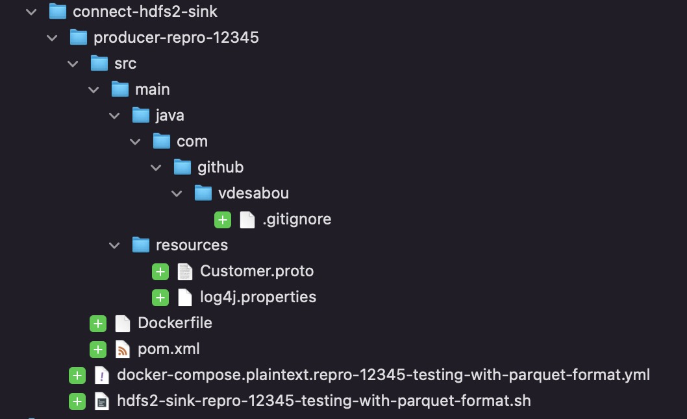

# ♨️ Legacy Java producers (deprecated)

### ♨️ Java producers

<!-- tabs:start -->

#### **Avro**

> [!WARNING]
> Most of times, it's much simpler to use `playground topic produce` [CLI](/playground%20topic%20produce)
> 
> Use java producer only if you have very specific requirements such as specifying record timestamp, use key with schema or to do [perf testing](/reusables?id=%e2%8f%b1%ef%b8%8f-benchmark-a-connector)


If you want to send a complex AVRO message, the easiest way is to use an Avro JAVA producer which creates a Specific Record using Maven plugin and populate it using [j-easy/easy-random](https://github.com/j-easy/easy-random).

> [!TIP]
> A complete example is available [here](https://github.com/vdesabou/kafka-docker-playground/blob/master/other/schema-format-avro).

Here are the steps to follow:

1. Bootstrap your reproduction model by following [🛠 Bootstrap reproduction model](/reusables?id=🛠-bootstrap-reproduction-model) and use `avro` for the `--producer` (or `-p`) flag.

2. *optional*: use `--producer-schema-key` and/or `--producer-schema-value` flag(s) to specify another schema(s) to use, if you use this option, step 3 below is **not** required as it is done automatically

3. *not required if step 2 was done* Update `producer-repro-12345/src/main/resources/schema/customer.avsc` with your AVRO schema but be careful, you need to keep `Customer` for the name and `com.github.vdesabou` for the namespace:

```json
    "name": "Customer",
    "namespace": "com.github.vdesabou",
```

By default, the following environment variables are used in producer container:

```yml
    environment:
      KAFKA_BOOTSTRAP_SERVERS: broker:9092
      TOPIC: "customer_avro"
      REPLICATION_FACTOR: 1
      NUMBER_OF_PARTITIONS: 1
      NB_MESSAGES: 10 # -1 for MAX_VALUE
      MESSAGE_BACKOFF: 100 # Frequency of message injection
      KAFKA_ACKS: "all" # default: "1"
      KAFKA_REQUEST_TIMEOUT_MS: 20000
      KAFKA_RETRY_BACKOFF_MS: 500
      KAFKA_CLIENT_ID: "my-java-producer-repro-123456"
      KAFKA_SCHEMA_REGISTRY_URL: "http://schema-registry:8081"
      JAVA_OPTS: ${GRAFANA_AGENT_PRODUCER}
```

But you can specify any [producer config](https://docs.confluent.io/platform/current/installation/configuration/producer-configs.html) you like by prefixing it with `KAFKA_`.

For example, for [retries](https://docs.confluent.io/platform/current/installation/configuration/producer-configs.html#retries):

```yml
      KAFKA_RETRIES: 10
```

In case this is an example with [ccloud](/content?id=%e2%98%81%ef%b8%8f-confluent-cloud), the producer will be generated with Confluent Cloud security automatically:

```yml
    environment:
      KAFKA_BOOTSTRAP_SERVERS: $BOOTSTRAP_SERVERS
      KAFKA_SSL_ENDPOINT_IDENTIFICATION_ALGORITHM: "https"
      KAFKA_SASL_MECHANISM: "PLAIN"
      KAFKA_SASL_JAAS_CONFIG: $SASL_JAAS_CONFIG
      KAFKA_SECURITY_PROTOCOL: "SASL_SSL"
      TOPIC: "customer_avro"
      REPLICATION_FACTOR: 3
      NUMBER_OF_PARTITIONS: 1
      NB_MESSAGES: 10 # -1 for MAX_VALUE
      MESSAGE_BACKOFF: 100 # Frequency of message injection
      KAFKA_ACKS: "all" # default: "1"
      KAFKA_REQUEST_TIMEOUT_MS: 20000
      KAFKA_RETRY_BACKOFF_MS: 500
      KAFKA_CLIENT_ID: "my-java-producer-repro-123456"
      KAFKA_SCHEMA_REGISTRY_URL: $SCHEMA_REGISTRY_URL
      KAFKA_BASIC_AUTH_CREDENTIALS_SOURCE: $BASIC_AUTH_CREDENTIALS_SOURCE
      KAFKA_SCHEMA_REGISTRY_BASIC_AUTH_USER_INFO: $SCHEMA_REGISTRY_BASIC_AUTH_USER_INFO
```

You can also specify environment variables directly when running the producer:

Example:

Send 100 messages to topic called "test-topic":

```bash
playground container exec -c producer-repro-12345 --command "NB_MESSAGES=100 TOPIC=test-topic java -jar producer-1.0.0-jar-with-dependencies.jar"
```

#### **Protobuf**

> [!WARNING]
> Most of times, it's much simpler to use `playground topic produce` [CLI](/playground%20topic%20produce)
> 
> Use java producer only if you have very specific requirements such as specifying record timestamp, use key with schema or to do [perf testing](/reusables?id=%e2%8f%b1%ef%b8%8f-benchmark-a-connector)

If you want to send a complex Protobuf message, the easiest way is to use an Protobuf JAVA producer which creates a Protobuf Record using Maven [plugin](https://github.com/os72/protoc-jar-maven-plugin) and populate it using [j-easy/easy-random](https://github.com/j-easy/easy-random).

> [!TIP]
> A complete example is available [here](https://github.com/vdesabou/kafka-docker-playground/tree/master/other/schema-format-protobuf).

Here are the steps to follow:

1. Bootstrap your reproduction model by following [🛠 Bootstrap reproduction model](/reusables?id=🛠-bootstrap-reproduction-model) and use `protobuf` for the `--producer` (or `-p`) flag.

2. *optional*: use `--producer-schema-key` and/or `--producer-schema-value` flag(s) to specify another schema(s) to use, if you use this option, step 3 below is **not** required as it is done automatically

3. *not required if step 2 was done* Update `producer-repro-12345/src/main/proto/Customer.proto` with your Protobuf schema but be careful, you need to keep `Customer` for the name and `com.github.vdesabou` for the package and `CustomerImpl` for the `java_outer_classname`:

```protobuf
package com.github.vdesabou;
option java_outer_classname = "CustomerImpl";
```

👉 Make sure to move it in your script to the right place !

By default, the following environment variables are used in producer container:

```yml
    environment:
      KAFKA_BOOTSTRAP_SERVERS: broker:9092
      TOPIC: "customer_protobuf"
      REPLICATION_FACTOR: 1
      NUMBER_OF_PARTITIONS: 1
      NB_MESSAGES: 10 # -1 for MAX_VALUE
      MESSAGE_BACKOFF: 100 # Frequency of message injection
      KAFKA_ACKS: "all" # default: "1"
      KAFKA_REQUEST_TIMEOUT_MS: 20000
      KAFKA_RETRY_BACKOFF_MS: 500
      KAFKA_CLIENT_ID: "my-java-producer-repro-123456"
      KAFKA_SCHEMA_REGISTRY_URL: "http://schema-registry:8081"
      JAVA_OPTS: ${GRAFANA_AGENT_PRODUCER}
```

But you can specify any [producer config](https://docs.confluent.io/platform/current/installation/configuration/producer-configs.html) you like by prefixing it with `KAFKA_`.

For example, for [retries](https://docs.confluent.io/platform/current/installation/configuration/producer-configs.html#retries):

```yml
      KAFKA_RETRIES: 10
```

In case this is an example with [ccloud](/content?id=%e2%98%81%ef%b8%8f-confluent-cloud), the producer will be generated with Confluent Cloud security automatically:

```yml
    environment:
      KAFKA_BOOTSTRAP_SERVERS: $BOOTSTRAP_SERVERS
      KAFKA_SSL_ENDPOINT_IDENTIFICATION_ALGORITHM: "https"
      KAFKA_SASL_MECHANISM: "PLAIN"
      KAFKA_SASL_JAAS_CONFIG: $SASL_JAAS_CONFIG
      KAFKA_SECURITY_PROTOCOL: "SASL_SSL"
      TOPIC: "customer_protobuf"
      REPLICATION_FACTOR: 3
      NUMBER_OF_PARTITIONS: 1
      NB_MESSAGES: 10 # -1 for MAX_VALUE
      MESSAGE_BACKOFF: 100 # Frequency of message injection
      KAFKA_ACKS: "all" # default: "1"
      KAFKA_REQUEST_TIMEOUT_MS: 20000
      KAFKA_RETRY_BACKOFF_MS: 500
      KAFKA_CLIENT_ID: "my-java-producer-repro-123456"
      KAFKA_SCHEMA_REGISTRY_URL: $SCHEMA_REGISTRY_URL
      KAFKA_BASIC_AUTH_CREDENTIALS_SOURCE: $BASIC_AUTH_CREDENTIALS_SOURCE
      KAFKA_SCHEMA_REGISTRY_BASIC_AUTH_USER_INFO: $SCHEMA_REGISTRY_BASIC_AUTH_USER_INFO
```

You can also specify environment variables directly when running the producer:

Example:

Send 100 messages to topic called "test-topic":

```bash
playground container exec -c producer-repro-12345 --command "NB_MESSAGES=100 TOPIC=test-topic java -jar producer-1.0.0-jar-with-dependencies.jar"
```

#### **JSON Schema**

> [!WARNING]
> Most of times, it's much simpler to use `playground topic produce` [CLI](/playground%20topic%20produce)
> 
> Use java producer only if you have very specific requirements such as specifying record timestamp, use key with schema or to do [perf testing](/reusables?id=%e2%8f%b1%ef%b8%8f-benchmark-a-connector)

If you want to send a complex JSON Schema message, the easiest way is to use an JSON Schema JAVA producer which creates a JSON Schema Record using Maven [plugin](https://github.com/joelittlejohn/jsonschema2pojo) and populate it using [j-easy/easy-random](https://github.com/j-easy/easy-random).

> [!TIP]
> A complete example is available [here](https://github.com/vdesabou/kafka-docker-playground/tree/master/other/schema-format-json-schema).

> [!WARNING]
> The pojo maven plugin used ([jsonschema2pojo-maven-plugin](https://github.com/joelittlejohn/jsonschema2pojo)) does not [handle](https://github.com/joelittlejohn/jsonschema2pojo/wiki/Reference) `oneOf` so if your json schema is using this, it will not work.  

Here are the steps to follow:

1. Bootstrap your reproduction model by following [🛠 Bootstrap reproduction model](/reusables?id=🛠-bootstrap-reproduction-model) and use `json-schema` for the `--producer` (or `-p`) flag.

2. *optional*: use `--producer-schema-key` and/or `--producer-schema-value` flag(s) to specify another schema(s) to use, if you use this option, step 3 below is **not** required as it is done automatically

3. *not required if step 2 was done* Update `producer-repro-12345/src/main/resources/schema/Customer.json` with your JSON Schema schema but be careful, you need to keep `Customer` for the title:

```json
{
  "$schema": "http://json-schema.org/draft-07/schema#",
  "additionalProperties": false,
  "$id": "http://lh.test/Customer.schema.json",
  "title": "Customer",
  "description": "Customer description",
  "type": "object",
  "properties": {
    "name": {
      "description": "Customer name",
      "type": "string",
      "maxLength": 25
    },
    "surname": {
      "description": "Customer surname",
      "type": "string",
      "minLength": 2
    },
    "email": {
      "description": "Email",
      "type": "string",
      "pattern": "^[a-zA-Z0-9_.+-]+@[a-zA-Z0-9-]+\\.[a-zA-Z0-9-.]+$"
    }
  },
  "required": [
    "name",
    "surname"
  ]
}
```

By default, the following environment variables are used in producer container:

```yml
    environment:
      KAFKA_BOOTSTRAP_SERVERS: broker:9092
      TOPIC: "customer_json_schema"
      REPLICATION_FACTOR: 1
      NUMBER_OF_PARTITIONS: 1
      NB_MESSAGES: 10 # -1 for MAX_VALUE
      MESSAGE_BACKOFF: 100 # Frequency of message injection
      KAFKA_ACKS: "all" # default: "1"
      KAFKA_REQUEST_TIMEOUT_MS: 20000
      KAFKA_RETRY_BACKOFF_MS: 500
      KAFKA_CLIENT_ID: "my-java-producer-repro-123456"
      KAFKA_SCHEMA_REGISTRY_URL: "http://schema-registry:8081"
      JAVA_OPTS: ${GRAFANA_AGENT_PRODUCER}
```

But you can specify any [producer config](https://docs.confluent.io/platform/current/installation/configuration/producer-configs.html) you like by prefixing it with `KAFKA_`.

For example, for [retries](https://docs.confluent.io/platform/current/installation/configuration/producer-configs.html#retries):

```yml
      KAFKA_RETRIES: 10
```

In case this is an example with [ccloud](/content?id=%e2%98%81%ef%b8%8f-confluent-cloud), the producer will be generated with Confluent Cloud security automatically:

```yml
    environment:
      KAFKA_BOOTSTRAP_SERVERS: $BOOTSTRAP_SERVERS
      KAFKA_SSL_ENDPOINT_IDENTIFICATION_ALGORITHM: "https"
      KAFKA_SASL_MECHANISM: "PLAIN"
      KAFKA_SASL_JAAS_CONFIG: $SASL_JAAS_CONFIG
      KAFKA_SECURITY_PROTOCOL: "SASL_SSL"
      TOPIC: "customer_json_schema"
      REPLICATION_FACTOR: 3
      NUMBER_OF_PARTITIONS: 1
      NB_MESSAGES: 10 # -1 for MAX_VALUE
      MESSAGE_BACKOFF: 100 # Frequency of message injection
      KAFKA_ACKS: "all" # default: "1"
      KAFKA_REQUEST_TIMEOUT_MS: 20000
      KAFKA_RETRY_BACKOFF_MS: 500
      KAFKA_CLIENT_ID: "my-java-producer-repro-123456"
      KAFKA_SCHEMA_REGISTRY_URL: $SCHEMA_REGISTRY_URL
      KAFKA_BASIC_AUTH_CREDENTIALS_SOURCE: $BASIC_AUTH_CREDENTIALS_SOURCE
      KAFKA_SCHEMA_REGISTRY_BASIC_AUTH_USER_INFO: $SCHEMA_REGISTRY_BASIC_AUTH_USER_INFO
```

You can also specify environment variables directly when running the producer:

Example:

Send 100 messages to topic called "test-topic":

```bash
playground container exec -c producer-repro-12345 --command "NB_MESSAGES=100 TOPIC=test-topic java -jar producer-1.0.0-jar-with-dependencies.jar"
```

<!-- tabs:end -->


If you want to automatically generate a Java Producer, use the hidden flag `--producer` (or `-p`):

Example with `protobuf`:

```bash
cd connect/connect-hdfs2-sink
playground repro bootstrap -f hdfs2-sink<tab> -d "123456 testing with parquet format" --producer protobuf

19:54:45 ℹ️ ✨ Creating file /Users/vsaboulin/Documents/github/kafka-docker-playground/reproduction-models/connect-connect-hdfs2-sink/docker-compose.plaintext.repro-123456-testing-with-parquet-format.yml
19:54:45 ℹ️ ✨ Creating file /Users/vsaboulin/Documents/github/kafka-docker-playground/reproduction-models/connect-connect-hdfs2-sink/hdfs2-sink-repro-123456-testing-with-parquet-format.sh

19:54:45 ℹ️ Examples to consume:
19:54:45 ℹ️ 1️⃣ Simplest
docker exec connect kafka-protobuf-console-consumer --bootstrap-server broker:9092 --property schema.registry.url=http://schema-registry:8081 --topic a-topic --from-beginning --max-messages 1
19:54:45 ℹ️ 2️⃣ Displaying key:
docker exec connect kafka-protobuf-console-consumer --bootstrap-server broker:9092 --property schema.registry.url=http://schema-registry:8081 --topic a-topic --property print.key=true --property key.separator=, --from-beginning --max-messages 1
19:54:45 ℹ️ ✨ Adding Java protobuf producer in /Users/vsaboulin/Documents/github/kafka-docker-playground/reproduction-models/connect-connect-hdfs2-sink/producer-repro-123456-1
19:54:45 ℹ️ 📂 The reproduction files are now available in:
/Users/vsaboulin/Documents/github/kafka-docker-playground/reproduction-models/connect-connect-hdfs2-sink
```

> [!TIP]
> To consume the topic, use [playground topic consume](/playground%20topic%20consume): `playground topic consume --topic a-topic`

This will create the following files:



Then follow the instructions in one of the [♨️ Java producers](/legacy-java-producer?id=♨️-java-producers) tabs above.

### With multiple Java producers (`--nb-producers`)

If you want multiple java producer (to test schema evolution for example), use the flag `--nb-producers` (or `-n`):, for example 2:

```bash
cd connect/connect-hdfs2-sink
playground repro bootstrap -f hdfs2-sink<tab> -d "123456 testing with avro format" --producer avro --nb-producers 2

19:57:16 ℹ️ ✨ Creating file /Users/vsaboulin/Documents/github/kafka-docker-playground/reproduction-models/connect-connect-hdfs2-sink/docker-compose.plaintext.repro-123456-testing-with-avro-format.yml
19:57:16 ℹ️ ✨ Creating file /Users/vsaboulin/Documents/github/kafka-docker-playground/reproduction-models/connect-connect-hdfs2-sink/hdfs2-sink-repro-123456-testing-with-avro-format.sh

19:57:16 ℹ️ ✨ Adding Java avro producer in /Users/vsaboulin/Documents/github/kafka-docker-playground/reproduction-models/connect-connect-hdfs2-sink/producer-repro-123456-2
19:57:16 ℹ️ ✨ Adding Java avro producer in /Users/vsaboulin/Documents/github/kafka-docker-playground/reproduction-models/connect-connect-hdfs2-sink/producer-repro-123456-1
19:57:16 ℹ️ 📂 The reproduction files are now available in:
/Users/vsaboulin/Documents/github/kafka-docker-playground/reproduction-models/connect-connect-hdfs2-sink
```


### playground repro bootstrap hidden flags

#### *--producer, -p PRODUCER-TYPE*

♨️ Java producer type to use  
  
One of avro, avro-with-key, protobuf, protobuf-with-key, json-schema, json-schema-with-key  
  
🎓 Tip: Most of times, it's much simpler to use 'playground topic produce'. Use java producer only if you have very specific requirements such as specifying record timestamp or to do perf testing (even though CLI is also good for that)  
  
🎓 Tip: 'with-key' will also produce key with selected converter, otherwise LongConverter is used

| Attributes      | &nbsp;                                                                                    |
| --------------- | ----------------------------------------------------------------------------------------- |
| Default Value:  | none                                                                                      |
| Allowed Values: | none, avro, avro-with-key, protobuf, protobuf-with-key, json-schema, json-schema-with-key |
| Conflicts With: | *--pipeline*                                                                              |

#### *--nb-producers, -n NB-PRODUCERS*

2️⃣ Number of java producers to generate

#### *--producer-schema-key*

🔰 Schema to use for the key  
  
✨ Copy and paste the schema you want to use for the key, save and close the file to continue

#### *--producer-schema-value*

🔰 Schema to use for the value  
  
✨ Copy and paste the schema you want to use for the key, save and close the file to continue