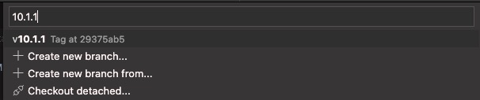
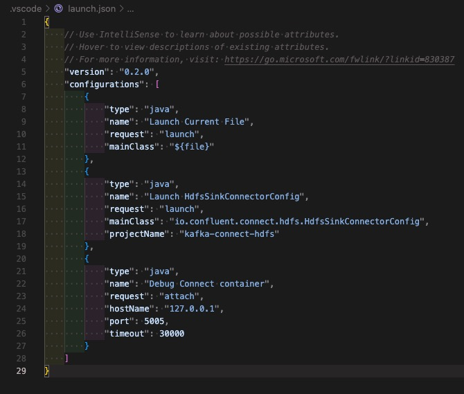
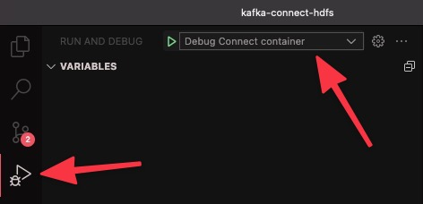
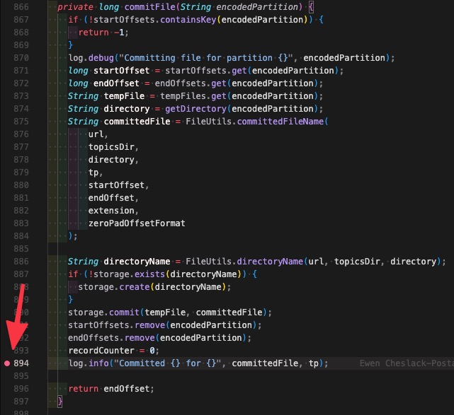
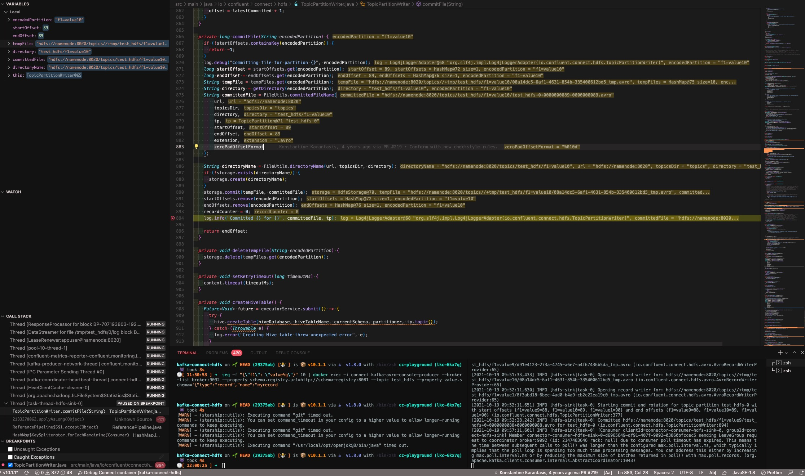

# 🐛 Debugging and analysis

Attach a debugger, raise the log levels, take dumps and recordings of a JVM or of the network, then analyze what you collected. Part of the [🧰 Reproduction toolkit](/reusables.md).

> [!TIP]
> For the details, see the deep dives on [JVM diagnostics](/deep-dive-jvm-diagnostics.md), [log levels](/deep-dive-log-levels.md) and [network traffic](/deep-dive-network-traffic.md).

## 🐛 Debugging tools

### ✨ Remote debugging

Java Remote debugging is the perfect tool for troubleshooting Kafka connectors for example.

> [!TIP]
> Following are instructions for [Visual Studio Code ](https://code.visualstudio.com/docs/java/java-debugging), but it is exactly the same principle for [IntelliJ IDEA](https://www.jetbrains.com/help/idea/tutorial-remote-debug.html#436b3b68).

#### ☑️ Prerequisites

Make sure you have already the required Visual Studio code extensions by following [this](https://code.visualstudio.com/docs/java/java-debugging#_install).

#### 💫 Full example

Here is a full example using [HDFS 2 sink](https://github.com/vdesabou/kafka-docker-playground/tree/master/connect/connect-hdfs2-sink) connector and [Visual Studio Code ](https://code.visualstudio.com/docs/java/java-debugging):

1. Launch the example as usual, i.e start `./hdfs2-sink.sh`.

2. Clone and open [`confluentinc/kafka-connect-hdfs`](https://github.com/confluentinc/kafka-connect-hdfs) repository in Visual Studio Code.

3. Switch to the branch corresponding to the connector version you're going to run. 
 
In this example, the connector version is `10.1.1`, so switch to branch tag `v10.1.1` (use the version you are actually running, see `playground connector versions`):



4. Remote debugging is enabled by default on the `connect` container (port `5005`), so there is nothing to do for connectors.

For other containers (for example `broker` or `schema-registry`), use [🧠 CLI](/cli) with `enable-remote-debugging` [command](/playground%20debug%20enable-remote-debugging):

```bash
$ playground debug enable-remote-debugging -c broker
```

It sets `KAFKA_DEBUG` and `JAVA_DEBUG_OPTS` environment variables on the container (using `playground container set-environment-variables`) and displays the configuration to add in `.vscode/launch.json`.

5. [Configure](https://code.visualstudio.com/docs/java/java-debugging#_configure) remote debugging by clicking on menu `Run`->`Add Configuration...`:


Then copy/paste the following entry:

```json
{
    "type": "java",
    "name": "Debug connect container",
    "request": "attach",
    "hostName": "127.0.0.1",
    "port": 5005,
    "timeout": 30000
}
```

Note: you can also directly edit file `.vscode/launch.json`:

```json
{
    "version": "0.2.0",
    "configurations": [
    
        {
            "type": "java",
            "name": "Debug connect container",
            "request": "attach",
            "hostName": "127.0.0.1",
            "port": 5005,
            "timeout": 30000
        }
    ]
}
```

*Example:*



6. Go in `Run and Debug` and make sure to select the `Debug connect container` config:



7. Click on the green play button


8. Add breakpoint(s) where you want, for example [here](https://github.com/confluentinc/kafka-connect-hdfs/blob/9a5e68d7294a79c40050efd7b51d7428c7f7c4d5/src/main/java/io/confluent/connect/hdfs/TopicPartitionWriter.java#L894):



9. Process some messages:

```bash
playground topic produce -t test_hdfs --nb-messages 10 << 'EOF'
{
  "type": "record",
  "name": "myrecord",
  "fields": [
    {"name": "f1", "type": "string"}
  ]
}
EOF
```

10. See results 🍿:




Note (*for Confluent employees because control center code is proprietary*): for `control-center`, you can use following override (note the `5006` port in order to avoid clash with `connect` port):

```yml
  control-center:
    ports:
      - "9021:9021"
      - "5006:5006"
    environment:
      CONTROL_CENTER_OPTS: "-agentlib:jdwp=transport=dt_socket,server=y,suspend=n,address=0.0.0.0:5006"
```

### 🔗 Connectors

In order to enable `TRACE`(or `DEBUG`) logs for connectors, use the `admin/loggers` endpoint (see docs [here](https://docs.confluent.io/platform/current/connect/logging.html#change-the-log-level-for-a-specific-logger)):

*Example:*

```bash
curl --request PUT \
  --url http://localhost:8083/admin/loggers/io.confluent.connect.oracle.cdc \
  --header 'Accept: application/json' \
  --header 'Content-Type: application/json' \
  --data '{
	"level": "TRACE"
}'
```

> [!WARNING]
> Make sure to update `io.confluent.connect.oracle.cdc` above with the package you want to troubleshoot.

Useful packages:

* `io.confluent.kafka.schemaregistry.client.rest.RestService`: to track schema registry requests
* `org.apache.kafka.connect.runtime.TransformationChain`: to see records before, during and after SMT

Or just use [CLI](/playground%20connector%20log-level) `playground connector log-level` 

To have the levels set before the example creates its connector (so that the first lines are already at `TRACE`), use `--connect-log-level` option of [playground run](/playground%20run), with the same syntax as `CONNECT_LOG4J_LOGGERS` (levels `INFO`, `WARN`, `DEBUG` or `TRACE`). In the menu, 🔊 Connect log level(s) suggests the packages of the example's connector:

```bash
playground run -f s3-sink<tab> --connect-log-level "io.confluent.connect.s3=TRACE,org.apache.kafka.connect.runtime.WorkerSinkTask=DEBUG"
```

Example:

```bash
playground connector log-level --level TRACE
```

### 🔑 SSL debug

> [!NOTE]
> The default `connect` service already sets `KAFKA_OPTS: -Ddynamic.worker.config.file=/dev/null` (see [`environment/plaintext/docker-compose.yml`](https://github.com/vdesabou/kafka-docker-playground/blob/master/environment/plaintext/docker-compose.yml)), so keep it when you override `KAFKA_OPTS` in the snippets below.

Add `-Djavax.net.debug=all` in your `docker-compose` file:

*Example:*

```yml
  connect:
    environment:
      KAFKA_OPTS: -Ddynamic.worker.config.file=/dev/null -Djavax.net.debug=all
```

Use `-Djavax.net.debug=ssl:handshake` instead of `-Djavax.net.debug=all` to only see the handshake.

Or just use [CLI](/playground%20debug%20java-debug) `playground debug java-debug` with `--type ssl_all` or `--type ssl_handshake`.

### 🔒 Kerberos debug

Add `-Dsun.security.krb5.debug=true` in your `docker-compose` file:

*Example:*

```yml
  connect:
    environment:
      KAFKA_OPTS: -Ddynamic.worker.config.file=/dev/null -Dsun.security.krb5.debug=true
```

Or just use [CLI](/playground%20debug%20java-debug) `playground debug java-debug` with `--type kerberos`.

### 🔬 Class loading

Add `-verbose:class` in your `docker-compose` file to troubleshoot a `ClassNotFoundException` for example:

*Example:*

```yml
  connect:
    environment:
      KAFKA_OPTS: -Ddynamic.worker.config.file=/dev/null -verbose:class
```

Or just use [CLI](/playground%20debug%20java-debug) `playground debug java-debug` with `--type class_loading`.

In logs, you'll see:

```log
[Loaded org.apache.kafka.connect.runtime.isolation.DelegatingClassLoader$$Lambda$20/1007251739 from org.apache.kafka.connect.runtime.isolation.DelegatingClassLoader]
[Loaded java.lang.invoke.LambdaForm$MH/1556595366 from java.lang.invoke.LambdaForm]
[Loaded org.reflections.util.ConfigurationBuilder from file:/usr/share/java/kafka/reflections-0.9.12.jar]
[Loaded org.reflections.serializers.Serializer from file:/usr/share/java/kafka/reflections-0.9.12.jar]
[Loaded org.reflections.adapters.MetadataAdapter from file:/usr/share/java/kafka/reflections-0.9.12.jar]
[Loaded org.reflections.scanners.Scanner from file:/usr/share/java/kafka/reflections-0.9.12.jar]
[Loaded org.reflections.scanners.AbstractScanner from file:/usr/share/java/kafka/reflections-0.9.12.jar]
[Loaded org.reflections.scanners.TypeAnnotationsScanner from file:/usr/share/java/kafka/reflections-0.9.12.jar]
[Loaded org.reflections.scanners.AbstractScanner$$Lambda$21/1725097945 from org.reflections.scanners.AbstractScanner]
[Loaded org.reflections.scanners.SubTypesScanner from file:/usr/share/java/kafka/reflections-0.9.12.jar]
[Loaded org.reflections.util.FilterBuilder from file:/usr/share/java/kafka/reflections-0.9.12.jar]
[Loaded org.reflections.util.FilterBuilder$Matcher from file:/usr/share/java/kafka/reflections-0.9.12.jar]
```

### 🕸️ Debug ServiceNow or Salesforce

Those connectors use low level [com.google.api.client.http](https://developers.google.com/api-client-library/java) library.

In order to activate debug logs to see requests/responses, you can just add the `volumes` mount with existing `../../connect/connect-servicenow-source/nginx-proxy/logging.properties` file and add `KAFKA_OPTS: -Djava.util.logging.config.file=/tmp/logging.properties`:

Example:

```yml
  connect:
    volumes:
      - ../../connect/connect-servicenow-source/nginx-proxy/logging.properties:/tmp/logging.properties
    environment:
      KAFKA_OPTS: -Ddynamic.worker.config.file=/dev/null -Djava.util.logging.config.file=/tmp/logging.properties
```

This is how the `logging.properties` looks like:

```bash
$ cat /tmp/logging.properties
handlers=java.util.logging.ConsoleHandler
java.util.logging.ConsoleHandler.level=ALL
com.google.api.client.http.level=ALL
```

### 🌍 Debug HTTP sink

This connector uses low level [Apache HTTP client](https://hc.apache.org/httpcomponents-client-5.2.x/) library.

In order to activate debug logs to see requests/responses, you can add `jcl-over-slf4j-2.0.7.jar` to the connector `lib` folder before starting the environment.

Example (from [`http_basic_auth.sh`](https://github.com/vdesabou/kafka-docker-playground/blob/master/connect/connect-http-sink/http_basic_auth.sh)):

```bash
cd ../../connect/connect-http-sink/
if [ ! -f jcl-over-slf4j-2.0.7.jar ]
then
     wget -q https://repo1.maven.org/maven2/org/slf4j/jcl-over-slf4j/2.0.7/jcl-over-slf4j-2.0.7.jar
fi
mkdir -p ../../confluent-hub/confluentinc-kafka-connect-http/lib/
cp jcl-over-slf4j-2.0.7.jar ../../confluent-hub/confluentinc-kafka-connect-http/lib/jcl-over-slf4j-2.0.7.jar
cd -
```

> [!NOTE]
> It is already set in all HTTP sink examples.

Then you can enable TRACE logs on `org.apache.http`:

```bash
$ playground debug log-level set --package "org.apache.http" --level TRACE
```

### 🕵️‍♂️ See TLS traffic with mitmproxy

[mitmproxy](https://github.com/mitmproxy/mitmproxy) 

1. Add `mitmproxy` container in your `docker-compose` file:

```yml
  mitmproxy:
    image: mitmproxy/mitmproxy
    hostname: mitmproxy
    container_name: mitmproxy
    command: mitmdump --flow-detail 4
    ports:
      - "8080:8080"
    volumes:
      - $HOME/.mitmproxy:/home/mitmproxy/.mitmproxy
```

2. Add in your script after all containers are started:

```bash
playground container cp --source $HOME/.mitmproxy/mitmproxy-ca-cert.pem --destination connect:/tmp/mitmproxy-ca-cert.pem
playground container exec -c connect --root --command "cat /tmp/mitmproxy-ca-cert.pem >> /etc/ssl/certs/ca-bundle.crt"
playground container exec -c connect --root --command "keytool -importcert --cacerts -storepass changeit -noprompt -alias mitmproxy -file /tmp/mitmproxy-ca-cert.pem"
```

3. Use mitmproxy proxy in your connector config:

Example:

```json
"proxy.url": "mitmproxy:8080"
```

4. Check TLS traffic in clear text by checking logs of `mitmproxy` container

```bash
playground container logs -c mitmproxy

or

playground container logs --open --container mitmproxy
```

### 🕵 TCP Dump

When logs are not enough to understand a connectivity problem (connection resets, timeouts, TLS handshake failures, a client talking to the wrong host or port, unexpected retries…), capturing the network traffic of a container shows exactly what goes over the wire.

Just use [CLI](/playground%20debug%20tcp-dump) `playground debug tcp-dump`. It runs `tcpdump` from the `nicolaka/netshoot` image in the network namespace of the container (nothing is installed in the container, so it works with any image), captures the traffic for `--duration` (default 30s, all ports unless `--port` or `--filter` is set), copies the `.pcap` file to `--output-dir` (default: current folder), analyzes it with [`playground analyze tcp-dump`](/playground%20analyze%20tcp-dump) (refused and reset connections, retransmissions, TLS alerts, DNS errors, Kafka and HTTP errors and response times, the bodies of the HTTP error responses, with container names instead of ip addresses, in a text digest and an HTML report), then opens it with [Wireshark](https://www.wireshark.org/) if it is installed. Start it, then reproduce the issue while the capture is running: Ctrl+C stops it earlier and keeps the capture.

With several `--container`, the captures run at the same time, so both sides of a connection can be compared. For a window of any length, use `--action start`, reproduce, then `--action stop`.

> [!NOTE]
> On an encrypted listener (SSL, SASL_SSL) you will see the TCP connections and the TLS handshake, but not the content of the requests. To read HTTPS traffic in clear text, use [mitmproxy](/reusables?id=%f0%9f%95%b5%ef%b8%8f%e2%99%82%ef%b8%8f-see-tls-traffic-with-mitmproxy) instead.

```bash
playground debug tcp-dump --container control-center --port 9021 --duration 60
playground debug tcp-dump -c connect -c broker --port 9092 --duration 2m
playground debug tcp-dump -c connect --filter "host postgres" --action start
playground debug tcp-dump -c connect --action stop
playground analyze tcp-dump -f customer.pcapng          # a capture a customer sent
```

### 👻 Heap Dump

A [heap dump](https://www.baeldung.com/java-heap-dump-capture) is a snapshot of all the objects in the JVM memory. Take one when a component uses more and more memory, spends its time in garbage collection or fails with `java.lang.OutOfMemoryError`, to find which objects (and which connector, task or client) hold the memory.

Just use [CLI](/playground%20debug%20heap-dump) `playground debug heap-dump`. It saves output to a `.hprof` file that can be read with [VisualVM](https://visualvm.github.io/) or [MAT](https://www.eclipse.org/mat/), or analyzed with [`playground analyze heap-dump`](/playground%20analyze%20heap-dump) (Eclipse MAT leak suspects and an HTML report, see [Analyze what you collected](/reusables?id=%f0%9f%94%8e-analyze-what-you-collected)).

```bash
playground debug heap-dump
playground debug heap-dump -c connect -c broker
playground debug heap-dump --container schema-registry --live
```

You can also set `-XX:+HeapDumpOnOutOfMemoryError -XX:HeapDumpPath=/tmp` to generate heap dump automatically when hitting OOM:

Example:

```yml
  connect:
    environment:
      KAFKA_OPTS: -XX:+HeapDumpOnOutOfMemoryError -XX:HeapDumpPath=/tmp
      KAFKA_HEAP_OPTS: " -Xms2G -Xmx4G"
```

### 🎯 Thread Dump

A [Java thread dump](https://www.baeldung.com/java-thread-dump) shows what every thread of the JVM is doing at that moment, with its stack trace and the locks it holds or waits for. Take one when a connector or task looks stuck (no progress, no error in the logs), when a rebalance or shutdown never completes, or when a container uses a lot of CPU. Take several a few seconds apart: a thread that stays on the same stack is the one to look at.

Just use [CLI](/playground%20debug%20thread-dump) `playground debug thread-dump`. It saves output to a file and opens it with the editor set with `playground config editor`.

```bash
playground debug thread-dump
playground debug thread-dump -c connect -c broker
```
Analyze the dumps with [`playground analyze thread-dump`](/playground%20analyze%20thread-dump): deadlocks, lock contention, stuck and CPU-hungry threads (it can also take the dumps itself with `--container`).

### 🛩️ Flight Recorder

[Java Flight Recorder](https://www.baeldung.com/java-flight-recorder-monitoring) (JFR) records what happens in the JVM over a period of time with a low overhead: CPU usage per method, memory allocations, garbage collections, lock contention, file and socket I/O. Use it for performance problems (slow throughput, latency spikes, high CPU) where a single thread or heap dump is not enough.

Just use [CLI](/playground%20debug%20flight-recorder) `playground debug flight-recorder`: start the recording, reproduce the issue, then stop it. Stopping copies the `.jfr` file to the current directory (or `--output-dir`) and analyzes it with [`playground analyze flight-recorder`](/playground%20analyze%20flight-recorder): where the time of the connector tasks goes, with findings (see [Analyze what you collected](/reusables?id=%f0%9f%94%8e-analyze-what-you-collected)). Open the `.jfr` with [JDK Mission Control](https://jdk.java.net/jmc/) for the details.

```bash
playground debug flight-recorder --action start
# reproduce the issue
playground debug flight-recorder --action status
playground debug flight-recorder --action stop                     # copies the .jfr and analyzes it (--no-analyze to skip)
playground debug flight-recorder -c connect -c connect2 --action start --settings profile
```

The recording is driven over JMX (`FlightRecorderMXBean`): the Confluent images ship a JRE without `jcmd`, and nothing is installed or restarted. `jcmd` is only used for containers without a JMX port (cfk pods), when the image has it.

`--settings` chooses what is recorded:

| Settings | Records | Overhead |
|---|---|---|
| `playground` (default) | what `playground analyze flight-recorder` needs: CPU per thread every second, execution and native samples, socket, file, lock and park events of 1 ms or more, allocation samples, GC, exceptions | low |
| `profile` / `default` | the settings shipped with the JDK | about 2% / 1% |
| `all` | every event, with no threshold, for a deep dive in JDK Mission Control | high |

> [!TIP]
> To record for a fixed time and analyze in one command: `playground analyze flight-recorder -c connect --duration 2m`. On JDK 25+ (cp 8.3.2), `--trace-method <Class::method>` also records every call of a method with its duration and caller. During a benchmark, [playground connector benchmark](/reusables?id=%e2%8f%b1%ef%b8%8f-benchmark-a-connector) records the workers on its own.

### 🧰 More debug commands

| Command | Description |
|---|---|
| [`playground debug java-debug`](/playground%20debug%20java-debug) | 🤎 JVM arguments for SSL, Kerberos or Class Loading |
| [`playground debug generate-diagnostics`](/playground%20debug%20generate-diagnostics) | ⛑️ Generate a diagnostic bundle with Diagnostics Bundle Tool |
| [`playground debug jscissors`](/playground%20debug%20jscissors) | ✂️ Trace the calls of any method of a running JVM, without restart: arguments, return values, durations, exceptions, call tree, analyzed on `--action stop` (see the [deep dive](/deep-dive-jvm-diagnostics?id=_6-jscissors-what-the-code-does-call-by-call)) |
| [`playground debug testssl`](/playground%20debug%20testssl) | 🔐 Test TLS/SSL encryption using [testssl.sh](https://testssl.sh/) |
| [`playground debug disable-remote-debugging`](/playground%20debug%20disable-remote-debugging) | Disable java remote debugging for a container |

## 🔎 Analyze what you collected

The [`playground analyze`](/playground%20analyze) commands turn a dump, a log, a bundle or a report (yours, or one a
customer sent) into findings: what is wrong, with the evidence, and what to do. They all work offline, and
**`--sample <name>`** runs them on the samples shipped with the playground, to see what they report before using them on
real data.

| Command | Analyzes | Try it |
|---|---|---|
| [`playground analyze thread-dump`](/playground%20analyze%20thread-dump) | 🧵 thread dumps: deadlocks, lock contention, stuck and CPU-hungry threads | `--sample deadlock_jdk21` |
| [`playground analyze gc-logs`](/playground%20analyze%20gc-logs) | 📈 GC logs: pauses, failures, live set, leak trend | `--sample jdk21_g1_kafka_real` |
| [`playground analyze heap-dump`](/playground%20analyze%20heap-dump) | 🔬 heap dumps with Eclipse MAT: leak suspects, retained sizes, growth between two dumps, Kafka-aware hints (producer and fetch buffers, records held by the tasks…) | `--sample leak_growth` |
| [`playground analyze logs`](/playground%20analyze%20logs) | 🔥 ERROR/FATAL digest of log files, folders, zip / tar bundles: known causes, timeline, root causes, every distinct record | `--sample support_bundle` |
| [`playground analyze oracle-xstream-report`](/playground%20analyze%20oracle-xstream-report) | 🅾️ Oracle XStream CDC diagnostics reports (`orclcdc_diag.sql`) | `--sample synthetic_failures` |
| [`playground analyze logs`](/playground%20analyze%20logs) on a CFK bundle | 📦 CFK support bundles: pods, events, custom resources, logs, ZooKeeper to KRaft migration | `--sample cfk_bundle`, `--sample cfk_kraft_migration`, `--sample cfk_rollout`, `--sample cfk_rollout --sample cfk_rollout_after` (comparison) |
| [`playground analyze flight-recorder`](/playground%20analyze%20flight-recorder) | 🛩️ Java Flight Recorder recordings: where the time of the connector tasks goes (network I/O by remote, Kafka client, locks, CPU by layer, hot methods) | `--sample jdbc_postgres_sink` |
| [`playground analyze jscissors`](/playground%20analyze%20jscissors) | ✂️ traces of `playground debug jscissors`: methods by total time, exceptions with the arguments of the failing call, calls still running (hangs), slowest calls, call trees | `--sample filestream_sink_bad_json` |
| [`playground analyze tcp-dump`](/playground%20analyze%20tcp-dump) | 🦈 network captures (`.pcap`, `.pcapng`): refused and reset connections, retransmissions, TLS alerts, DNS errors, Kafka and HTTP errors and response times, with the bodies of the HTTP error responses | `--sample kafka_and_network_errors`, `--sample http_errors` |

```bash
playground analyze thread-dump --sample deadlock_jdk21
playground analyze thread-dump --container connect                 # 3 dumps of the running connect worker
playground analyze logs --file ./customer-logs.zip
playground analyze heap-dump --file heap-dump-connect-2026-10-14.hprof
playground analyze flight-recorder --container connect --duration 60s --connector my-sink   # records connect over JMX, then analyzes
```

Besides the text digest, they write a self-contained HTML report to share in a case (opened in your browser), and most
of them accept `--json` for scripts and agents. Each report starts with a one-line verdict (🚨 critical findings and
where to start, ⚠️ things to look at, or ✅ nothing alarming), followed by the findings with their severity (🔴 critical,
🟠 high, 🟡 medium, 🟢 low, ℹ️ info).

The reports of the samples:

<!-- tabs:start -->

#### **🧵 thread-dump**

```bash
playground analyze thread-dump --sample deadlock_jdk21
```


#### **📈 gc-logs**

```bash
playground analyze gc-logs --sample jdk21_g1_kafka_real
```


#### **🔬 heap-dump**

```bash
playground analyze heap-dump --sample leak_growth
```


#### **🅾️ oracle-xstream-report**

```bash
playground analyze oracle-xstream-report --sample synthetic_failures
```


#### **📦 logs on a CFK support bundle**

```bash
playground analyze logs --sample cfk_bundle
```


#### **🛩️ flight-recorder**

```bash
playground analyze flight-recorder --sample jdbc_postgres_sink
```


#### **🦈 tcp-dump**

```bash
playground analyze tcp-dump --sample kafka_and_network_errors
playground analyze tcp-dump --sample http_errors
```


<!-- tabs:end -->

#### 🛩️ What `analyze flight-recorder` reports

It reads `.jfr` files of JDK 11+ JVMs with the flight recorder API of the JDK, run in an `eclipse-temurin:25-jdk`
container (pulled the first time), and looks at the Kafka Connect task threads (`task-thread-*`, `--connector` for one
connector, `--threads` for any regex; every thread when none matches):

| Section | Content |
|---|---|
| Findings | one sentence, a number and a next step: the tasks wait on a remote system, on the Kafka consumer fetch or the producer, on a lock, sleep; they are CPU bound; conversion, logging or SMTs take the CPU; the JVM was still compiling code (JIT); allocation, exceptions, long GC pauses |
| Task thread time, by state | share of the recording each task thread spent running, blocked on network I/O, in the Kafka client, on locks, waiting, on file I/O |
| CPU of the task threads, by layer | execution samples classified by their first frame outside the JDK: connector, converters (serialization), SMTs, Kafka client, connect framework, libraries (drivers, SDKs), logging, JDK |
| Hot methods | the methods the task threads run, with a link to the source of the connector when its manifest has one |
| Network I/O, allocation, locks and waits, busiest threads | by remote host, class, site and thread |

Recordings made with the `playground` settings (benchmark, `debug flight-recorder`, `analyze flight-recorder
--container`) give the most details; a recording made with the JDK settings works too, with throttled socket events and
10 or 20 ms thresholds.
